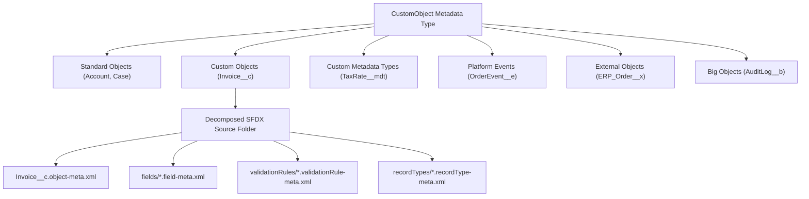

## Overview

The `CustomObject` metadata type is the foundational data model building block on the Salesforce platform. Despite its name, `CustomObject` represents six distinct entity flavors in Metadata API: custom objects (`__c`), standard object customizations (`Account`, `Case`), external objects (`__x`), big objects (`__b`), platform events (`__e`), and custom metadata types (`__mdt`).

Use `CustomObject` metadata whenever you provision database tables, configure Organization-Wide Default (OWD) sharing models (`sharingModel`), enable field history tracking (`enableHistory`), or set up standard Name field numbering (`nameField`). Do not treat the raw `.object` XML as a monolithic file in modern repositories—always use Salesforce DX source decomposition so multiple developers can work on the same object without Git merge conflicts.



As shown in the diagram above, `CustomObject` acts as the parent container across six entity suffixes and decomposes into modular subdirectories (`fields/`, `validationRules/`, `recordTypes/`, `listViews/`, `compactLayouts/`, `fieldSets/`, `businessProcesses/`, and `webLinks/`) in Salesforce DX projects.

## Prerequisites

- **Permissions:** "Customize Application" and "Modify Metadata Through Metadata API Functions" permissions in the target org.
- **CLI Version:** Salesforce CLI (`sf`) v2.x or later with source tracking enabled.
- **API Version:** Available since API version 10.0 (`__x` external objects since v32.0). Verified against API version `68.0` (Winter '27).

## Source Format vs Metadata Format Architecture

Salesforce DX transforms the legacy monolithic `.object` file into a decomposed folder hierarchy inside `force-app/main/default/objects/<ObjectName>/`. This decomposition is critical for enterprise CI/CD pipelines.

| Property | Classic Metadata API Format | SFDX Source Format (Recommended) |
| :--- | :--- | :--- |
| **Root File Path** | `objects/Invoice__c.object` | `objects/Invoice__c/Invoice__c.object-meta.xml` |
| **Custom Fields** | Embedded `<fields>` inside `.object` | `objects/Invoice__c/fields/<Field>__c.field-meta.xml` |
| **Validation Rules** | Embedded `<validationRules>` | `objects/Invoice__c/validationRules/<Rule>.validationRule-meta.xml` |
| **Record Types** | Embedded `<recordTypes>` | `objects/Invoice__c/recordTypes/<RT>.recordType-meta.xml` |
| **List Views** | Embedded `<listViews>` | `objects/Invoice__c/listViews/<View>.listView-meta.xml` |

> [!TIP]
> When deploying partial changes in CI/CD, deploying `Invoice__c.object-meta.xml` updates only the object-level properties (such as `sharingModel` or `enableReports`) without touching fields or validation rules.

## Key XML Fields and Architect Configuration

The root `CustomObject` XML file controls database behavior, security boundaries, and platform feature indexing.

| Field Name | Type | Architectural Purpose & Best Practice |
| :--- | :--- | :--- |
| `deploymentStatus` | `DeploymentStatus` | Required for custom objects (`Deployed` or `InDevelopment`). Always set to `Deployed` in version control. |
| `sharingModel` | `SharingModel` | Internal OWD (`Private`, `Read`, `ReadWrite`, `ControlledByParent`). Set `ControlledByParent` when a Master-Detail field exists. |
| `externalSharingModel` | `SharingModel` | Experience Cloud OWD. Must be equal to or more restrictive than `sharingModel`. |
| `nameField` | `CustomField` | Defines the standard `Name` field (`Text` or `AutoNumber` with a `displayFormat` like `INV-{00000}`). |
| `enableHistory` | `boolean` | Enables tracking up to 20 fields in the companion `*__History` table (up to 60 with Field Audit Trail). |
| `enableReports` | `boolean` | Allows custom report types and standard reports on the object. |
| `enableActivities` | `boolean` | Allows `Task` and `Event` records to link to this object via the `WhatId` polymorphic lookup. |
| `enableBulkApi` / `enableStreamingApi` | `boolean` | Both must be `true` together with `enableSharing` to support Bulk API 2.0 and Streaming API / PushTopics. |

## Querying CustomObject via SOQL and Tooling API

You can inspect `CustomObject` metadata at runtime using standard SOQL against `EntityDefinition` or via the Tooling API `CustomObject` table. These queries are invaluable for automated schema audits, security reviews, and dynamic Apex frameworks.

### 1. Audit Organization-Wide Defaults (OWD) Across Custom Objects
Use standard SOQL on `EntityDefinition` to verify internal and external sharing models across all custom objects:

```soql
SELECT QualifiedApiName, Label, InternalSharingModel, ExternalSharingModel,
       IsCustomizable, IsEverCreatable, KeyPrefix
FROM EntityDefinition
WHERE IsCustomSetting = false
  AND QualifiedApiName LIKE '%__c'
ORDER BY QualifiedApiName ASC
LIMIT 200
```

### 2. Query CustomObject Metadata Directly via Tooling API
Execute a Tooling API query (`sf data query --use-tooling-api`) to find custom objects created or modified recently, along with their namespace and description:

```soql
SELECT Id, DeveloperName, NamespacePrefix, Description,
       SharingModel, ExternalSharingModel, ManageableState, CreatedDate
FROM CustomObject
WHERE NamespacePrefix = null
ORDER BY CreatedDate DESC
```

### 3. Count Custom Fields per Object Using Tooling API
Identify objects approaching the custom field governor limit (500–800 fields depending on edition):

```soql
SELECT TableEnumOrId, COUNT(Id) totalCustomFields
FROM CustomField
GROUP BY TableEnumOrId
ORDER BY COUNT(Id) DESC
```

## Example

The following SFDX source file defines an enterprise `Invoice__c` custom object with private internal and external sharing, auto-number record naming, field history tracking, and activity support.

```xml title="force-app/main/default/objects/Invoice__c/Invoice__c.object-meta.xml"
<?xml version="1.0" encoding="UTF-8"?>
<CustomObject xmlns="http://soap.sforce.com/2006/04/metadata">
    <actionOverrides>
        <actionName>View</actionName>
        <comment>Action override updated by Lightning App Builder during activation.</comment>
        <content>Invoice_Record_Page</content>
        <formFactor>Large</formFactor>
        <skipRecordTypeSelect>false</skipRecordTypeSelect>
        <type>Flexipage</type>
    </actionOverrides>
    <allowInChatterGroups>false</allowInChatterGroups>
    <compactLayoutAssignment>Invoice_Highlight_Compact_Layout</compactLayoutAssignment>
    <deploymentStatus>Deployed</deploymentStatus>
    <description>Stores customer billing invoices synchronized with the ERP general ledger.</description>
    <enableActivities>true</enableActivities>
    <enableBulkApi>true</enableBulkApi>
    <enableFeeds>true</enableFeeds>
    <enableHistory>true</enableHistory>
    <enableLicensing>false</enableLicensing>
    <enableReports>true</enableReports>
    <enableSearch>true</enableSearch>
    <enableSharing>true</enableSharing>
    <enableStreamingApi>true</enableStreamingApi>
    <externalSharingModel>Private</externalSharingModel>
    <label>Invoice</label>
    <nameField>
        <displayFormat>INV-{YYYY}-{000000}</displayFormat>
        <label>Invoice Number</label>
        <trackFeedHistory>false</trackFeedHistory>
        <trackHistory>false</trackHistory>
        <type>AutoNumber</type>
    </nameField>
    <pluralLabel>Invoices</pluralLabel>
    <searchLayouts>
        <customTabListAdditionalFields>Account__c</customTabListAdditionalFields>
        <customTabListAdditionalFields>Invoice_Date__c</customTabListAdditionalFields>
        <customTabListAdditionalFields>Total_Amount__c</customTabListAdditionalFields>
        <customTabListAdditionalFields>Status__c</customTabListAdditionalFields>
        <searchResultsAdditionalFields>Account__c</searchResultsAdditionalFields>
        <searchResultsAdditionalFields>Total_Amount__c</searchResultsAdditionalFields>
        <searchResultsAdditionalFields>Status__c</searchResultsAdditionalFields>
    </searchLayouts>
    <sharingModel>Private</sharingModel>
    <visibility>Public</visibility>
</CustomObject>
```

### Package Manifest (`package.xml`) Gotcha with Wildcards

When retrieving objects with `package.xml`, `<members>*</members>` only matches **custom objects**. Standard objects (`Account`, `Contact`, `Opportunity`) must be named explicitly:

```xml title="manifest/package.xml"
<?xml version="1.0" encoding="UTF-8"?>
<Package xmlns="http://soap.sforce.com/2006/04/metadata">
    <types>
        <!-- Wildcard retrieves all custom objects (__c, __mdt, __e, __b, __x) -->
        <members>*</members>
        <!-- Standard objects must be listed explicitly -->
        <members>Account</members>
        <members>Opportunity</members>
        <members>Invoice__c</members>
        <name>CustomObject</name>
    </types>
    <version>68.0</version>
</Package>
```

Deploy or retrieve the `Invoice__c` custom object using the `sf` CLI:

```bash
# Retrieve a specific custom object and all its decomposed child metadata
sf project retrieve start --metadata CustomObject:Invoice__c

# Deploy only the object-meta.xml properties without redeploying fields
sf project deploy start --source-dir force-app/main/default/objects/Invoice__c/Invoice__c.object-meta.xml
```

## Limits and Gotchas

- **Custom Object Limit per Org:** Up to 3,000 custom objects per org in Unlimited and Performance Editions (2,000 base + installed packages), and 200 in Enterprise Edition.
- **Sharing Recalculation Locks:** Changing `sharingModel` (for example, from `ReadWrite` to `Private` or `ControlledByParent`) triggers an asynchronous Organization-Wide Default sharing recalculation in large orgs. Concurrent deployments touching the same object's sharing rules will fail with an `UNABLE_TO_LOCK_ROW` or `SHARING_RECALCULATION_IN_PROGRESS` error.
- **Master-Detail OWD Requirement:** If an object is on the detail side of a [CustomField](/docs/metadata/custom-field-metadata-type/) Master-Detail relationship, its `sharingModel` **must** be set to `ControlledByParent`, or the deployment fails.
- **Big Object Indexes:** Big Objects (`__b`) require an `<indexes>` element defined at creation time; you cannot modify or add an `<indexes>` block to an existing Big Object after deployment.
- **Profile & PermissionSet Side Effect:** Retrieving a `CustomObject` alongside [Profile](/docs/metadata/profile-metadata-type/) or [PermissionSet](/docs/metadata/permission-set-metadata-type/) in the same manifest automatically populates `<objectPermissions>`, `<fieldPermissions>`, and `<layoutAssignments>` for that object inside the retrieved security files.

> [!WARNING]
> Never delete a `<fields>` node from a monolithic `.object` file expecting it to delete the field in the target org. In Metadata API, omitting a field simply leaves it untouched in the target org; you must use a `destructiveChanges.xml` manifest or `sf project delete source` to remove a field or object.

## Related Official Documentation

- [CustomObject Metadata API Reference](https://developer.salesforce.com/docs/atlas.en-us.api_meta.meta/api_meta/customobject.htm): Complete XML field schema for standard, custom, external, and big objects.
- [EntityDefinition Tooling API Reference](https://developer.salesforce.com/docs/atlas.en-us.api_tooling.meta/api_tooling/tooling_api_objects_entitydefinition.htm): SOQL-queryable entity metadata for standard and custom objects.
- [Project Configuration for Source Format](https://developer.salesforce.com/docs/atlas.en-us.sfdx_dev.meta/sfdx_dev/sfdx_dev_ws_config.htm): How Salesforce CLI decomposes `CustomObject` into child directories.

