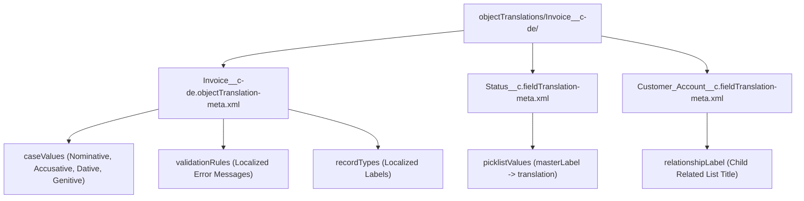

## Why the `CustomObjectTranslation` Metadata Type Matters

In multi-language global Salesforce deployments, **`CustomObjectTranslation`** controls how every custom object (and custom metadata on standard objects) renders when a user changes their personal language locale. It translates not just the object's singular/plural name, grammatical gender, and case forms (`caseValues`), but also all child metadata attached to that object:

- **Custom Fields & Help Text** (`CustomFieldTranslation`)
- **Local Picklist & Lookup Filter Messages**
- **Validation Rule Error Messages** (`ValidationRuleTranslation`)
- **Record Type Labels & Descriptions** (`RecordTypeTranslation`)
- **Object-Specific Quick Actions, Layouts, Field Sets, and WebLinks**



---

## SFDX Source Decomposition (`objectTranslations/`)

In SFDX source format, `CustomObjectTranslation` is decomposed into one folder per `<ObjectName>-<locale>` inside `force-app/main/default/objectTranslations/`:

```text
force-app/main/default/objectTranslations/Invoice__c-de/
├── Invoice__c-de.objectTranslation-meta.xml
├── Amount__c.fieldTranslation-meta.xml
└── Status__c.fieldTranslation-meta.xml
```

---

## Real-World XML Examples

### 1. Object-Level Translation (`objectTranslations/Invoice__c-de/Invoice__c-de.objectTranslation-meta.xml`)

```xml
<?xml version="1.0" encoding="UTF-8"?>
<CustomObjectTranslation xmlns="http://soap.sforce.com/2006/04/metadata">
    <caseValues>
        <caseType>Nominative</caseType>
        <plural>false</plural>
        <value>Rechnung</value>
    </caseValues>
    <caseValues>
        <caseType>Nominative</caseType>
        <plural>true</plural>
        <value>Rechnungen</value>
    </caseValues>
    <gender>Feminine</gender>
    <nameFieldLabel>Rechnungsnummer</nameFieldLabel>
    <recordTypes>
        <description>Standardrechnung für Unternehmenskunden</description>
        <label>Unternehmensrechnung</label>
        <name>Commercial_Invoice</name>
    </recordTypes>
    <validationRules>
        <errorMessage>Der Rechnungsbetrag muss größer als 0 sein.</errorMessage>
        <name>Positive_Invoice_Amount</name>
    </validationRules>
</CustomObjectTranslation>
```

### 2. Field-Level Translation (`objectTranslations/Invoice__c-de/Status__c.fieldTranslation-meta.xml`)

```xml
<?xml version="1.0" encoding="UTF-8"?>
<CustomFieldTranslation xmlns="http://soap.sforce.com/2006/04/metadata">
    <help>Aktueller Zahlungsstatus der Rechnung.</help>
    <label>Rechnungsstatus</label>
    <name>Status__c</name>
    <picklistValues>
        <masterLabel>Draft</masterLabel>
        <translation>Entwurf</translation>
    </picklistValues>
    <picklistValues>
        <masterLabel>Paid</masterLabel>
        <translation>Bezahlt</translation>
    </picklistValues>
</CustomFieldTranslation>
```

---

## Senior Architect Deployment Gotchas

> [!WARNING]
> **The `nameFieldLabel` Silent Failure:** If you populate `<nameFieldLabel>` in `.objectTranslation-meta.xml` while leaving `<caseValues><value></value></caseValues>` blank (which Salesforce CLI frequently generates when retrieving untranslated objects), Salesforce **ignores** the `nameFieldLabel` translation during deployment! Always provide at least the singular and plural `Nominative` `<caseValues>` when translating an object's `Name` field.

- **Global Value Set Picklists Are Not Translated Here:** If a picklist field uses a [GlobalValueSet](/docs/metadata/global-value-set-metadata-type/), do not put `<picklistValues>` inside its `.fieldTranslation-meta.xml` file. Translate those shared values once in [GlobalValueSetTranslation](/docs/metadata/global-value-set-translation-metadata-type/).
- **Enable Translation Workbench First:** Deploying `CustomObjectTranslation` to a new Scratch Org or Sandbox where Translation Workbench is disabled or the target language is inactive will fail unless `Translations` settings are enabled in the org definition.
