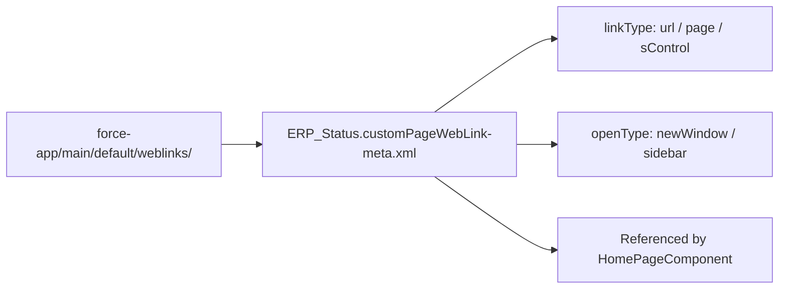

## Architectural Overview

The `CustomPageWebLink` metadata type represents a standalone custom link that is not bound to a standard or custom object, historically used inside `HomePageComponent` link lists. While object-specific custom buttons and links use the [WebLink](/docs/metadata/web-link-metadata-type/) metadata type under `objects/<ObjectName>/webLinks/`, `CustomPageWebLink` lives at the top-level `weblinks/` folder and shares the same XML schema structure as `WebLink`.

Architects encounter `CustomPageWebLink` primarily during Classic-to-Lightning migrations, org dependency cleanups, and security audits (especially scanning for retired `javascript` link types or hard-coded instance URLs).



## SFDX Directory and File Suffix

| Property | Value |
| :--- | :--- |
| **Metadata Type Name** | `CustomPageWebLink` |
| **Classic Directory** | `weblinks/` |
| **Classic File Suffix** | `.weblink` |
| **SFDX Source Directory** | `force-app/main/default/weblinks/` |
| **SFDX File Suffix** | `.customPageWebLink-meta.xml` |

## Key Metadata Fields

`CustomPageWebLink` shares its field structure with `WebLink`:

| Field Name | Type | Required | Description & Architectural Guidance |
| :--- | :--- | :--- | :--- |
| `availability` | `WebLinkAvailability` | Yes | Specifies whether the link is `online` or `offline`. |
| `displayType` | `WebLinkDisplayType` | Yes | Display style: `link` (standard for custom page web links), `button`, or `massActionButton`. |
| `encodingKey` | `Encoding` | No | Character encoding for URL parameters, typically `UTF-8`. |
| `hasMenubar` | `boolean` | No | When `openType` is `newWindow`, controls browser menu bar visibility. |
| `hasScrollbars` | `boolean` | No | When `openType` is `newWindow`, controls whether scrollbars are enabled. |
| `hasToolbar` | `boolean` | No | When `openType` is `newWindow`, controls browser toolbar visibility. |
| `height` | `int` | No | Height in pixels of the popup window or iframe. |
| `isResizable` | `boolean` | No | Whether the new browser window can be resized by the user. |
| `linkType` | `WebLinkType` | Yes | Target type: `url`, `page` (Visualforce), `sControl`, or `javascript`. |
| `masterLabel` | `string` | No | Display label for the custom page link. |
| `openType` | `WebLinkWindowType` | Yes | Window behavior: `newWindow`, `sidebar`, `noSidebar`, `replace`, or `onClickJavaScript`. |
| `page` | `string` | No | Visualforce page name when `linkType` is `page`. |
| `position` | `WebLinkPosition` | No | Window positioning (`none`, `topLeft`, `fullScreen`). |
| `protected` | `boolean` | Yes | Indicates whether the component is protected in a managed package. |
| `showsLocation` | `boolean` | No | Displays the browser address bar in a new window. |
| `showsStatus` | `boolean` | No | Displays the browser status bar in a new window. |
| `url` | `string` | No | Target URL expression (supports merge fields like `{!$User.Id}`) when `linkType` is `url`. |
| `width` | `int` | No | Width in pixels of the new window. |

## Declarative XML and `package.xml` Examples

### Source Format XML (`Corporate_Compliance_Portal.customPageWebLink-meta.xml`)

```xml title="force-app/main/default/weblinks/Corporate_Compliance_Portal.customPageWebLink-meta.xml"
<?xml version="1.0" encoding="UTF-8"?>
<CustomPageWebLink xmlns="http://soap.sforce.com/2006/04/metadata">
    <availability>online</availability>
    <description>Opens the enterprise compliance portal with the current user context.</description>
    <displayType>link</displayType>
    <encodingKey>UTF-8</encodingKey>
    <hasMenubar>false</hasMenubar>
    <hasScrollbars>true</hasScrollbars>
    <hasToolbar>false</hasToolbar>
    <height>600</height>
    <isResizable>true</isResizable>
    <linkType>url</linkType>
    <masterLabel>Corporate Compliance Portal</masterLabel>
    <openType>newWindow</openType>
    <position>none</position>
    <protected>false</protected>
    <showsLocation>false</showsLocation>
    <showsStatus>false</showsStatus>
    <url>https://compliance.example.com/sso?user={!$User.Username}</url>
</CustomPageWebLink>
```

### Manifest (`package.xml`)

```xml title="manifest/package.xml"
<?xml version="1.0" encoding="UTF-8"?>
<Package xmlns="http://soap.sforce.com/2006/04/metadata">
    <types>
        <members>Corporate_Compliance_Portal</members>
        <name>CustomPageWebLink</name>
    </types>
    <version>68.0</version>
</Package>
```

## Querying via SOQL and Tooling API

Under the hood, `CustomPageWebLink` records are stored in the `WebLink` table with `PageOrSobjectType = 'CustomPageItem'`:

```soql
SELECT Id, Name, MasterLabel, LinkType, OpenType, Url, EncodingKey
FROM WebLink
WHERE PageOrSobjectType = 'CustomPageItem'
ORDER BY Name ASC
```

Retrieve or deploy using the `sf` CLI:

```bash
sf project retrieve start --metadata CustomPageWebLink:Corporate_Compliance_Portal
```

## Architect Best Practices and Gotchas

- **Lightning Experience Modernization:** Classic Home Page Custom Links (`CustomPageWebLink`) do not render on Lightning Home Pages (`FlexiPage`). For Lightning Experience, use the [CustomHelpMenuSection](/docs/metadata/custom-help-menu-section-metadata-type/) for global links or a Rich Text / custom LWC component on the Lightning Home Page.
- **Avoid Hard-Coded Org URLs:** Never hard-code `https://na1.salesforce.com` or sandbox domains inside `<url>`. Use relative paths or `{!$Api.Partner_Server_URL_680}` / Custom Labels where external base URLs vary by environment.

> [!WARNING]
> Auditing `WebLink` where `PageOrSobjectType = 'CustomPageItem'` and `LinkType = 'javascript'` is a mandatory pre-check before retiring Salesforce Classic, as `onClickJavaScript` links fail silently or disappear in Lightning Experience.
