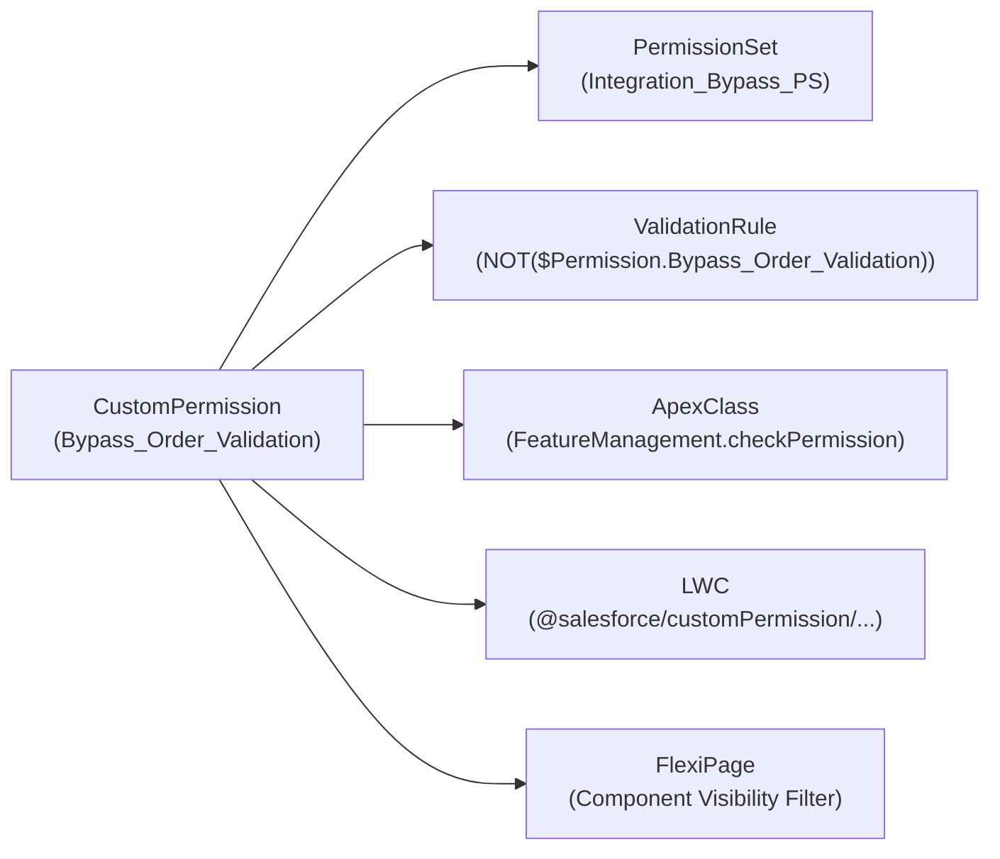

The `CustomPermission` metadata type defines a custom security capability or feature toggle that can be assigned to users through [PermissionSet](/docs/metadata/permission-set-metadata-type/) or [Profile](/docs/metadata/profile-metadata-type/) metadata. Introduced in API version 31.0, `CustomPermission` is the gold-standard architectural pattern for replacing hardcoded `$Profile.Name` checks across [ValidationRule](/docs/metadata/validation-rule-metadata-type/) formulas, [Flow](/docs/metadata/flow-metadata-type/) decisions, [ApexClass](/docs/metadata/apex-class-metadata-type/) logic, and [LightningComponentBundle](/docs/metadata/lightning-component-bundle-metadata-type/) UI controls.

In Salesforce DX projects, custom permissions are stored in `force-app/main/default/customPermissions/` with the `.customPermission-meta.xml` suffix.



## Key Metadata Fields

| Field | Type | Required | Description |
|---|---|---|---|
| `label` | `string` | Yes | Human-readable label shown in Setup and Permission Set editors |
| `description` | `string` | No | Explains what business capability or bypass this permission grants |
| `isLicensed` | `boolean` | No | Indicates whether the permission requires a managed package license (v38.0+) |
| `connectedApp` | `string` | No | Associates the custom permission with a specific [ConnectedApp](/docs/metadata/connected-app-metadata-type/) |
| `requiredPermission` | `CustomPermissionDependencyRequired[]` | No | Declares prerequisite `<customPermission>` dependencies (`dependency` set to `true`) |

## Production-Grade XML Example

Below is a `CustomPermission` definition (`Bypass_Account_Validation.customPermission-meta.xml`) used to exempt data migration jobs from validation rules:

```xml
<?xml version="1.0" encoding="UTF-8"?>
<CustomPermission xmlns="http://soap.sforce.com/2006/04/metadata">
    <description>Exempts the running user from Account and Contact validation rules during bulk data loads.</description>
    <isLicensed>false</isLicensed>
    <label>Bypass Account Validation</label>
</CustomPermission>
```

## Checking `CustomPermission` Across the Stack

### 1. Validation Rules and Flows (`$Permission`)

```text
AND(
    NOT($Permission.Bypass_Account_Validation),
    ISBLANK(BillingCountry)
)
```

### 2. Apex (`FeatureManagement.checkPermission`)

```java
public with sharing class OrderApprovalService {
    public static void approveHighValueOrder(Order ord) {
        // Zero-SOQL, session-cached permission evaluation
        if (!FeatureManagement.checkPermission('Approve_Executive_Discounts')) {
            throw new AuraHandledException('You lack permission to approve executive discounts.');
        }
        ord.Status = 'Approved';
        update as user ord;
    }
}
```

### 3. Lightning Web Components (`@salesforce/customPermission`)

```javascript
import { LightningElement } from 'lwc';
import hasExecutiveDiscountPerm from '@salesforce/customPermission/Approve_Executive_Discounts';

export default class DiscountApprovalAction extends LightningElement {
    get isApproveButtonDisabled() {
        return !hasExecutiveDiscountPerm;
    }
}
```

## Auditing Custom Permissions with SOQL

Both `CustomPermission` and `SetupEntityAccess` are queryable in standard SOQL:

```sql
-- 1. List all Custom Permissions in the org
SELECT Id, DeveloperName, MasterLabel, NamespacePrefix, Description, IsLicensed
FROM CustomPermission
ORDER BY DeveloperName ASC

-- 2. Find every Permission Set that grants a specific Custom Permission
SELECT Id, Parent.Name, Parent.Label, Parent.IsOwnedByProfile, SetupEntityId
FROM SetupEntityAccess
WHERE SetupEntityType = 'CustomPermission'
  AND SetupEntityId IN (
      SELECT Id FROM CustomPermission WHERE DeveloperName = 'Bypass_Account_Validation'
  )
```

> [!TIP]
> **Testing Custom Permissions in Apex Unit Tests**: Instead of querying and assigning profiles in `@TestSetup`, assign a lightweight Permission Set containing your `CustomPermission` to a test user via `insert new PermissionSetAssignment(AssigneeId = u.Id, PermissionSetId = ps.Id);` inside `System.runAs(u)`.

