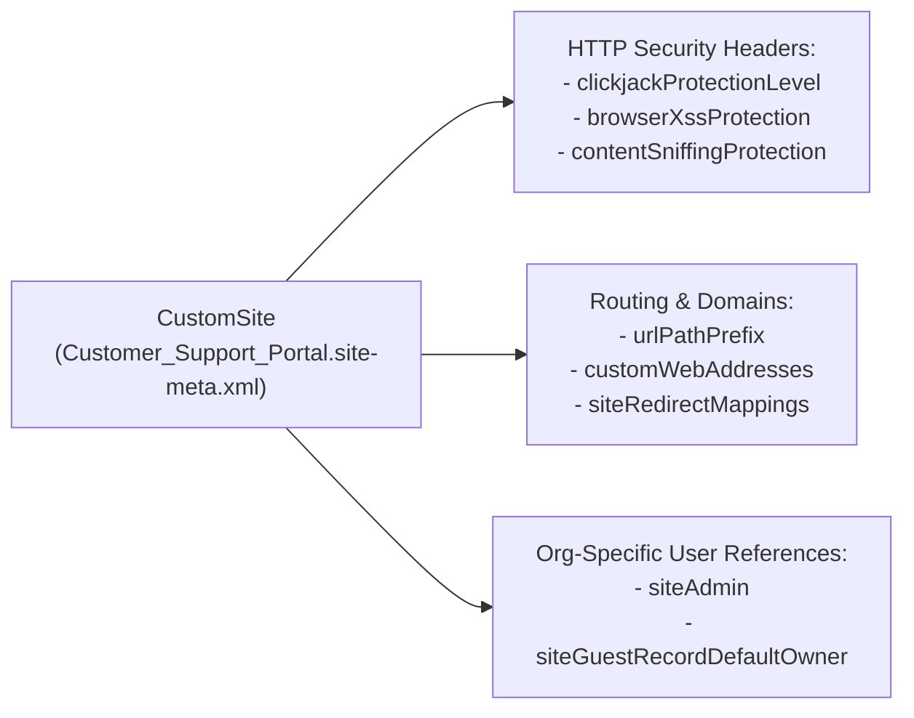

The `CustomSite` metadata type configures the web server container for both **Salesforce Sites** (unauthenticated Visualforce webhook/landing sites) and **Experience Cloud sites** (`ChatterNetwork` / `ChatterNetworkPicasso`). Available in API version 14.0 and later, `CustomSite` controls the site's activation state (`active`), URL path prefix (`urlPathPrefix`), security headers (`clickjackProtectionLevel`, `browserXssProtection`, `contentSniffingProtection`, `referrerPolicyOriginWhenCrossOrigin`), custom domains (`customWebAddresses`), and system error pages (`fileNotFoundPage`, `inMaintenancePage`).

In Salesforce DX projects, site definitions are stored in `force-app/main/default/sites/` with the `.site-meta.xml` suffix.



## Key Metadata Fields

| Field | Type | Required | Description |
|---|---|---|---|
| `masterLabel` | `string` | Yes | Display label of the site in Setup -> Sites / All Sites |
| `active` | `boolean` | Yes | Activates (`true`) or deactivates (`false`) the site |
| `siteType` | `SiteType` | Yes | `Visualforce` (Salesforce Sites) or `ChatterNetwork` (Experience Cloud) |
| `urlPathPrefix` | `string` | No | URL path segment after the domain (for example, `support` in `https://domain.my.site.com/support`) |
| `indexPage` | `string` | Yes | Default home Visualforce page (`CommunitiesLanding` for Experience Cloud) |
| `clickjackProtectionLevel` | `SiteClickjackProtectionLevel` | No | `NoFraming`, `SameOriginOnly` (recommended), `External`, or `AllowAllFraming` |
| `browserXssProtection` | `boolean` | Yes | Enables `X-XSS-Protection` browser defense (`true` recommended) |
| `contentSniffingProtection` | `boolean` | Yes | Enables `X-Content-Type-Options: nosniff` (`true` recommended) |
| `referrerPolicyOriginWhenCrossOrigin` | `boolean` | Yes | Sends `Referrer-Policy: origin-when-cross-origin` header (`true` recommended) |
| `enableAuraRequests` | `boolean` | No | Allows guest users to invoke Aura/LWC endpoints (`true` for Experience Cloud) |
| `siteAdmin` | `string` | No | Username of the site administrator |
| `siteGuestRecordDefaultOwner` | `string` | No | Username of the internal user who becomes the owner of records created by the Guest User |

## Production-Grade XML Example

Below is a hardened `CustomSite` (`Customer_Support_Portal.site-meta.xml`) for an Experience Cloud portal:

```xml
<?xml version="1.0" encoding="UTF-8"?>
<CustomSite xmlns="http://soap.sforce.com/2006/04/metadata">
    <active>true</active>
    <allowHomePage>false</allowHomePage>
    <allowStandardAnswersPages>false</allowStandardAnswersPages>
    <allowStandardIdeasPages>false</allowStandardIdeasPages>
    <allowStandardLookups>false</allowStandardLookups>
    <allowStandardPortalPages>true</allowStandardPortalPages>
    <allowStandardSearch>false</allowStandardSearch>
    <authorizationRequiredPage>CommunitiesLogin</authorizationRequiredPage>
    <bandwidthExceededPage>BandwidthExceeded</bandwidthExceededPage>
    <browserXssProtection>true</browserXssProtection>
    <cachePublicVisualforcePagesInProxyServers>true</cachePublicVisualforcePagesInProxyServers>
    <clickjackProtectionLevel>SameOriginOnly</clickjackProtectionLevel>
    <contentSniffingProtection>true</contentSniffingProtection>
    <enableAuraRequests>true</enableAuraRequests>
    <fileNotFoundPage>FileNotFound</fileNotFoundPage>
    <genericErrorPage>Exception</genericErrorPage>
    <inMaintenancePage>InMaintenance</inMaintenancePage>
    <indexPage>CommunitiesLanding</indexPage>
    <masterLabel>Customer Support Portal</masterLabel>
    <referrerPolicyOriginWhenCrossOrigin>true</referrerPolicyOriginWhenCrossOrigin>
    <siteType>ChatterNetwork</siteType>
    <urlPathPrefix>support</urlPathPrefix>
</CustomSite>
```

> [!WARNING]
> **Handling `customWebAddresses` Across Sandboxes**: Deploying a `CustomSite` that contains `<customWebAddresses>` replaces all root custom domain bindings in the target org and will fail if the referenced domain/certificate does not exist in a sandbox. Exclude `<customWebAddresses>` from lower-environment branches or manage domain bindings separately via `Domain` and `SiteIframeWhiteListUrl` metadata.

## Querying `Site` and Guest User Security with SOQL

```sql
-- 1. List all active Salesforce Sites and Experience Cloud sites with their Guest User
SELECT Id, Name, MasterLabel, Subdomain, UrlPathPrefix, SiteType, Status,
       GuestUserId, GuestUser.Username, GuestUser.ProfileId, GuestRecordDefaultOwnerId
FROM Site
WHERE Status = 'Active'
ORDER BY MasterLabel ASC

-- 2. Inspect Guest User Permission Set Assignments for a Site
SELECT Id, Assignee.Name, PermissionSet.Name, PermissionSet.Label
FROM PermissionSetAssignment
WHERE AssigneeId IN (SELECT GuestUserId FROM Site WHERE Status = 'Active')
  AND PermissionSet.IsOwnedByProfile = false
```
