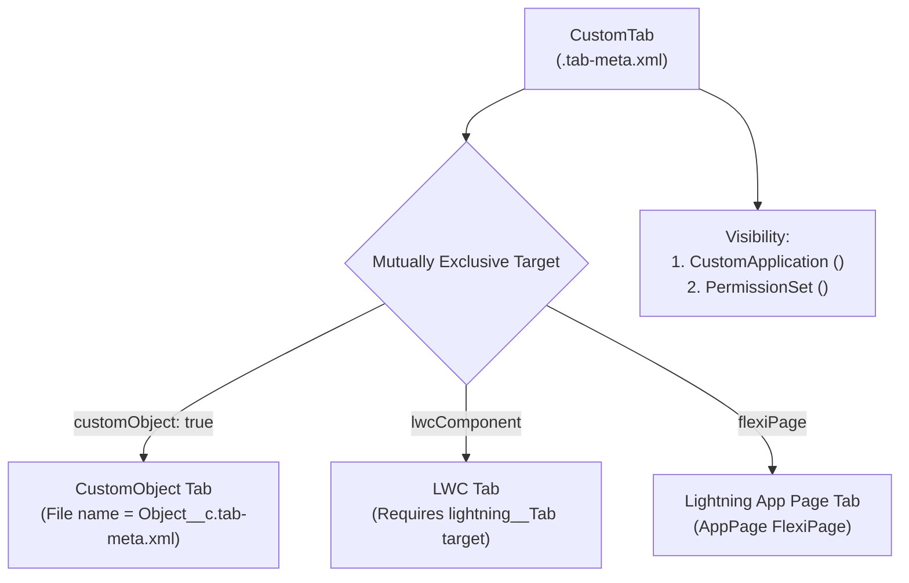

The `CustomTab` metadata type creates a navigation entry in the **App Launcher** and [CustomApplication](/docs/metadata/custom-application-metadata-type/) navigation bars. Available in API version 10.0 and later, a `CustomTab` can expose a [CustomObject](/docs/metadata/custom-object-metadata-type/) home/list view, a standalone [LightningComponentBundle](/docs/metadata/lightning-component-bundle-metadata-type/) (`lwcComponent`), a Lightning App Page ([FlexiPage](/docs/metadata/flexipage-metadata-type/)), a Visualforce `page`, or an external web `url`.

In Salesforce DX projects, custom tabs are stored in `force-app/main/default/tabs/` with the `.tab-meta.xml` suffix.



## Key Metadata Fields

Exactly **one** of `customObject`, `lwcComponent`, `flexiPage`, `auraComponent`, `page`, `scontrol`, or `url` must be specified per `CustomTab`:

| Field | Type | Required | Description |
|---|---|---|---|
| `motif` | `string` | Yes | Required icon and color style (for example, `Custom67: Gears`, `Custom18: Form`) |
| `customObject` | `boolean` | Conditional | Set to `true` when the tab represents a Custom Object (filename must match `<Object>__c.tab-meta.xml`) |
| `lwcComponent` | `string` | Conditional | Developer name of a Lightning Web Component exposing the `lightning__Tab` target |
| `flexiPage` | `string` | Conditional | Developer name of an `AppPage` `FlexiPage` |
| `label` | `string` | Conditional | Display label in the navigation bar (used for LWC, FlexiPage, VF, and URL tabs; Custom Object tabs inherit the object's plural label) |
| `description` | `string` | No | Architectural notes on the tab's purpose |
| `actionOverrides` | `ActionOverride[]` | No | Tab-level overrides (one per `formFactor`) |

## Production-Grade XML Examples

### 1. Custom Object Tab (`Invoice__c.tab-meta.xml`)

```xml
<?xml version="1.0" encoding="UTF-8"?>
<CustomTab xmlns="http://soap.sforce.com/2006/04/metadata">
    <customObject>true</customObject>
    <description>Primary navigation tab for Customer Invoices.</description>
    <motif>Custom41: Cash</motif>
</CustomTab>
```

### 2. Standalone Lightning Web Component Tab (`Order_Command_Center.tab-meta.xml`)

```xml
<?xml version="1.0" encoding="UTF-8"?>
<CustomTab xmlns="http://soap.sforce.com/2006/04/metadata">
    <description>Full-screen LWC command center for monitoring real-time ERP order sync queues.</description>
    <label>Order Command Center</label>
    <lwcComponent>orderCommandCenterApp</lwcComponent>
    <motif>Custom67: Gears</motif>
</CustomTab>
```

> [!TIP]
> **Remember to Grant Tab Visibility in a Permission Set**: Deploying a `.tab-meta.xml` file creates the tab with a default visibility of `Hidden` across all profiles and permission sets unless you also include `<tabSettings>` in a [PermissionSet](/docs/metadata/permission-set-metadata-type/) (`<visibility>Visible</visibility>`) and add the tab's developer name to `<tabs>` in your [CustomApplication](/docs/metadata/custom-application-metadata-type/).

## Querying Tabs with SOQL (`TabDefinition`)

You can inspect all standard and custom tabs available in your org using the `TabDefinition` object:

```sql
-- List all Custom Tabs in the org and their SObject or URL bindings
SELECT Id, Name, Label, SobjectName, IsCustom, Url
FROM TabDefinition
WHERE IsCustom = true
ORDER BY Label ASC
```

