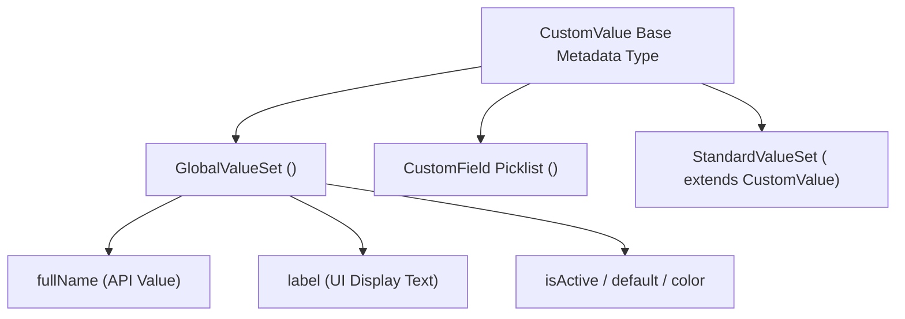

## Architectural Overview

The `CustomValue` metadata type is the base XML structure that represents a single value inside a picklist, [GlobalValueSet](/docs/metadata/global-value-set-metadata-type/), or `StandardValueSet`. It is also extended by specialized picklist subtypes such as `StandardValue` (for Opportunity `StageName`, Case `Status`, and Lead `Status`) and `ValueSetValuesDefinition`.

Understanding `CustomValue` is critical for Salesforce Architects because Salesforce strictly separates a picklist option's **API Name** (`fullName`) from its **Display Label** (`label`). Integration payloads, Apex logic, [Flow](/docs/metadata/flow-metadata-type/) conditions, and validation rules always evaluate `fullName`, whereas end users and Translation Workbench interact with `label`.



## Where `CustomValue` Appears in SFDX Source Format

Because `CustomValue` is a nested metadata type, it does not have its own standalone `.customValue-meta.xml` file. Instead, it is embedded inside three parent metadata files:

| Parent Metadata Type | SFDX File Location | XML Element Tag |
| :--- | :--- | :--- |
| `GlobalValueSet` | `force-app/main/default/globalValueSets/<Name>.globalValueSet-meta.xml` | `<customValue>` |
| `CustomField` | `force-app/main/default/objects/<Obj>/fields/<Field>.field-meta.xml` | `<value>` inside `<valueSetDefinition>` |
| `StandardValueSet` | `force-app/main/default/standardValueSets/<Name>.standardValueSet-meta.xml` | `<standardValue>` |

## Key Metadata Fields

| Field Name | Type | Required | Description & Architectural Guidance |
| :--- | :--- | :--- | :--- |
| `fullName` | `string` | Yes | The API name of the picklist value stored in database records and queried via SOQL (up to 255 characters). |
| `label` | `string` | No | The user-facing UI label. In `GlobalValueSet` and `CustomField`, this is required whenever it differs from `fullName`. |
| `default` | `boolean` | Yes | Indicates whether this value is the default selection (`true` or `false`). Only one value in a single-select picklist can be `true`. |
| `isActive` | `boolean` | No | Controls whether the picklist value is active (`true`) or inactive (`false`). Defaults to `true` when omitted. |
| `color` | `string` | No | Hexadecimal RGB color code (for example, `#0B6FCE`) assigned to this value on Lightning dashboards and charts. |
| `description` | `string` | No | Architectural or business description of when this picklist value should be used. |

## Declarative XML Examples

### 1. `CustomValue` Inside a `GlobalValueSet`

```xml title="force-app/main/default/globalValueSets/ISO_Region.globalValueSet-meta.xml"
<?xml version="1.0" encoding="UTF-8"?>
<GlobalValueSet xmlns="http://soap.sforce.com/2006/04/metadata">
    <customValue>
        <fullName>AMER</fullName>
        <color>#0B6FCE</color>
        <default>true</default>
        <description>North, Central, and South America</description>
        <isActive>true</isActive>
        <label>Americas (AMER)</label>
    </customValue>
    <customValue>
        <fullName>EMEA</fullName>
        <color>#2E844A</color>
        <default>false</default>
        <isActive>true</isActive>
        <label>Europe, Middle East, and Africa (EMEA)</label>
    </customValue>
    <customValue>
        <fullName>APAC_LEGACY</fullName>
        <default>false</default>
        <description>Deactivated legacy code preserved for historical records.</description>
        <isActive>false</isActive>
        <label>Asia-Pacific (Legacy)</label>
    </customValue>
    <masterLabel>ISO Operating Region</masterLabel>
    <sorted>false</sorted>
</GlobalValueSet>
```

### 2. `CustomValue` Inside a `CustomField` Picklist

```xml title="force-app/main/default/objects/Invoice__c/fields/Approval_Tier__c.field-meta.xml"
<?xml version="1.0" encoding="UTF-8"?>
<CustomField xmlns="http://soap.sforce.com/2006/04/metadata">
    <fullName>Approval_Tier__c</fullName>
    <label>Approval Tier</label>
    <required>false</required>
    <trackHistory>true</trackHistory>
    <type>Picklist</type>
    <valueSet>
        <restricted>true</restricted>
        <valueSetDefinition>
            <sorted>false</sorted>
            <value>
                <fullName>TIER_1_AUTO</fullName>
                <default>true</default>
                <label>Tier 1 - Auto Approved</label>
            </value>
            <value>
                <fullName>TIER_2_VP</fullName>
                <default>false</default>
                <label>Tier 2 - VP Finance Sign-off</label>
            </value>
        </valueSetDefinition>
    </valueSet>
</CustomField>
```

## Inspecting Picklist `CustomValue` Entries via SOQL

You can inspect active and inactive picklist values at runtime by querying `PicklistValueInfo` in SOQL or Tooling API:

```soql
SELECT Value, Label, IsActive, IsDefaultValue, DurableId
FROM PicklistValueInfo
WHERE EntityParticle.EntityDefinition.QualifiedApiName = 'Account'
  AND EntityParticle.DeveloperName = 'Type'
ORDER BY Value ASC
```

## Architect Best Practices and Gotchas

- **Use Stable Screaming-Snake or Code `fullName` Values:** Set `<fullName>` to a stable integration code (like `TIER_2_VP`) and `<label>` to the business phrase (`Tier 2 - VP Finance Sign-off`). When business stakeholders rename the label in the future, you can deploy the `<label>` change without breaking Apex, Flows, or external API integrations.
- **Deactivate Instead of Deleting:** Instead of removing a `<customValue>` or `<value>` block from Git, set `<isActive>false</isActive>` and deploy. This cleanly deactivates the option in the UI while keeping historical data intact.
- **RecordType Picklist Assignments:** Adding a new `CustomValue` to a `GlobalValueSet` or `CustomField` does **not** automatically assign that value to existing Record Types unless the Record Type XML (`<picklistValues>`) is also updated and deployed in the same transaction.

> [!TIP]
> Always include `RecordType` metadata alongside `GlobalValueSet` or `CustomField` changes in your pull requests so newly added `CustomValue` entries become selectable on record pages immediately after deployment.
