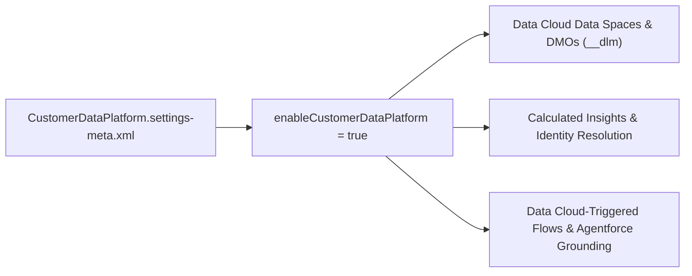

## Architectural Overview

**Salesforce Data Cloud** (originally introduced as Customer Data Platform, hence the API name `CustomerDataPlatformSettings`) is the hyperscale data engine underlying Agentforce grounding, Unified Individual identity resolution, Calculated Insights, and Data Cloud-Triggered Flows.

The `CustomerDataPlatformSettings` metadata type (`CustomerDataPlatform.settings-meta.xml`) exposes the org-level feature toggles that activate Data Cloud capabilities inside the host Salesforce org. In enterprise DevOps pipelines that package **Data Kits** (`DataPackageKitDefinition`), Data Streams, or Apex `ConnectApi.CdpQuery` integrations, deploying `CustomerDataPlatform.settings-meta.xml` ensures the target scratch org or sandbox has Data Cloud services enabled before dependent Data Model Objects (`__dlm`) or Calculated Insights (`__cio`) are deployed.



## SFDX Directory and File Suffix

| Property | Value |
| :--- | :--- |
| **Metadata Type Name** | `CustomerDataPlatformSettings` (deployed via `Settings` type with member `CustomerDataPlatform`) |
| **SFDX Source File Path** | `force-app/main/default/settings/CustomerDataPlatform.settings-meta.xml` |
| **Classic Metadata File Path** | `settings/CustomerDataPlatform.settings` |
| **`package.xml` Type / Member** | `<name>Settings</name>` / `<members>CustomerDataPlatform</members>` |

## Key Metadata Fields

`CustomerDataPlatformSettings` provides boolean switches for core Data Cloud services and cross-cloud connectors.

| Field Name | Type | Required | Architectural Purpose |
| :--- | :--- | :--- | :--- |
| `enableCustomerDataPlatform` | `boolean` | No | Master switch enabling Salesforce Data Cloud (CDP) metadata and runtime services in the org. |
| `enableCdpForService` | `boolean` | No | Enables Service Cloud integration with Data Cloud for unified contact center intelligence and engagement history. |
| `enableCdpSegmentActivation` | `boolean` | No | Enables segment activation targets so Data Cloud segments can publish to Marketing Cloud and external ad platforms. |
| `enableDataShareTarget` | `boolean` | No | Enables Zero-Copy Data Sharing targets to external data warehouses (such as Snowflake, BigQuery, and Redshift). |

## Declarative XML Example

Below is a standard `CustomerDataPlatform.settings-meta.xml` file enabling Data Cloud core services, segment activations, Service Cloud intelligence, and zero-copy data sharing targets.

```xml title="force-app/main/default/settings/CustomerDataPlatform.settings-meta.xml"
<?xml version="1.0" encoding="UTF-8"?>
<CustomerDataPlatformSettings xmlns="http://soap.sforce.com/2006/04/metadata">
    <enableCdpForService>true</enableCdpForService>
    <enableCdpSegmentActivation>true</enableCdpSegmentActivation>
    <enableCustomerDataPlatform>true</enableCustomerDataPlatform>
    <enableDataShareTarget>true</enableDataShareTarget>
</CustomerDataPlatformSettings>
```

### `package.xml` Manifest

Reference `CustomerDataPlatformSettings` under the `Settings` metadata type with member `CustomerDataPlatform`:

```xml title="manifest/package.xml"
<?xml version="1.0" encoding="UTF-8"?>
<Package xmlns="http://soap.sforce.com/2006/04/metadata">
    <types>
        <members>CustomerDataPlatform</members>
        <name>Settings</name>
    </types>
    <version>68.0</version>
</Package>
```

## SFDX CLI Retrieval and Deployment

Use Salesforce CLI to retrieve and deploy `CustomerDataPlatformSettings`:

```bash
# Retrieve CustomerDataPlatformSettings from a Data Cloud-enabled org
sf project retrieve start --metadata Settings:CustomerDataPlatform

# Deploy CustomerDataPlatformSettings to a target sandbox or scratch org
sf project deploy start --metadata Settings:CustomerDataPlatform
```

## Architect Best Practices and Gotchas

> [!WARNING]
> **License & Provisioning Requirement:** Deploying `<enableCustomerDataPlatform>true</enableCustomerDataPlatform>` via Metadata API requires the target org to have an active **Data Cloud** (or **Data Cloud for Core / Enterprise Edition**) license provisioned. Attempting to deploy this setting to a standard sandbox or scratch org without the `CustomerDataPlatform` feature license will fail with an insufficient license error.

- **Use Data Kits for DLO/DMO Packaging:** While `CustomerDataPlatformSettings` enables the org-wide toggles, never attempt to deploy raw auto-generated `__dlm` (Data Model Object) or `__dll` (Data Lake Object) files directly without wrapping them in a **Data Kit** (`DataPackageKitDefinition` and `DataPackageKitObject`). Data Kits ensure Data Space bindings and field mappings activate cleanly in the target org.
- **Permission Set Assignments:** After enabling `CustomerDataPlatformSettings`, assign the **Data Cloud Admin** or **Data Cloud Architect** permission set to your deployment integration user before deploying Data Streams, Identity Resolution rulesets, or Calculated Insights.
