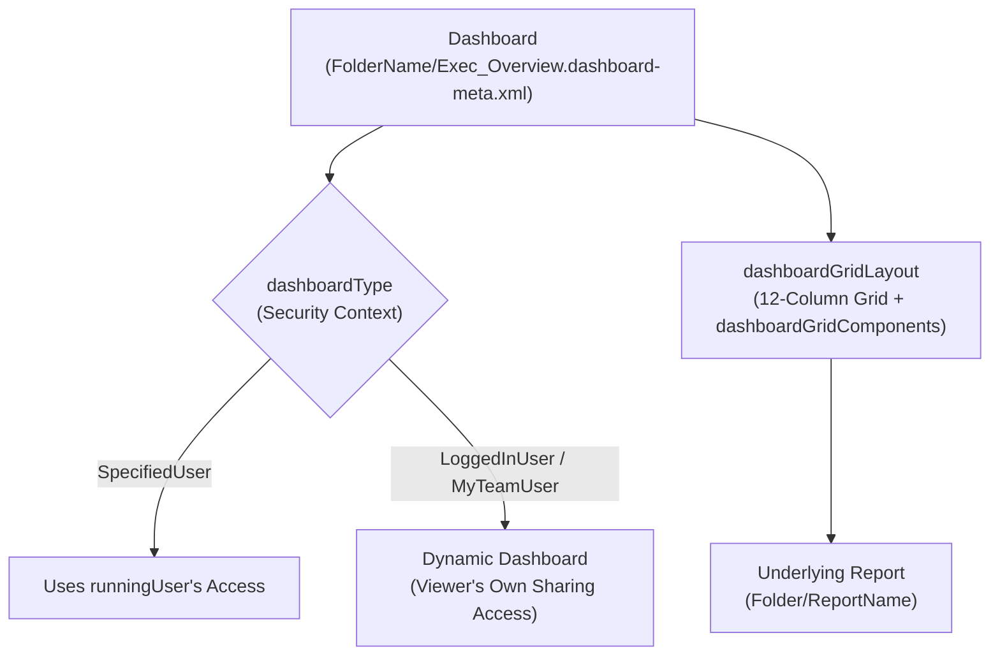

The `Dashboard` metadata type represents an analytics dashboard composed of charts, metric gauges, KPI cards, and Lightning tables powered by underlying [Report](/docs/metadata/report-metadata-type/) components. Introduced in API version 14.0 (with the 12-column Lightning `dashboardGridLayout` introduced in API v35.0), `Dashboard` also controls dashboard-wide filters (`dashboardFilters`) and data visibility security (`dashboardType`: `SpecifiedUser`, `LoggedInUser`, or `MyTeamUser`).

In Salesforce DX projects, dashboards are stored inside folder subdirectories at `force-app/main/default/dashboards/<FolderName>/<DashboardDeveloperName>.dashboard-meta.xml`.



## Key Metadata Fields

| Field | Type | Required | Description |
|---|---|---|---|
| `title` | `string` | Yes | Display title of the dashboard |
| `isGridLayout` | `boolean` | No | Set to `true` for modern 12-column Lightning Experience dashboards |
| `dashboardType` | `DashboardType` | No | `SpecifiedUser`, `LoggedInUser` (Dynamic), or `MyTeamUser` (Dynamic) |
| `runningUser` | `string` | Conditional | Username of the context user (required when `dashboardType` is `SpecifiedUser`) |
| `chartTheme` | `ChartTheme` | No | `light` or `dark` default widget theme (v42.0+) |
| `colorPalette` | `ChartColorPalettes` | No | Color palette (`Default`, `colorSafe`, `dusk`, `sunrise`, `water`, etc.) |
| `dashboardFilters` | `DashboardFilter[]` | No | Up to 3 header filter dropdowns (`name`, `dashboardFilterOptions`) |
| `dashboardGridLayout` | `DashboardGridLayout` | No | Defines `numberOfColumns` (`12`), `rowHeight`, and `dashboardGridComponents` (`colSpan`, `rowSpan`, `columnIndex`, `rowIndex`, `dashboardComponent`) |
| `backgroundStartColor` / `backgroundEndColor` / `backgroundFadeDirection` | `string` | Yes | Legacy gradient attributes (`#FFFFFF` / `Diagonal`) required by the schema |

## Production-Grade XML Example (12-Column Lightning Dashboard)

Below is a Lightning `Dashboard` (`force-app/main/default/dashboards/Executive_Dashboards/Q4_Revenue_Command_Center.dashboard-meta.xml`) using `LoggedInUser` so it deploys across sandboxes without hardcoded usernames:

```xml
<?xml version="1.0" encoding="UTF-8"?>
<Dashboard xmlns="http://soap.sforce.com/2006/04/metadata">
    <backgroundEndColor>#FFFFFF</backgroundEndColor>
    <backgroundFadeDirection>Diagonal</backgroundFadeDirection>
    <backgroundStartColor>#FFFFFF</backgroundStartColor>
    <chartTheme>light</chartTheme>
    <colorPalette>colorSafe</colorPalette>
    <dashboardGridLayout>
        <dashboardGridComponents>
            <colSpan>6</colSpan>
            <columnIndex>0</columnIndex>
            <dashboardComponent>
                <autoselectColumnsFromReport>false</autoselectColumnsFromReport>
                <chartAxisRange>Auto</chartAxisRange>
                <chartSummary>
                    <aggregate>Sum</aggregate>
                    <axisBinding>y</axisBinding>
                    <column>AMOUNT</column>
                </chartSummary>
                <componentType>Bar</componentType>
                <displayUnits>Auto</displayUnits>
                <GroupingColumn>STAGE_NAME</GroupingColumn>
                <header>Pipeline by Stage</header>
                <report>Executive_Sales_Reports/Quarterly_Enterprise_Pipeline</report>
                <showPercentage>false</showPercentage>
                <showValues>true</showValues>
                <sortBy>RowLabelAscending</sortBy>
            </dashboardComponent>
            <rowIndex>0</rowIndex>
            <rowSpan>8</rowSpan>
        </dashboardGridComponents>
        <numberOfColumns>12</numberOfColumns>
        <rowHeight>36</rowHeight>
    </dashboardGridLayout>
    <dashboardType>LoggedInUser</dashboardType>
    <description>Executive pipeline dashboard running under the logged-in user security context.</description>
    <isGridLayout>true</isGridLayout>
    <title>Q4 Revenue Command Center</title>
    <titleColor>#000000</titleColor>
    <titleSize>12</titleSize>
</Dashboard>
```

> [!WARNING]
> **Eliminating `<runningUser>` Deployment Failures**: Even when `dashboardType` is set to `LoggedInUser`, retrieving a Dashboard from a sandbox often includes a `<runningUser>developer@company.com.dev</runningUser>` tag. Strip `<runningUser>` from `LoggedInUser` dashboards before committing to Git, or use SFDX string replacements (`sfdx-project.json` `replacements`) for `SpecifiedUser` dashboards.

## Querying Dashboards and Folders with SOQL

```sql
-- 1. Audit all Dashboards, their Folders, and whether they consume Dynamic Dashboard slots
SELECT Id, Title, DeveloperName, FolderName, Type, RunningUser.Username, LastViewedDate
FROM Dashboard
ORDER BY Type, FolderName, Title ASC

-- 2. Count how many Dynamic Dashboards (LoggedInUser / MyTeamUser) are currently used
SELECT Type, COUNT(Id) totalDashboards
FROM Dashboard
WHERE Type IN ('LoggedInUser', 'MyTeamUser')
GROUP BY Type
```

