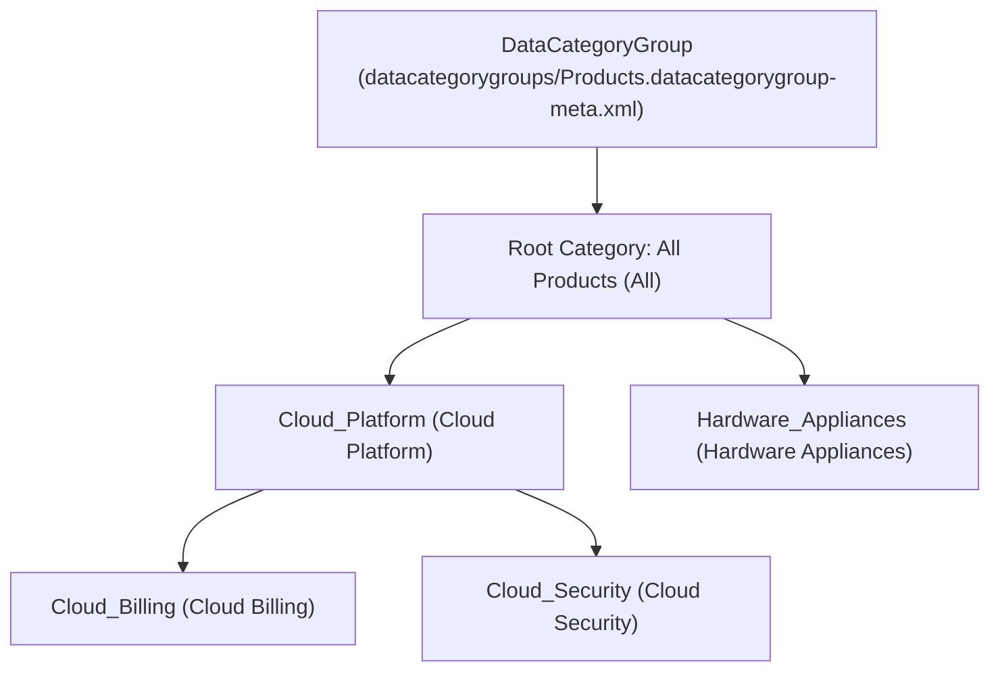

## Why the `DataCategoryGroup` Metadata Type Governs Knowledge Taxonomy & Visibility

In Salesforce Service Cloud and Experience Cloud help centers, **`DataCategoryGroup`** (`datacategorygroups/<Name>.datacategorygroup-meta.xml`) defines a hierarchical tree of categories (up to 5 levels deep and 100 categories per group) assigned to **Salesforce Knowledge** (`KnowledgeArticleVersion` / `Knowledge__kav`) and **Chatter Questions** (`Question`).

Data Categories serve a dual architectural role:
1. **Faceted Search & Navigation:** Filtering Knowledge searches by Product Line, Region, or Customer Segment.
2. **Article Visibility Security:** Restricting which internal agents, partner portal users, or customer community members can view specific Knowledge categories.



---

## Key Metadata Fields on `DataCategoryGroup`

| Field | Type | Required | Description |
|---|---|---|---|
| `label` | `string` | Yes | Display name of the Data Category Group in Setup and Knowledge UI. |
| `active` | `boolean` | Yes | Activates (`true`) or deactivates (`false`) the category group. |
| `description` | `string` | No | Explains the taxonomy purpose of the category group. |
| `dataCategory` | `DataCategory` | Yes | Top-level root category containing nested recursive `<dataCategory>` child nodes (`name` and `label`). |
| `objectUsage.object` | `string[]` | No | Objects associated with the category group: `KnowledgeArticleVersion` and/or `Question`. |

---

## Real-World XML Example (`datacategorygroups/Product_Taxonomy.datacategorygroup-meta.xml`)

```xml
<?xml version="1.0" encoding="UTF-8"?>
<DataCategoryGroup xmlns="http://soap.sforce.com/2006/04/metadata">
    <active>true</active>
    <dataCategory>
        <dataCategory>
            <dataCategory>
                <label>SSO &amp; MFA</label>
                <name>SSO_MFA</name>
            </dataCategory>
            <dataCategory>
                <label>API Gateways</label>
                <name>API_Gateways</name>
            </dataCategory>
            <label>Identity &amp; Security</label>
            <name>Identity_Security</name>
        </dataCategory>
        <dataCategory>
            <label>Billing &amp; Subscriptions</label>
            <name>Billing_Subscriptions</name>
        </dataCategory>
        <label>All Products</label>
        <name>All</name>
    </dataCategory>
    <description>Classifies Knowledge articles by product line and module.</description>
    <label>Product Taxonomy</label>
    <objectUsage>
        <object>KnowledgeArticleVersion</object>
    </objectUsage>
</DataCategoryGroup>
```

---

## Filtering Knowledge Articles with `WITH DATA CATEGORY` in SOQL & Apex

While `DataCategoryGroup` itself is inspected in Apex using the `Schema.DescribeDataCategoryGroupResult` API, you filter published Knowledge articles and inspect article categorizations using `WITH DATA CATEGORY` and `Knowledge__DataCategorySelection`:

### 1. Query Published Knowledge Articles Using `WITH DATA CATEGORY` (`ABOVE_OR_BELOW`)

```sql
SELECT Id, KnowledgeArticleId, Title, UrlName, Summary, LastPublishedDate
FROM Knowledge__kav
WHERE PublishStatus = 'Online'
  AND Language = 'en_US'
WITH DATA CATEGORY Product_Taxonomy__c BELOW Identity_Security__c
```

### 2. Query Data Category Assignments on Specific Articles (`Knowledge__DataCategorySelection`)

```sql
SELECT Id, ParentId, DataCategoryGroupName, DataCategoryName
FROM Knowledge__DataCategorySelection
WHERE Parent.PublishStatus = 'Online'
```

---

## Senior Architect Warning: Destructive Category Overwrites

> [!WARNING]
> **Deploying `DataCategoryGroup` Permanently Deletes Omitted Categories:** If a Knowledge manager adds a new category in Production Setup that is not in your Git branch's `.datacategorygroup-meta.xml` file, deploying your XML file **permanently deletes** that category in Production and re-parents all its Knowledge articles to the parent category! Always retrieve `DataCategoryGroup` from Production immediately before modifying and deploying it.
