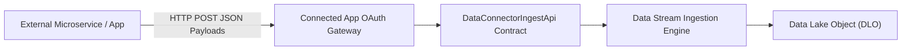

## Architectural Overview

The `DataConnectorIngestApi` metadata type configures Ingestion API connection endpoints and data contracts within **Salesforce Data Cloud**. The Ingestion API provides a push-based integration pattern allowing external applications, microservices, mobile applications, and IoT fleets to transmit real-time telemetry or bulk batches directly into Data Cloud Data Lake Objects (DLOs).

In an enterprise integration architecture, `DataConnectorIngestApi` establishes the schema blueprint (derived from OpenAPI/JSON schema specifications). When client applications authenticate via a [Connected App](/docs/metadata/connected-app-metadata-type/) using OAuth 2.0 client credentials or JWT bearer flows, Data Cloud validates incoming payload structures against this metadata definition prior to landing records in staging lake storage.



## Directory and File Suffix Conventions

In SFDX source format, `DataConnectorIngestApi` metadata files are located in the `dataConnectorIngestApis` directory within your package directory:

| Property | Value |
| :--- | :--- |
| **Metadata Type Name** | `DataConnectorIngestApi` |
| **SFDX Source Directory** | `force-app/main/default/dataConnectorIngestApis/` |
| **SFDX File Suffix** | `.dataConnectorIngestApi-meta.xml` |
| **Manifest Member Name** | `<name>DataConnectorIngestApi</name>` |

## Key Metadata Fields

| Field Name | Type | Required | Architectural Guidance |
| :--- | :--- | :--- | :--- |
| `masterLabel` | `string` | Yes | Human-readable title displayed in Data Cloud Ingest API connector management. |
| `developerName` | `string` | Yes | Unique API identifier used in ingestion endpoints and metadata manifests. |
| `description` | `string` | No | Architectural summary outlining data contracts, consumers, and retention criteria. |
| `status` | `string` | No | Operational status of the ingestion endpoint (`Active`, `Draft`, or `Disabled`). |
| `sourceType` | `string` | No | Ingestion mechanism classification, supporting `Streaming` or `Bulk` ingestion modes. |
| `schemaDefinition` | `string` | No | Embedded or referenced schema contract describing payload structure and field mappings. |

## Declarative XML and Manifest Examples

### Source Format XML (`Mobile_Telemetry_Connector.dataConnectorIngestApi-meta.xml`)

```xml title="force-app/main/default/dataConnectorIngestApis/Mobile_Telemetry_Connector.dataConnectorIngestApi-meta.xml"
<?xml version="1.0" encoding="UTF-8"?>
<DataConnectorIngestApi xmlns="http://soap.sforce.com/2006/04/metadata">
    <developerName>Mobile_Telemetry_Connector</developerName>
    <masterLabel>Mobile App Telemetry Ingest API</masterLabel>
    <description>Receives high-velocity mobile customer interaction events via Ingestion API.</description>
    <status>Active</status>
    <sourceType>Streaming</sourceType>
</DataConnectorIngestApi>
```

### Manifest (`package.xml`)

```xml title="manifest/package.xml"
<?xml version="1.0" encoding="UTF-8"?>
<Package xmlns="http://soap.sforce.com/2006/04/metadata">
    <types>
        <members>Mobile_Telemetry_Connector</members>
        <name>DataConnectorIngestApi</name>
    </types>
    <version>68.0</version>
</Package>
```

## Retrieval and Deployment Commands

Use the Salesforce CLI to retrieve and deploy `DataConnectorIngestApi` components:

```bash
# Retrieve all Ingestion API connectors from the target org
sf project retrieve start --metadata DataConnectorIngestApi

# Retrieve a specific Ingestion API connector by name
sf project retrieve start --metadata DataConnectorIngestApi:Mobile_Telemetry_Connector

# Deploy Ingestion API connector metadata to target environment
sf project deploy start --metadata DataConnectorIngestApi:Mobile_Telemetry_Connector
```

## Senior Architect Best Practices and Gotchas

- **Schema Immutability Considerations:** Once an Ingest API connector is deployed and actively streaming data to linked Data Streams, modifying field types in the schema contract can disrupt ongoing ingestion pipelines. Always introduce versioned schema objects rather than in-place breaking changes.
- **Pair with Connected App Security:** `DataConnectorIngestApi` governs the schema contract, while a [Connected App](/docs/metadata/connected-app-metadata-type/) handles transport authentication. Ensure deployment pipelines coordinate both assets and assign appropriate permissions via [PermissionSet](/docs/metadata/permission-set-metadata-type/).
- **Data Kit Packaging:** For ISVs and enterprise multi-org templates, encapsulate `DataConnectorIngestApi` within a `DataPackageKitDefinition` so subscribers can install ingestion schemas without manual field recreation.

> [!NOTE]
> Data Cloud licenses must be provisioned and enabled in the destination environment before deploying `DataConnectorIngestApi` components.
