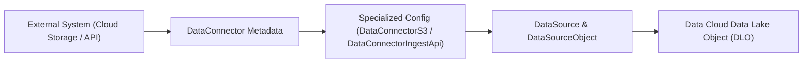

## Architectural Overview

The `DataConnector` metadata type represents an external or internal connection configuration in **Salesforce Data Cloud** (formerly Customer Data Platform). In Data Cloud enterprise architectures, data ingestion pipelines require a formal connector boundary before a `DataSource`, `DataSourceObject`, or `DataStreamDefinition` can ingest payloads into Data Lake Objects (DLOs).

When packaging Data Cloud implementations into deployable **Data Kits** (`DataPackageKitDefinition`) or promoting Data Cloud pipelines across Dev, Staging, and Production orgs via SFDX, `DataConnector` provides the declarative connection metadata linking the ingestion source to the target schema.



## SFDX Directory and File Suffix

| Property | Value |
| :--- | :--- |
| **Metadata Type Name** | `DataConnector` |
| **Classic Directory** | `dataConnectors/` |
| **Classic File Suffix** | `.dataConnector` |
| **SFDX Source Directory** | `force-app/main/default/dataConnectors/` |
| **SFDX File Suffix** | `.dataConnector-meta.xml` |

## Key Metadata Fields

| Field Name | Type | Required | Description & Architectural Guidance |
| :--- | :--- | :--- | :--- |
| `masterLabel` | `string` | No | Human-readable label for the Data Cloud connector shown in Data Cloud Setup. |
| `connectorType` | `string` | No | Specifies the Data Cloud connector classification (such as `S3`, `IngestApi`, `SalesforceDotCom`, or partner connector type). |
| `connectorHandler` | `string` | No | Internal or package handler identifier associated with the connector runtime. |
| `dataConnectionStatus` | `string` | No | Status of the connection definition in the org (`Active`, `Inactive`, or `Draft`). |

## Declarative XML and `package.xml` Examples

### Source Format XML (`Enterprise_Snowflake_Bridge.dataConnector-meta.xml`)

```xml title="force-app/main/default/dataConnectors/Enterprise_Snowflake_Bridge.dataConnector-meta.xml"
<?xml version="1.0" encoding="UTF-8"?>
<DataConnector xmlns="http://soap.sforce.com/2006/04/metadata">
    <connectorType>IngestApi</connectorType>
    <dataConnectionStatus>Active</dataConnectionStatus>
    <masterLabel>Enterprise Snowflake Event Bridge</masterLabel>
</DataConnector>
```

### Manifest (`package.xml`)

```xml title="manifest/package.xml"
<?xml version="1.0" encoding="UTF-8"?>
<Package xmlns="http://soap.sforce.com/2006/04/metadata">
    <types>
        <members>Enterprise_Snowflake_Bridge</members>
        <name>DataConnector</name>
    </types>
    <version>68.0</version>
</Package>
```

## SFDX CLI Retrieval and Deployment Commands

Use the Salesforce CLI (`sf`) to retrieve and deploy `DataConnector` metadata alongside your Data Cloud Data Kit components:

```bash
# Retrieve all DataConnector definitions from a Data Cloud org
sf project retrieve start --metadata DataConnector

# Retrieve a specific DataConnector by developer name
sf project retrieve start --metadata DataConnector:Enterprise_Snowflake_Bridge

# Deploy DataConnector metadata to a target Data Cloud org
sf project deploy start --metadata DataConnector:Enterprise_Snowflake_Bridge
```

## Architect Best Practices and Gotchas

- **Package Inside Data Kits for ISV and Multi-Org Delivery:** Rather than deploying raw Data Cloud objects in isolation, bundle `DataConnector`, `DataSource`, and `DataSourceObject` definitions inside a `DataPackageKitDefinition` so target orgs can install and bind credentials cleanly in Data Cloud Setup.
- **Post-Deployment Authentication Handshake:** Like [NamedCredential](/docs/metadata/named-credential-metadata-type/) and [ExternalDataSource](/docs/metadata/external-data-source-metadata-type/), deploying a `DataConnector` provisions the metadata shell, but secrets (IAM role ARNs, OAuth tokens, or S3 access keys) must be authenticated in the target environment after deployment.
- **License Prerequisite:** The target org must have an active **Salesforce Data Cloud** license and `DataCloudAdmin` permissions assigned to the deployment user, or the Metadata API deployment will fail with `Invalid type: DataConnector`.

> [!NOTE]
> For Amazon S3 buckets and Data Cloud Ingestion API endpoints, pair or use the specialized `DataConnectorS3` and `DataConnectorIngestApi` metadata types to configure bucket paths or schema files.
