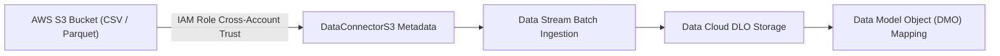

## Architectural Overview

The `DataConnectorS3` metadata type defines the declarative integration configuration between **Salesforce Data Cloud** and **Amazon Web Services (AWS) Simple Storage Service (S3)**. In modern enterprise lakehouse architectures, Amazon S3 commonly serves as the primary staging repository for enterprise data warehouses, customer transaction logs, and external ERP exports.

`DataConnectorS3` establishes the connection metadata envelope, specifying target AWS S3 bucket identifiers, bucket directories, object prefix patterns, compression algorithms, and file formatting specifications. Once deployed, Data Cloud Data Streams bind to this connector to execute automated batch ingestion schedules into staging Data Lake Objects (DLOs).



## Directory and File Suffix Conventions

In SFDX source format, `DataConnectorS3` metadata definitions reside in the `dataConnectorS3s` folder:

| Property | Value |
| :--- | :--- |
| **Metadata Type Name** | `DataConnectorS3` |
| **SFDX Source Directory** | `force-app/main/default/dataConnectorS3s/` |
| **SFDX File Suffix** | `.dataConnectorS3-meta.xml` |
| **Manifest Member Name** | `<name>DataConnectorS3</name>` |

## Key Metadata Fields

| Field Name | Type | Required | Architectural Guidance |
| :--- | :--- | :--- | :--- |
| `masterLabel` | `string` | Yes | Display name of the S3 connector in the Data Cloud administrative console. |
| `developerName` | `string` | Yes | Unique API name identifying the S3 connection definition across deployments. |
| `bucketName` | `string` | No | Target AWS S3 bucket name containing data lake source files. |
| `directoryPath` | `string` | No | Root directory or prefix path inside the S3 bucket designated for polling. |
| `fileFormat` | `string` | No | Ingestion payload format, such as `CSV`, `Parquet`, or `TSV`. |
| `compressionType` | `string` | No | Compression algorithm applied to files (`GZIP` or `None`). |
| `status` | `string` | No | Lifecycle status of the connection (`Active`, `Inactive`, or `Draft`). |

## Declarative XML and Manifest Examples

### Source Format XML (`Enterprise_DataLake_S3.dataConnectorS3-meta.xml`)

```xml title="force-app/main/default/dataConnectorS3s/Enterprise_DataLake_S3.dataConnectorS3-meta.xml"
<?xml version="1.0" encoding="UTF-8"?>
<DataConnectorS3 xmlns="http://soap.sforce.com/2006/04/metadata">
    <developerName>Enterprise_DataLake_S3</developerName>
    <masterLabel>Enterprise Data Lake S3 Connector</masterLabel>
    <bucketName>corp-lakehouse-data-cloud-sync</bucketName>
    <directoryPath>/inbound/customers/</directoryPath>
    <fileFormat>CSV</fileFormat>
    <compressionType>GZIP</compressionType>
    <status>Active</status>
</DataConnectorS3>
```

### Manifest (`package.xml`)

```xml title="manifest/package.xml"
<?xml version="1.0" encoding="UTF-8"?>
<Package xmlns="http://soap.sforce.com/2006/04/metadata">
    <types>
        <members>Enterprise_DataLake_S3</members>
        <name>DataConnectorS3</name>
    </types>
    <version>68.0</version>
</Package>
```

## Retrieval and Deployment Commands

Use the Salesforce CLI to retrieve and deploy `DataConnectorS3` metadata:

```bash
# Retrieve all S3 connector definitions
sf project retrieve start --metadata DataConnectorS3

# Retrieve a specific S3 connector by developer name
sf project retrieve start --metadata DataConnectorS3:Enterprise_DataLake_S3

# Deploy S3 connector metadata to target environment
sf project deploy start --metadata DataConnectorS3:Enterprise_DataLake_S3
```

## Senior Architect Best Practices and Gotchas

- **Cross-Account AWS IAM Roles:** Deploying the metadata definition creates the connection structure, but security handshake requires configuring AWS IAM AssumeRole policies with Salesforce's 12-digit AWS account ID and External ID. Never attempt to hardcode static AWS credentials in CI/CD pipelines.
- **Parquet Schema Compatibility:** When ingesting Parquet format from S3, ensure upstream data engineering pipelines produce snappy or uncompressed Parquet files with fixed schemas matching your Data Stream field specifications.
- **Data Kit Encapsulation:** When deploying Data Cloud assets across staging and production orgs, package the `DataConnectorS3` alongside linked `DataSource` and `DataPackageKitDefinition` components to preserve data lineage.

> [!NOTE]
> Ensure the target Salesforce org has the active Salesforce Data Cloud license and appropriate storage provisioning prior to deploying `DataConnectorS3` metadata.
