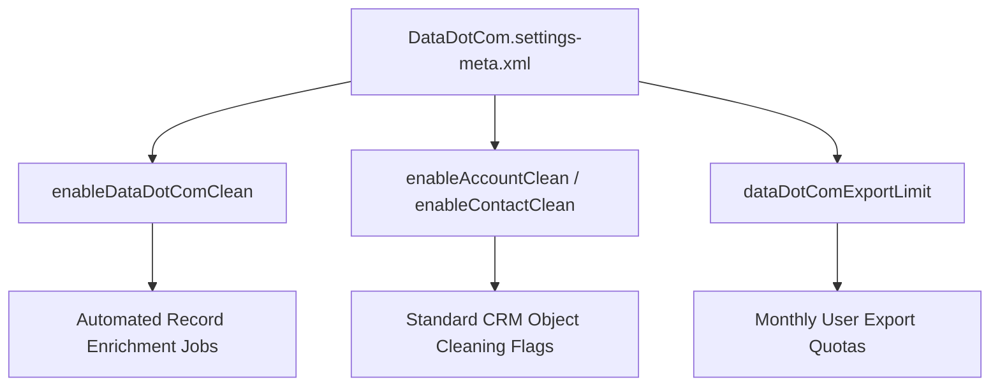

## Architectural Overview

The `DataDotComSettings` metadata type represents the declarative configuration for legacy **Data.com** (originally Jigsaw) services within a Salesforce organization. Historically, Data.com supplied native B2B company and contact directories, automated data assessment, and record enrichment through Data.com Clean and Prospector.

From an enterprise metadata and DevOps perspective, `DataDotComSettings` governs tenant-wide preferences including Clean job automation on standard [CustomObject](/docs/metadata/custom-object-metadata-type/) records (Account, Contact, and Lead), monthly record addition quotas, and Prospector user permissions. While Data.com commercial products were retired, this metadata type persists across legacy org definitions and schema migration projects.



## Directory and File Conventions

In SFDX source format, `DataDotComSettings` is managed under the `settings/` directory as part of the unified Settings metadata family:

| Property | Value |
| :--- | :--- |
| **Metadata Type Name** | `Settings` (member: `DataDotCom`) / `DataDotComSettings` |
| **SFDX Source Directory** | `force-app/main/default/settings/` |
| **File Name** | `DataDotCom.settings-meta.xml` |
| **Manifest Member Name** | `<members>DataDotCom</members><name>Settings</name>` |

## Key Metadata Fields

| Field Name | Type | Required | Architectural Guidance |
| :--- | :--- | :--- | :--- |
| `enableDataDotComClean` | `boolean` | No | Enables automated or manual Data.com Clean services across standard CRM records. |
| `enableAccountClean` | `boolean` | No | Enables Clean rules and data comparison status fields on Account records. |
| `enableContactClean` | `boolean` | No | Activates contact matching and verification rules against the Data.com repository. |
| `enableLeadClean` | `boolean` | No | Enables lead enrichment and field overwrite configurations. |
| `dataDotComExportLimit` | `int` | No | Defines monthly record export threshold allocated per user. |

## Declarative XML and Manifest Examples

### Source Format XML (`DataDotCom.settings-meta.xml`)

```xml title="force-app/main/default/settings/DataDotCom.settings-meta.xml"
<?xml version="1.0" encoding="UTF-8"?>
<DataDotComSettings xmlns="http://soap.sforce.com/2006/04/metadata">
    <enableDataDotComClean>false</enableDataDotComClean>
    <enableAccountClean>false</enableAccountClean>
    <enableContactClean>false</enableContactClean>
    <enableLeadClean>false</enableLeadClean>
    <dataDotComExportLimit>300</dataDotComExportLimit>
</DataDotComSettings>
```

### Manifest (`package.xml`)

```xml title="manifest/package.xml"
<?xml version="1.0" encoding="UTF-8"?>
<Package xmlns="http://soap.sforce.com/2006/04/metadata">
    <types>
        <members>DataDotCom</members>
        <name>Settings</name>
    </types>
    <version>68.0</version>
</Package>
```

## Retrieval and Deployment Commands

Use the Salesforce CLI to retrieve and deploy `DataDotComSettings`:

```bash
# Retrieve DataDotCom settings via the Settings type
sf project retrieve start --metadata Settings:DataDotCom

# Deploy DataDotCom settings to an environment
sf project deploy start --metadata Settings:DataDotCom
```

## Senior Architect Best Practices and Gotchas

- **Legacy Product Retirement:** Salesforce formally retired Data.com Clean and Prospector. Modern enterprise architectures should migrate to Salesforce Data Cloud, AppExchange partner enrichment (such as ZoomInfo or Dun & Bradstreet), or external Ingest APIs.
- **Scratch Org Definitions:** If maintaining older DX scratch org definitions with `"dataDotComSettings"`, remove the feature unless working in an active legacy org that holds grandfathered licenses to avoid org creation failures.
- **Decommissioning Clean Fields:** When deprecating Data.com, review page layouts and permission sets to remove legacy Clean status fields and action buttons.

> [!NOTE]
> In modern production orgs created after the Data.com retirement date, deploying `DataDotComSettings` with enabled flags may result in deployment errors if licenses are unavailable.
