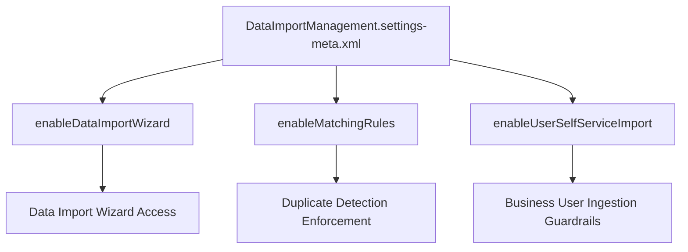

## Architectural Overview

The `DataImportManagementSettings` metadata type represents organization-wide settings for the native **Salesforce Data Import Wizard** and user-facing bulk data management utilities. While enterprise data operations typically utilize ETL tools, Bulk API 2.0, or MuleSoft, the Data Import Wizard remains an important self-service tool for business users importing Accounts, Contacts, Leads, Solutions, and [CustomObject](/docs/metadata/custom-object-metadata-type/) records.

`DataImportManagementSettings` controls whether end users can execute self-service imports, enforces deduplication matching rules during ingestion, and manages automated assignment rules (such as Lead and Case routing). Architecting these settings ensures data governance, prevents mass duplicate creation, and standardizes import behavior across scratch orgs, sandboxes, and production.



## Directory and File Conventions

In SFDX source format, `DataImportManagementSettings` is grouped within the `settings/` directory:

| Property | Value |
| :--- | :--- |
| **Metadata Type Name** | `Settings` (member: `DataImportManagement`) / `DataImportManagementSettings` |
| **SFDX Source Directory** | `force-app/main/default/settings/` |
| **File Name** | `DataImportManagement.settings-meta.xml` |
| **Manifest Member Name** | `<members>DataImportManagement</members><name>Settings</name>` |

## Key Metadata Fields

| Field Name | Type | Required | Architectural Guidance |
| :--- | :--- | :--- | :--- |
| `enableDataImportWizard` | `boolean` | No | Enables the Data Import Wizard interface in Setup for administrative and delegated users. |
| `enableMatchingRules` | `boolean` | No | Enforces matching rules (by Name, Email, or External ID) to prevent duplicate record insertion during imports. |
| `enableUserImport` | `boolean` | No | Permits non-administrator users with appropriate permissions to initiate self-service personal imports. |

## Declarative XML and Manifest Examples

### Source Format XML (`DataImportManagement.settings-meta.xml`)

```xml title="force-app/main/default/settings/DataImportManagement.settings-meta.xml"
<?xml version="1.0" encoding="UTF-8"?>
<DataImportManagementSettings xmlns="http://soap.sforce.com/2006/04/metadata">
    <enableDataImportWizard>true</enableDataImportWizard>
    <enableMatchingRules>true</enableMatchingRules>
    <enableUserImport>false</enableUserImport>
</DataImportManagementSettings>
```

### Manifest (`package.xml`)

```xml title="manifest/package.xml"
<?xml version="1.0" encoding="UTF-8"?>
<Package xmlns="http://soap.sforce.com/2006/04/metadata">
    <types>
        <members>DataImportManagement</members>
        <name>Settings</name>
    </types>
    <version>68.0</version>
</Package>
```

## Retrieval and Deployment Commands

Use the Salesforce CLI to retrieve and deploy `DataImportManagementSettings`:

```bash
# Retrieve DataImportManagement settings from an org
sf project retrieve start --metadata Settings:DataImportManagement

# Deploy DataImportManagement settings to an environment
sf project deploy start --metadata Settings:DataImportManagement
```

## Senior Architect Best Practices and Gotchas

- **Data Governance Strategy:** In regulated environments (finance, healthcare, defense), enterprise architects frequently set `enableUserImport` to `false` via this metadata type, channeling all data loads through vetted ETL pipelines and staging validation engines.
- **Pair with Duplicate Rules:** While `enableMatchingRules` controls wizard-level matching, ensure comprehensive Duplicate Rules and Matching Rules are deployed to provide consistent deduplication across both UI wizards and API integrations.
- **Permission Dependencies:** Enabling wizard features org-wide still requires granting users the `Import Personal Records` administrative permission via a [PermissionSet](/docs/metadata/permission-set-metadata-type/) or [Profile](/docs/metadata/profile-metadata-type/).

> [!NOTE]
> Modifying `DataImportManagementSettings` applies org-wide immediately upon deployment without requiring scheduled maintenance downtime.
