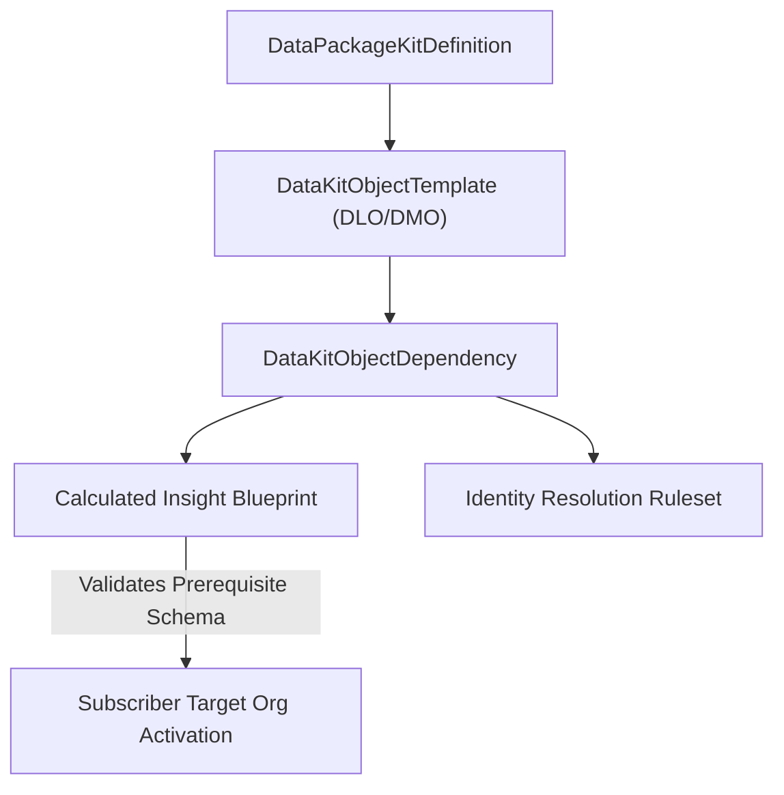

## Architectural Overview

The `DataKitObjectDependency` metadata type manages prerequisite relationships and execution dependency graphs between constituent assets in a **Salesforce Data Cloud Data Kit** (`DataPackageKitDefinition`). When packaging Data Cloud architectures into managed or unlocked packages, components do not exist in isolation; they form an interconnected dependency web.

For instance, a Calculated Insight depends on specific Data Model Objects (DMOs) and standard CRM [CustomField](/docs/metadata/custom-field-metadata-type/) mappings, which in turn depend on Data Lake Objects (DLOs) populated by Data Streams. `DataKitObjectDependency` explicitly codifies these parent-child and prerequisite relationships, ensuring the deployment engine validates dependencies and orchestrates activation order safely in subscriber environments.



## Directory and File Suffix Conventions

In SFDX source format, `DataKitObjectDependency` metadata is stored in the `dataKitObjectDependencies` folder:

| Property | Value |
| :--- | :--- |
| **Metadata Type Name** | `DataKitObjectDependency` |
| **SFDX Source Directory** | `force-app/main/default/dataKitObjectDependencies/` |
| **SFDX File Suffix** | `.dataKitObjectDependency-meta.xml` |
| **Manifest Member Name** | `<name>DataKitObjectDependency</name>` |

## Key Metadata Fields

| Field Name | Type | Required | Architectural Guidance |
| :--- | :--- | :--- | :--- |
| `masterLabel` | `string` | Yes | Human-readable label for the dependency mapping. |
| `developerName` | `string` | Yes | Unique API name identifying the dependency definition. |
| `dataPackageKitDefinition` | `string` | Yes | Reference to the parent `DataPackageKitDefinition` container. |
| `sourceObject` | `string` | Yes | Identifier of the dependent object initiating the requirement. |
| `targetObject` | `string` | Yes | Identifier of the prerequisite object that must exist prior to activation. |
| `dependencyType` | `string` | No | Nature of the structural link, such as schema mapping, data lineage, or calculation input. |

## Declarative XML and Manifest Examples

### Source Format XML (`Customer360_DMO_Dependency.dataKitObjectDependency-meta.xml`)

```xml title="force-app/main/default/dataKitObjectDependencies/Customer360_DMO_Dependency.dataKitObjectDependency-meta.xml"
<?xml version="1.0" encoding="UTF-8"?>
<DataKitObjectDependency xmlns="http://soap.sforce.com/2006/04/metadata">
    <developerName>Customer360_DMO_Dependency</developerName>
    <masterLabel>Customer 360 DMO Dependency</masterLabel>
    <dataPackageKitDefinition>Enterprise_Customer360_Kit</dataPackageKitDefinition>
    <sourceObject>Customer_Lifetime_Value_Insight</sourceObject>
    <targetObject>Unified_Customer_DMO</targetObject>
    <dependencyType>CalculationInput</dependencyType>
</DataKitObjectDependency>
```

### Manifest (`package.xml`)

```xml title="manifest/package.xml"
<?xml version="1.0" encoding="UTF-8"?>
<Package xmlns="http://soap.sforce.com/2006/04/metadata">
    <types>
        <members>Customer360_DMO_Dependency</members>
        <name>DataKitObjectDependency</name>
    </types>
    <version>68.0</version>
</Package>
```

## Retrieval and Deployment Commands

Use the Salesforce CLI to retrieve and deploy `DataKitObjectDependency` metadata:

```bash
# Retrieve all Data Kit dependency definitions
sf project retrieve start --metadata DataKitObjectDependency

# Retrieve a specific dependency configuration
sf project retrieve start --metadata DataKitObjectDependency:Customer360_DMO_Dependency

# Deploy Data Kit dependency metadata to the target environment
sf project deploy start --metadata DataKitObjectDependency:Customer360_DMO_Dependency
```

## Senior Architect Best Practices and Gotchas

- **Prevent Cyclic Dependencies:** Always audit Data Kit graphs to avoid circular references (for example, Object A requiring Object B while Object B references Object A). Cyclic graphs block package version creation and installation.
- **Subscriber Namespace Mapping:** When building commercial AppExchange packages, ensure target object references account for package namespaces to prevent unresolvable metadata references upon installation.
- **Atomic Deployment with Data Kits:** Deploy `DataKitObjectDependency` alongside its parent `DataPackageKitDefinition` and constituent `DataPackageKitObject` records within a single manifest to preserve schema integrity.

> [!NOTE]
> Subscriber orgs must satisfy all external data model prerequisites before activating kits containing complex object dependencies.
