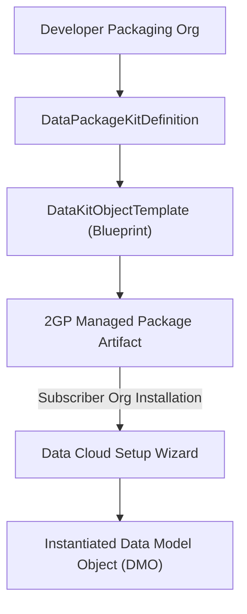

## Architectural Overview

The `DataKitObjectTemplate` metadata type represents an object blueprint or schema template bundled inside a **Salesforce Data Cloud Data Kit** (`DataPackageKitDefinition`). Data Kits function as modular packaging units for Data Cloud, enabling Independent Software Vendors (ISVs) and enterprise architects to encapsulate complex data architectures—including custom Data Model Objects (DMOs), Data Lake Objects (DLOs), data stream mappings, and Calculated Insights—into 2GP managed or unlocked packages.

Rather than hardcoding rigid physical tables, `DataKitObjectTemplate` provides an abstract object template. When installed in a subscriber organization, the Data Cloud installation runtime consumes the template to generate or extend the target data model while adapting to subscriber namespace configurations.



## Directory and File Suffix Conventions

In SFDX source format, `DataKitObjectTemplate` metadata files reside in the `dataKitObjectTemplates` directory:

| Property | Value |
| :--- | :--- |
| **Metadata Type Name** | `DataKitObjectTemplate` |
| **SFDX Source Directory** | `force-app/main/default/dataKitObjectTemplates/` |
| **SFDX File Suffix** | `.dataKitObjectTemplate-meta.xml` |
| **Manifest Member Name** | `<name>DataKitObjectTemplate</name>` |

## Key Metadata Fields

| Field Name | Type | Required | Architectural Guidance |
| :--- | :--- | :--- | :--- |
| `masterLabel` | `string` | Yes | Human-readable title of the object blueprint displayed in the Data Kit builder. |
| `developerName` | `string` | Yes | Unique programmatic identifier for the template definition. |
| `dataPackageKitDefinition` | `string` | Yes | API name of the enclosing `DataPackageKitDefinition` container. |
| `templateType` | `string` | Yes | Categorizes the asset structure (`DataModelObject`, `DataLakeObject`, `CalculatedInsight`, etc.). |
| `targetObjectType` | `string` | No | Schema classification or standard entity reference targeted by this template. |
| `templateDefinition` | `string` | No | Serialized schema definition specifying field configurations and relationships. |

## Declarative XML and Manifest Examples

### Source Format XML (`Loyalty_Transaction_Template.dataKitObjectTemplate-meta.xml`)

```xml title="force-app/main/default/dataKitObjectTemplates/Loyalty_Transaction_Template.dataKitObjectTemplate-meta.xml"
<?xml version="1.0" encoding="UTF-8"?>
<DataKitObjectTemplate xmlns="http://soap.sforce.com/2006/04/metadata">
    <developerName>Loyalty_Transaction_Template</developerName>
    <masterLabel>Loyalty Transaction DMO Blueprint</masterLabel>
    <dataPackageKitDefinition>Retail_Loyalty_DataKit</dataPackageKitDefinition>
    <templateType>DataModelObject</templateType>
    <targetObjectType>Custom</targetObjectType>
</DataKitObjectTemplate>
```

### Manifest (`package.xml`)

```xml title="manifest/package.xml"
<?xml version="1.0" encoding="UTF-8"?>
<Package xmlns="http://soap.sforce.com/2006/04/metadata">
    <types>
        <members>Loyalty_Transaction_Template</members>
        <name>DataKitObjectTemplate</name>
    </types>
    <version>68.0</version>
</Package>
```

## Retrieval and Deployment Commands

Use the Salesforce CLI to retrieve and deploy `DataKitObjectTemplate` metadata:

```bash
# Retrieve all Data Kit object templates
sf project retrieve start --metadata DataKitObjectTemplate

# Retrieve a specific object template by name
sf project retrieve start --metadata DataKitObjectTemplate:Loyalty_Transaction_Template

# Deploy object template metadata to the target environment
sf project deploy start --metadata DataKitObjectTemplate:Loyalty_Transaction_Template
```

## Senior Architect Best Practices and Gotchas

- **Schema Reusability and Modularity:** Design object templates to be modular and generalized. Avoid baking org-specific custom field IDs or rigid external database keys into the blueprint.
- **Support for Standard DMO Extensions:** When templating extensions to standard Data Cloud entities (such as Individual or ContactPointAddress), ensure your template adheres to canonical standard schema conventions to avoid collision with Salesforce updates.
- **Version Compatibility:** Verify that subscriber orgs are running a compatible Data Cloud release (Winter '27 / API 68.0) that supports all templated data types and calculation engines.

> [!NOTE]
> Installing a package containing `DataKitObjectTemplate` provisions the template definitions; administrators must activate the Data Kit in Data Cloud Setup to instantiate live objects.
