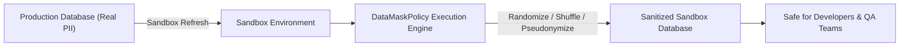

## Architectural Overview

The `DataMaskPolicy` metadata type defines automated data anonymization, pseudonymization, and obfuscation policies within **Salesforce Data Mask**. For enterprise organizations operating in regulated sectors (such as healthcare, banking, and public sector), copying production databases into Full or Partial Copy Sandboxes introduces significant compliance risks under GDPR, HIPAA, and CCPA regulations.

Salesforce Data Mask provides native, platform-level data sanitization directly inside sandboxes without extracting records over external ETL networks. `DataMaskPolicy` specifies target [CustomObject](/docs/metadata/custom-object-metadata-type/) and standard records, designated sensitive [CustomField](/docs/metadata/custom-field-metadata-type/) attributes (such as SSNs, credit card numbers, email addresses, and phone numbers), and the chosen masking technique (shuffling, pattern replacement, deletion, or random characters).



## Directory and File Suffix Conventions

In SFDX source format, `DataMaskPolicy` metadata definitions reside in the `dataMaskPolicies` directory:

| Property | Value |
| :--- | :--- |
| **Metadata Type Name** | `DataMaskPolicy` |
| **SFDX Source Directory** | `force-app/main/default/dataMaskPolicies/` |
| **SFDX File Suffix** | `.dataMaskPolicy-meta.xml` |
| **Manifest Member Name** | `<name>DataMaskPolicy</name>` |

## Key Metadata Fields

| Field Name | Type | Required | Architectural Guidance |
| :--- | :--- | :--- | :--- |
| `masterLabel` | `string` | Yes | Human-readable name identifying the masking policy. |
| `developerName` | `string` | Yes | Unique programmatic identifier for metadata deployment. |
| `description` | `string` | No | Governance rationale documenting covered compliance frameworks. |
| `targetObject` | `string` | Yes | API name of the target sObject (e.g., `Contact`, `Lead`, `Account`, or custom object). |
| `maskingType` | `string` | No | Masking algorithm category (`Anonymize`, `Pseudonymize`, `Delete`, `Shuffle`). |
| `status` | `string` | No | Policy state (`Active` or `Draft`). |
| `executionOrder` | `int` | No | Sequence priority when orchestrating multiple interdependent masking operations. |

## Declarative XML and Manifest Examples

### Source Format XML (`Sanitize_Customer_PII.dataMaskPolicy-meta.xml`)

```xml title="force-app/main/default/dataMaskPolicies/Sanitize_Customer_PII.dataMaskPolicy-meta.xml"
<?xml version="1.0" encoding="UTF-8"?>
<DataMaskPolicy xmlns="http://soap.sforce.com/2006/04/metadata">
    <developerName>Sanitize_Customer_PII</developerName>
    <masterLabel>Sanitize Customer PII Policy</masterLabel>
    <description>Anonymizes customer contact emails, phone numbers, and birth dates in sandboxes.</description>
    <targetObject>Contact</targetObject>
    <maskingType>Pseudonymize</maskingType>
    <status>Active</status>
    <executionOrder>1</executionOrder>
</DataMaskPolicy>
```

### Manifest (`package.xml`)

```xml title="manifest/package.xml"
<?xml version="1.0" encoding="UTF-8"?>
<Package xmlns="http://soap.sforce.com/2006/04/metadata">
    <types>
        <members>Sanitize_Customer_PII</members>
        <name>DataMaskPolicy</name>
    </types>
    <version>68.0</version>
</Package>
```

## Retrieval and Deployment Commands

Use the Salesforce CLI to retrieve and deploy `DataMaskPolicy` metadata:

```bash
# Retrieve all Data Mask policies from an org
sf project retrieve start --metadata DataMaskPolicy

# Retrieve a specific policy by developer name
sf project retrieve start --metadata DataMaskPolicy:Sanitize_Customer_PII

# Deploy policy metadata to target sandbox or production configuration repository
sf project deploy start --metadata DataMaskPolicy:Sanitize_Customer_PII
```

## Senior Architect Best Practices and Gotchas

- **Safe Configuration in Production Repositories:** You can safely store and deploy `DataMaskPolicy` definitions to production version control repositories. The Data Mask runtime engine is architecturally blocked from executing inside Production orgs; policies only run when executed inside sandboxes.
- **Foreign Key and Email Format Integrity:** When masking email fields or phone numbers, utilize pattern-based masking or library substitution rather than random characters to ensure downstream integration tests or validation rules do not fail due to invalid email formats.
- **Automation via Sandbox Post-Copy:** Combine `DataMaskPolicy` with `SandboxPostCopy` Apex scripts or `DataMaskSettings` to trigger masking automatically upon sandbox completion before developers are granted access.

> [!NOTE]
> Salesforce Data Mask requires the Data Mask managed package license or Data Mask Platform feature enabled in your tenant.
