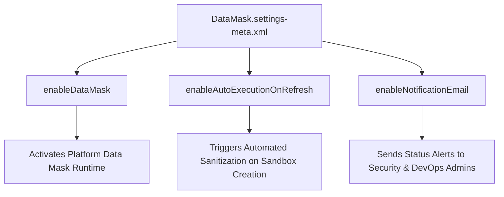

## Architectural Overview

The `DataMaskSettings` metadata type controls organization-wide configuration for **Salesforce Data Mask**. While individual data obfuscation rules are defined within `DataMaskPolicy` records, `DataMaskSettings` establishes tenant-level execution parameters, automation flags, and administrative notification targets.

In modern enterprise DevOps pipelines, automating sandbox data sanitization is essential to maintaining zero-trust development environments. By enabling automatic execution flags via `DataMaskSettings`, platform teams guarantee that whenever a Full or Partial Copy Sandbox finishes refreshing from Production, Data Mask immediately initiates sanitization jobs prior to development team check-in, fulfilling compliance requirements under HIPAA, GDPR, and SOC 2.



## Directory and File Conventions

In SFDX source format, `DataMaskSettings` is managed under the `settings/` directory:

| Property | Value |
| :--- | :--- |
| **Metadata Type Name** | `Settings` (member: `DataMask`) / `DataMaskSettings` |
| **SFDX Source Directory** | `force-app/main/default/settings/` |
| **File Name** | `DataMask.settings-meta.xml` |
| **Manifest Member Name** | `<members>DataMask</members><name>Settings</name>` |

## Key Metadata Fields

| Field Name | Type | Required | Architectural Guidance |
| :--- | :--- | :--- | :--- |
| `enableDataMask` | `boolean` | No | Enables or disables the Data Mask execution engine within the organization. |
| `enableAutoExecutionOnRefresh` | `boolean` | No | Automatically invokes active masking policies immediately upon sandbox refresh completion. |
| `enableNotificationEmail` | `boolean` | No | Triggers automated email notifications upon masking job completion or error detection. |
| `notificationEmailRecipient` | `string` | No | Designated security officer or DevOps distribution list receiving execution audit logs. |

## Declarative XML and Manifest Examples

### Source Format XML (`DataMask.settings-meta.xml`)

```xml title="force-app/main/default/settings/DataMask.settings-meta.xml"
<?xml version="1.0" encoding="UTF-8"?>
<DataMaskSettings xmlns="http://soap.sforce.com/2006/04/metadata">
    <enableDataMask>true</enableDataMask>
    <enableAutoExecutionOnRefresh>true</enableAutoExecutionOnRefresh>
    <enableNotificationEmail>true</enableNotificationEmail>
    <notificationEmailRecipient>security-devops@example.com</notificationEmailRecipient>
</DataMaskSettings>
```

### Manifest (`package.xml`)

```xml title="manifest/package.xml"
<?xml version="1.0" encoding="UTF-8"?>
<Package xmlns="http://soap.sforce.com/2006/04/metadata">
    <types>
        <members>DataMask</members>
        <name>Settings</name>
    </types>
    <version>68.0</version>
</Package>
```

## Retrieval and Deployment Commands

Use the Salesforce CLI to retrieve and deploy `DataMaskSettings`:

```bash
# Retrieve DataMask settings from an org
sf project retrieve start --metadata Settings:DataMask

# Deploy DataMask settings to target environment
sf project deploy start --metadata Settings:DataMask
```

## Senior Architect Best Practices and Gotchas

- **Production Safe Settings:** Even with `enableAutoExecutionOnRefresh` set to `true`, the Salesforce Data Mask platform engine includes hardcoded safety interlocks preventing execution inside Production organizations.
- **Pair with CI/CD Sandbox Provisioning:** Incorporate `DataMaskSettings` deployment in automated sandbox creation pipelines to ensure new non-production environments inherit enterprise compliance controls from day one.
- **Audit Logging and Notification:** Always configure `notificationEmailRecipient` to point to a centralized monitoring inbox or incident response webhook to verify that masking jobs complete without unhandled record lock timeouts.

> [!NOTE]
> Organizations must have the Salesforce Data Mask add-on provisioned to deploy and activate `DataMaskSettings`.
