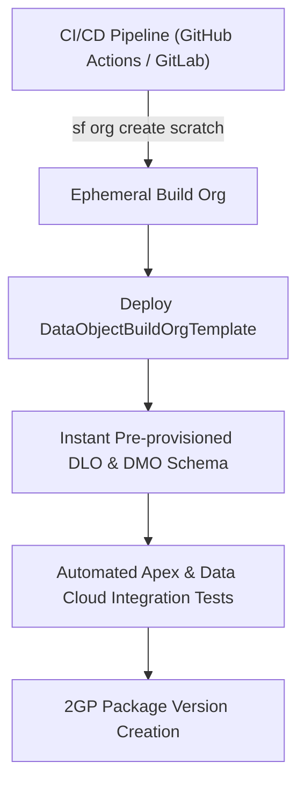

## Architectural Overview

The `DataObjectBuildOrgTemplate` metadata type accelerates environment automation and continuous integration (CI) workflows for **Salesforce Data Cloud**. In enterprise development pipelines, spinning up ephemeral scratch orgs or automated packaging build orgs requires initializing foundational Data Cloud structures—including Data Lake Objects (DLOs), Data Model Objects (DMOs), and initial schema mappings.

Rather than running lengthy manual setup wizards or brittle post-deployment UI automation, `DataObjectBuildOrgTemplate` provides a declarative definition of the target Data Cloud org shape. The packaging and deployment engines consume this template to provision standardized data schemas, ensuring integration test suites execute against reliable, repeatable data architectures.



## Directory and File Suffix Conventions

In SFDX source format, `DataObjectBuildOrgTemplate` files reside in the `dataObjectBuildOrgTemplates` directory:

| Property | Value |
| :--- | :--- |
| **Metadata Type Name** | `DataObjectBuildOrgTemplate` |
| **SFDX Source Directory** | `force-app/main/default/dataObjectBuildOrgTemplates/` |
| **SFDX File Suffix** | `.dataObjectBuildOrgTemplate-meta.xml` |
| **Manifest Member Name** | `<name>DataObjectBuildOrgTemplate</name>` |

## Key Metadata Fields

| Field Name | Type | Required | Architectural Guidance |
| :--- | :--- | :--- | :--- |
| `masterLabel` | `string` | Yes | Descriptive label for the build template. |
| `developerName` | `string` | Yes | Unique programmatic identifier referenced in CI scripts. |
| `description` | `string` | No | Architectural purpose and target release notes. |
| `templateVersion` | `string` | No | Version number indicating template schema alignment. |
| `status` | `string` | No | Lifecycle flag (`Active` or `Draft`). |

## Declarative XML and Manifest Examples

### Source Format XML (`CI_Build_DataCloud_Template.dataObjectBuildOrgTemplate-meta.xml`)

```xml title="force-app/main/default/dataObjectBuildOrgTemplates/CI_Build_DataCloud_Template.dataObjectBuildOrgTemplate-meta.xml"
<?xml version="1.0" encoding="UTF-8"?>
<DataObjectBuildOrgTemplate xmlns="http://soap.sforce.com/2006/04/metadata">
    <developerName>CI_Build_DataCloud_Template</developerName>
    <masterLabel>CI Build Data Cloud Template</masterLabel>
    <description>Scaffolds standardized customer and sales DMO schemas for automated packaging builds.</description>
    <templateVersion>1.0</templateVersion>
    <status>Active</status>
</DataObjectBuildOrgTemplate>
```

### Manifest (`package.xml`)

```xml title="manifest/package.xml"
<?xml version="1.0" encoding="UTF-8"?>
<Package xmlns="http://soap.sforce.com/2006/04/metadata">
    <types>
        <members>CI_Build_DataCloud_Template</members>
        <name>DataObjectBuildOrgTemplate</name>
    </types>
    <version>68.0</version>
</Package>
```

## Retrieval and Deployment Commands

Use the Salesforce CLI to retrieve and deploy `DataObjectBuildOrgTemplate` metadata:

```bash
# Retrieve all build org templates from an environment
sf project retrieve start --metadata DataObjectBuildOrgTemplate

# Retrieve a specific build template
sf project retrieve start --metadata DataObjectBuildOrgTemplate:CI_Build_DataCloud_Template

# Deploy build template metadata to an ephemeral build org
sf project deploy start --metadata DataObjectBuildOrgTemplate:CI_Build_DataCloud_Template
```

## Senior Architect Best Practices and Gotchas

- **CI Pipeline Optimization:** Deploy `DataObjectBuildOrgTemplate` at the beginning of ephemeral build org provisioning scripts immediately after scratch org creation to establish data foundations before test execution.
- **Maintain Parity with Production:** Ensure build org templates stay strictly aligned with production Data Cloud schema definitions. Use automated scheduled retrievals to catch drift between production DMOs and template definitions.
- **Combine with Data Kits:** Pair build org templates with `DataPackageKitDefinition` artifacts to validate both internal schema building and external package distribution workflows in the same CI cycle.

> [!NOTE]
> Ephemeral scratch orgs must enable Data Cloud features in their `project-scratch-def.json` configuration file before deploying `DataObjectBuildOrgTemplate` components.
