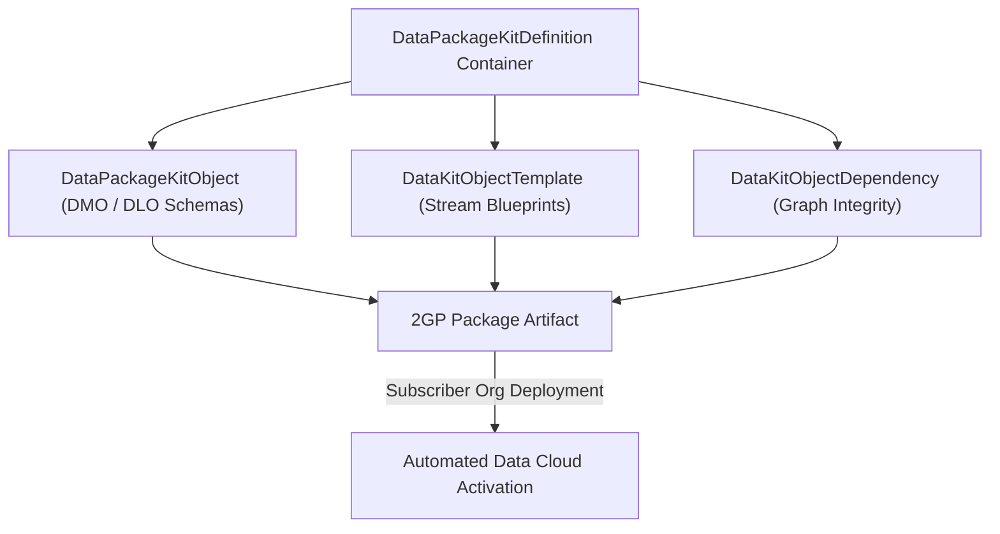

## Architectural Overview

The `DataPackageKitDefinition` metadata type represents the root definition for **Data Kits** within **Salesforce Data Cloud**. Data Kits are the primary modular distribution mechanism for Data Cloud solutions, allowing Independent Software Vendors (ISVs) and enterprise architects to encapsulate complete analytical applications into Second-Generation Managed Packages (2GP) or unlocked packages.

A `DataPackageKitDefinition` functions as the master manifest container. It links together constituent Data Streams, custom Data Model Objects (DMOs), Data Lake Objects (DLOs), relationship schemas, field mappings, and Calculated Insights. When installed in a subscriber organization, the Data Kit facilitates rapid, guided activation via Data Cloud Setup without requiring error-prone manual schema recreation.



## Directory and File Suffix Conventions

In SFDX source format, `DataPackageKitDefinition` files are located in the `dataPackageKitDefinitions` directory:

| Property | Value |
| :--- | :--- |
| **Metadata Type Name** | `DataPackageKitDefinition` |
| **SFDX Source Directory** | `force-app/main/default/dataPackageKitDefinitions/` |
| **SFDX File Suffix** | `.dataPackageKitDefinition-meta.xml` |
| **Manifest Member Name** | `<name>DataPackageKitDefinition</name>` |

## Key Metadata Fields

| Field Name | Type | Required | Architectural Guidance |
| :--- | :--- | :--- | :--- |
| `masterLabel` | `string` | Yes | Display title of the Data Kit shown in the Data Cloud packaging wizard. |
| `developerName` | `string` | Yes | Unique API name identifying the Data Kit definition across environments. |
| `description` | `string` | No | Architectural description summarizing bundled streams, DMOs, and purpose. |
| `packageCategory` | `string` | No | Functional grouping classification (e.g., `Sales`, `Service`, `Marketing`, `Industry`). |
| `version` | `string` | No | Semantic version string tracking package kit releases. |
| `isPublished` | `boolean` | No | Flag indicating whether the Data Kit is finalized for package creation. |

## Declarative XML and Manifest Examples

### Source Format XML (`FinancialServices_Analytics_Kit.dataPackageKitDefinition-meta.xml`)

```xml title="force-app/main/default/dataPackageKitDefinitions/FinancialServices_Analytics_Kit.dataPackageKitDefinition-meta.xml"
<?xml version="1.0" encoding="UTF-8"?>
<DataPackageKitDefinition xmlns="http://soap.sforce.com/2006/04/metadata">
    <developerName>FinancialServices_Analytics_Kit</developerName>
    <masterLabel>Financial Services Analytics Data Kit</masterLabel>
    <description>Bundles wealth management DMOs, transaction streams, and risk score Calculated Insights.</description>
    <packageCategory>Industry</packageCategory>
    <version>1.2</version>
    <isPublished>true</isPublished>
</DataPackageKitDefinition>
```

### Manifest (`package.xml`)

```xml title="manifest/package.xml"
<?xml version="1.0" encoding="UTF-8"?>
<Package xmlns="http://soap.sforce.com/2006/04/metadata">
    <types>
        <members>FinancialServices_Analytics_Kit</members>
        <name>DataPackageKitDefinition</name>
    </types>
    <version>68.0</version>
</Package>
```

## Retrieval and Deployment Commands

Use the Salesforce CLI to retrieve and deploy `DataPackageKitDefinition` metadata:

```bash
# Retrieve all Data Kit definitions from the org
sf project retrieve start --metadata DataPackageKitDefinition

# Retrieve a specific Data Kit by developer name
sf project retrieve start --metadata DataPackageKitDefinition:FinancialServices_Analytics_Kit

# Deploy Data Kit definition metadata to target environment
sf project deploy start --metadata DataPackageKitDefinition:FinancialServices_Analytics_Kit
```

## Senior Architect Best Practices and Gotchas

- **Encapsulate Related Assets:** Treat the `DataPackageKitDefinition` as the single source of truth for your Data Cloud packaging boundaries. Bundle child `DataPackageKitObject` and `DataKitObjectDependency` components in the same deployment commit.
- **ISV Namespacing:** When building AppExchange packages, ensure all constituent objects inside the kit conform to your managed package namespace. Namespaced kits install cleanly into subscriber orgs without conflicting with existing custom DMOs.
- **Subscriber Activation Handshake:** Installing a package containing a Data Kit deploys the schema blueprint, but an administrator in the subscriber org must click "Activate" in Data Cloud to connect local data connectors and begin streaming data.

> [!NOTE]
> Target orgs must have an active Salesforce Data Cloud license and Data Cloud Admin permissions to install and activate Data Kits.
