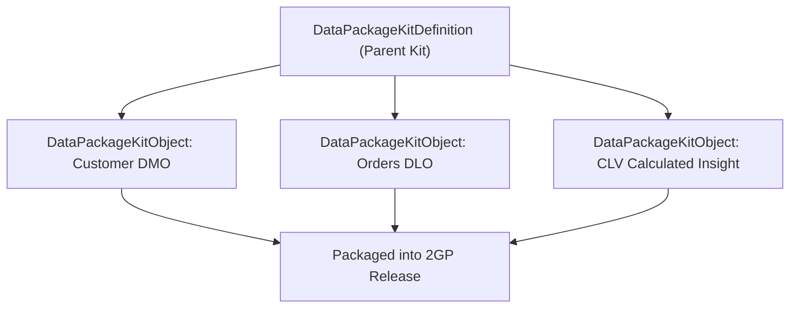

## Architectural Overview

The `DataPackageKitObject` metadata type represents an individual constituent artifact bundled within a parent **Salesforce Data Cloud Data Kit** (`DataPackageKitDefinition`). In Data Cloud packaging architectures, solutions are structured hierarchically: the `DataPackageKitDefinition` serves as the top-level manifest, while multiple `DataPackageKitObject` records declare specific schema assets participating in the kit.

Participating assets include Data Model Objects (DMOs), custom fields added to standard entities, Data Lake Objects (DLOs), data stream mappings, and Calculated Insights. By formalizing component inclusion through `DataPackageKitObject`, the metadata deployment and packaging runtime tracks asset versions and verifies that dependent objects are consistently packaged into 2GP managed and unlocked packages.



## Directory and File Suffix Conventions

In SFDX source format, `DataPackageKitObject` files reside in the `dataPackageKitObjects` directory:

| Property | Value |
| :--- | :--- |
| **Metadata Type Name** | `DataPackageKitObject` |
| **SFDX Source Directory** | `force-app/main/default/dataPackageKitObjects/` |
| **SFDX File Suffix** | `.dataPackageKitObject-meta.xml` |
| **Manifest Member Name** | `<name>DataPackageKitObject</name>` |

## Key Metadata Fields

| Field Name | Type | Required | Architectural Guidance |
| :--- | :--- | :--- | :--- |
| `masterLabel` | `string` | Yes | Human-readable title of the packaged object in Data Cloud Setup. |
| `developerName` | `string` | Yes | Unique programmatic identifier identifying the kit object member. |
| `dataPackageKitDefinition` | `string` | Yes | Reference to the parent `DataPackageKitDefinition` developer name. |
| `objectType` | `string` | Yes | Component type classification (`DataModelObject`, `DataLakeObject`, `CalculatedInsight`, etc.). |
| `targetObjectName` | `string` | Yes | API name of the physical or logical entity being bound to the kit. |
| `objectVersion` | `string` | No | Schema revision identifier for tracking component evolutions. |

## Declarative XML and Manifest Examples

### Source Format XML (`FinServ_Customer_DMO_KitObject.dataPackageKitObject-meta.xml`)

```xml title="force-app/main/default/dataPackageKitObjects/FinServ_Customer_DMO_KitObject.dataPackageKitObject-meta.xml"
<?xml version="1.0" encoding="UTF-8"?>
<DataPackageKitObject xmlns="http://soap.sforce.com/2006/04/metadata">
    <developerName>FinServ_Customer_DMO_KitObject</developerName>
    <masterLabel>Financial Services Customer DMO Kit Member</masterLabel>
    <dataPackageKitDefinition>FinancialServices_Analytics_Kit</dataPackageKitDefinition>
    <objectType>DataModelObject</objectType>
    <targetObjectName>Financial_Customer_DMO</targetObjectName>
    <objectVersion>1.0</objectVersion>
</DataPackageKitObject>
```

### Manifest (`package.xml`)

```xml title="manifest/package.xml"
<?xml version="1.0" encoding="UTF-8"?>
<Package xmlns="http://soap.sforce.com/2006/04/metadata">
    <types>
        <members>FinServ_Customer_DMO_KitObject</members>
        <name>DataPackageKitObject</name>
    </types>
    <version>68.0</version>
</Package>
```

## Retrieval and Deployment Commands

Use the Salesforce CLI to retrieve and deploy `DataPackageKitObject` metadata:

```bash
# Retrieve all Data Kit object members
sf project retrieve start --metadata DataPackageKitObject

# Retrieve a specific kit object member
sf project retrieve start --metadata DataPackageKitObject:FinServ_Customer_DMO_KitObject

# Deploy kit object member metadata to target environment
sf project deploy start --metadata DataPackageKitObject:FinServ_Customer_DMO_KitObject
```

## Senior Architect Best Practices and Gotchas

- **Parent Container Synchronization:** Never deploy a `DataPackageKitObject` without its associated `DataPackageKitDefinition`. Missing parent containers result in fatal metadata deployment errors.
- **Granular Modularity:** When building enterprise kits, break down packages by domain (e.g., separating Billing models from Marketing models) and declare corresponding kit objects deliberately to prevent monolithic package bloat.
- **Schema Reference Integrity:** Ensure that the `targetObjectName` exists in the packaging org before building second-generation package versions.

> [!NOTE]
> Modifying `DataPackageKitObject` metadata requires updating the version in the parent `DataPackageKitDefinition` before releasing a new package iteration.
