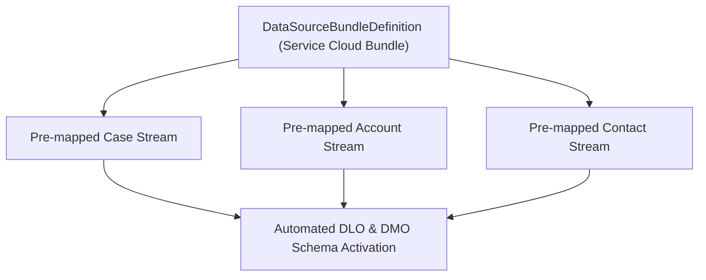

## Architectural Overview

The `DataSourceBundleDefinition` metadata type represents a curated bundle of data stream blueprints and schema mappings within **Salesforce Data Cloud**. Configuring ingestion pipelines individually for complex enterprise domains (such as Service Cloud, B2C Commerce, or Financial Services Cloud) requires defining dozens of interrelated tables, primary keys, and data model mappings.

`DataSourceBundleDefinition` encapsulates these interdependent stream templates into a turnkey, single-click activation bundle. When an administrator or automated CI/CD pipeline deploys and selects a bundle, Data Cloud automatically generates the necessary Data Lake Objects (DLOs), applies standard field mapping transformations, and schedules batch or real-time sync jobs without requiring manual field-by-field configuration.



## Directory and File Suffix Conventions

In SFDX source format, `DataSourceBundleDefinition` metadata files reside in the `dataSourceBundleDefinitions` directory:

| Property | Value |
| :--- | :--- |
| **Metadata Type Name** | `DataSourceBundleDefinition` |
| **SFDX Source Directory** | `force-app/main/default/dataSourceBundleDefinitions/` |
| **SFDX File Suffix** | `.dataSourceBundleDefinition-meta.xml` |
| **Manifest Member Name** | `<name>DataSourceBundleDefinition</name>` |

## Key Metadata Fields

| Field Name | Type | Required | Architectural Guidance |
| :--- | :--- | :--- | :--- |
| `masterLabel` | `string` | Yes | Human-readable title of the data source bundle displayed in Data Cloud wizards. |
| `developerName` | `string` | Yes | Programmatic identifier utilized in CI/CD automation and metadata manifests. |
| `bundleType` | `string` | No | Functional domain classification (e.g., `Sales`, `Service`, `B2CCommerce`, `Marketing`). |
| `dataSource` | `string` | No | Associated `DataSource` entity context providing origin lineage. |
| `isStandard` | `boolean` | No | Indicates whether the bundle represents an out-of-the-box Salesforce bundle or custom package. |
| `version` | `string` | No | Version number indicating bundle schema alignment. |

## Declarative XML and Manifest Examples

### Source Format XML (`Service_Operations_Bundle.dataSourceBundleDefinition-meta.xml`)

```xml title="force-app/main/default/dataSourceBundleDefinitions/Service_Operations_Bundle.dataSourceBundleDefinition-meta.xml"
<?xml version="1.0" encoding="UTF-8"?>
<DataSourceBundleDefinition xmlns="http://soap.sforce.com/2006/04/metadata">
    <developerName>Service_Operations_Bundle</developerName>
    <masterLabel>Service Operations Data Bundle</masterLabel>
    <bundleType>Service</bundleType>
    <isStandard>false</isStandard>
    <version>2.0</version>
</DataSourceBundleDefinition>
```

### Manifest (`package.xml`)

```xml title="manifest/package.xml"
<?xml version="1.0" encoding="UTF-8"?>
<Package xmlns="http://soap.sforce.com/2006/04/metadata">
    <types>
        <members>Service_Operations_Bundle</members>
        <name>DataSourceBundleDefinition</name>
    </types>
    <version>68.0</version>
</Package>
```

## Retrieval and Deployment Commands

Use the Salesforce CLI to retrieve and deploy `DataSourceBundleDefinition` metadata:

```bash
# Retrieve all Data Source Bundle definitions
sf project retrieve start --metadata DataSourceBundleDefinition

# Retrieve a specific bundle definition by developer name
sf project retrieve start --metadata DataSourceBundleDefinition:Service_Operations_Bundle

# Deploy bundle definition metadata to the target environment
sf project deploy start --metadata DataSourceBundleDefinition:Service_Operations_Bundle
```

## Senior Architect Best Practices and Gotchas

- **Streamline Onboarding:** Use custom bundle definitions when implementing horizontal template rollouts across multi-org architectures (e.g., regional operating companies) to guarantee uniform field mappings.
- **Custom Field Inclusion:** Verify that all referenced custom fields on standard CRM objects exist in the subscriber org prior to deploying bundles; missing source fields prevent successful stream initialization.
- **Data Kit Composition:** Integrate `DataSourceBundleDefinition` into your `DataPackageKitDefinition` packages to provide end users with pre-packaged data bundles during kit installation.

> [!NOTE]
> Standard Salesforce Data Cloud bundles (like Sales Cloud or Service Cloud bundles) are system-managed, while custom bundles can be created for bespoke ISV architectures.
