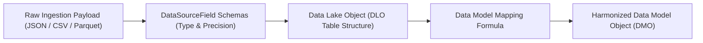

## Architectural Overview

The `DataSourceField` metadata type represents the granular schema definition for an individual attribute belonging to an external data source or Data Lake Object (DLO) within **Salesforce Data Cloud**. Just as standard CRM objects rely on [CustomField](/docs/metadata/custom-field-metadata-type/) definitions, Data Cloud requires explicit field-level metadata contracts to parse, ingest, and store high-scale data lake records.

`DataSourceField` specifies critical database characteristics including technical data types (`Text`, `Number`, `Date`, `DateTime`), length, decimal precision, scale, nullability, and primary key designations. These definitions establish the staging schema that downstream data model mapping engines consume when translating raw lake data into harmonized Data Model Objects (DMOs) and standard Customer 360 models.



## Directory and File Suffix Conventions

In SFDX source format, `DataSourceField` metadata definitions reside in the `dataSourceFields` directory:

| Property | Value |
| :--- | :--- |
| **Metadata Type Name** | `DataSourceField` |
| **SFDX Source Directory** | `force-app/main/default/dataSourceFields/` |
| **SFDX File Suffix** | `.dataSourceField-meta.xml` |
| **Manifest Member Name** | `<name>DataSourceField</name>` |

## Key Metadata Fields

| Field Name | Type | Required | Architectural Guidance |
| :--- | :--- | :--- | :--- |
| `masterLabel` | `string` | Yes | Human-readable label displayed in Data Cloud mapping interfaces. |
| `developerName` | `string` | Yes | Programmatic identifier used in formula expressions and metadata manifests. |
| `dataType` | `string` | Yes | Schema data type classification (`Text`, `Number`, `Date`, `DateTime`). |
| `length` | `int` | No | Maximum character length allocated for text attributes. |
| `precision` | `int` | No | Total number of significant digits stored for numeric attributes. |
| `scale` | `int` | No | Number of digits preserved to the right of the decimal point for numbers. |
| `isPrimaryKey` | `boolean` | No | Flags the field as a primary record identifier for deduplication and upserts. |
| `isNullable` | `boolean` | No | Indicates whether incoming payloads may omit or pass null values for this field. |

## Declarative XML and Manifest Examples

### Source Format XML (`Invoice_Transaction_Id.dataSourceField-meta.xml`)

```xml title="force-app/main/default/dataSourceFields/Invoice_Transaction_Id.dataSourceField-meta.xml"
<?xml version="1.0" encoding="UTF-8"?>
<DataSourceField xmlns="http://soap.sforce.com/2006/04/metadata">
    <developerName>Invoice_Transaction_Id</developerName>
    <masterLabel>Invoice Transaction Identifier</masterLabel>
    <dataType>Text</dataType>
    <length>64</length>
    <isPrimaryKey>true</isPrimaryKey>
    <isNullable>false</isNullable>
</DataSourceField>
```

### Manifest (`package.xml`)

```xml title="manifest/package.xml"
<?xml version="1.0" encoding="UTF-8"?>
<Package xmlns="http://soap.sforce.com/2006/04/metadata">
    <types>
        <members>Invoice_Transaction_Id</members>
        <name>DataSourceField</name>
    </types>
    <version>68.0</version>
</Package>
```

## Retrieval and Deployment Commands

Use the Salesforce CLI to retrieve and deploy `DataSourceField` metadata:

```bash
# Retrieve all DataSourceField definitions from an org
sf project retrieve start --metadata DataSourceField

# Retrieve a specific field definition by developer name
sf project retrieve start --metadata DataSourceField:Invoice_Transaction_Id

# Deploy field metadata to target environment
sf project deploy start --metadata DataSourceField:Invoice_Transaction_Id
```

## Senior Architect Best Practices and Gotchas

- **Primary Key Immutability:** Choosing which field is designated with `isPrimaryKey` is one of the most critical decisions in Data Cloud architecture. Changing primary key flags after streams begin ingesting requires recreating the DLO.
- **Precision Matching:** Ensure that numeric and currency fields specify sufficient precision and scale to match upstream data warehouse formats, avoiding truncation or rounding discrepancies.
- **Date Format Serialization:** For Date and DateTime fields, confirm that external systems export values conforming to ISO 8601 timestamps (e.g., `YYYY-MM-DDTHH:mm:ss.SSSZ`) to guarantee parsing success during ingestion.

> [!NOTE]
> Modifying deployed `DataSourceField` types is restricted once active Data Streams and DMO mappings reference the attribute.
