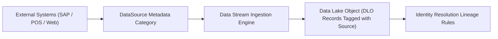

## Architectural Overview

The `DataSource` metadata type defines the originating system categorization and data lineage identity within **Salesforce Data Cloud**. In enterprise multi-cloud architectures, customer data flows into Data Cloud from a multitude of disparate systems: enterprise ERP (SAP, NetSuite), external commerce platforms, marketing platforms, and core Salesforce CRM instances.

`DataSource` provides the foundational metadata tag that stamps every ingested record in Data Lake Objects (DLOs) with its origin source system and tenant context. This categorization is indispensable for enterprise data governance, auditing, reconciliation, and building targeted identity resolution rulesets that prioritize higher-fidelity source systems during unified profile creation.



## Directory and File Suffix Conventions

In SFDX source format, `DataSource` metadata definitions reside in the `dataSources` folder:

| Property | Value |
| :--- | :--- |
| **Metadata Type Name** | `DataSource` |
| **SFDX Source Directory** | `force-app/main/default/dataSources/` |
| **SFDX File Suffix** | `.dataSource-meta.xml` |
| **Manifest Member Name** | `<name>DataSource</name>` |

## Key Metadata Fields

| Field Name | Type | Required | Architectural Guidance |
| :--- | :--- | :--- | :--- |
| `masterLabel` | `string` | Yes | Human-readable name displayed in Data Cloud Setup and Data Stream wizards. |
| `developerName` | `string` | Yes | Programmatic identifier utilized across metadata references and SOQL queries. |
| `dataSourceType` | `string` | No | System category classification (e.g., `SalesforceCRM`, `MarketingCloud`, `External`, `S3`). |
| `description` | `string` | No | Governance documentation detailing data stewardship, retention, and upstream system owners. |
| `status` | `string` | No | Operational state of the data source (`Active` or `Inactive`). |

## Declarative XML and Manifest Examples

### Source Format XML (`SAP_Billing_DataSource.dataSource-meta.xml`)

```xml title="force-app/main/default/dataSources/SAP_Billing_DataSource.dataSource-meta.xml"
<?xml version="1.0" encoding="UTF-8"?>
<DataSource xmlns="http://soap.sforce.com/2006/04/metadata">
    <developerName>SAP_Billing_DataSource</developerName>
    <masterLabel>SAP Enterprise Billing System</masterLabel>
    <dataSourceType>External</dataSourceType>
    <description>Lineage source for invoices, orders, and payment records synced from SAP ERP.</description>
    <status>Active</status>
</DataSource>
```

### Manifest (`package.xml`)

```xml title="manifest/package.xml"
<?xml version="1.0" encoding="UTF-8"?>
<Package xmlns="http://soap.sforce.com/2006/04/metadata">
    <types>
        <members>SAP_Billing_DataSource</members>
        <name>DataSource</name>
    </types>
    <version>68.0</version>
</Package>
```

## Retrieval and Deployment Commands

Use the Salesforce CLI to retrieve and deploy `DataSource` metadata:

```bash
# Retrieve all DataSource definitions from an org
sf project retrieve start --metadata DataSource

# Retrieve a specific DataSource by developer name
sf project retrieve start --metadata DataSource:SAP_Billing_DataSource

# Deploy DataSource metadata to target environment
sf project deploy start --metadata DataSource:SAP_Billing_DataSource
```

## Senior Architect Best Practices and Gotchas

- **Immutable Lineage Anchor:** Once Data Streams ingest records associated with a `DataSource`, modifying or deleting the `DataSource` developer name can break downstream data lineage and reconciliation queries. Plan naming conventions carefully.
- **Identity Resolution Weighting:** Leverage distinct `DataSource` records to distinguish authoritative customer master records (e.g., CRM or Master Data Management) from secondary marketing activity sources when configuring Identity Resolution reconciliation rules.
- **Bundle Packaging:** When packaging Data Streams and Data Kits, ensure that required `DataSource` records are included in your deployment manifests so stream definitions resolve without missing entity errors.

> [!NOTE]
> Standard data sources (such as Salesforce CRM and Marketing Cloud) are auto-provisioned when establishing connectors; custom sources represent external platforms.
