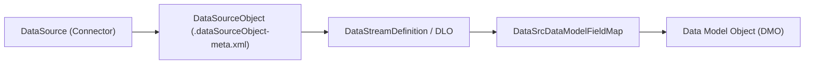

## Architectural Overview

In Salesforce Data Cloud, `DataSourceObject` represents the structural schema definition of an external table, object, or file feed originating from a `DataSource` (such as Amazon S3, Snowflake, Google BigQuery, or a Salesforce CRM org). While `CustomObject` with an `__dlm` or `__dll` suffix represents the materialized Data Model Object (DMO) or Data Lake Object (DLO), `DataSourceObject` captures the raw upstream schema contract before transformation.

Architecturally, separating `DataSourceObject` from target DMOs decouples ingestion connectors from canonical enterprise data models. When packaging Data Cloud integrations into a Data Kit, `DataSourceObject` ensures that downstream field mappings (`DataSrcDataModelFieldMap`) and stream templates (`DataStreamTemplate`) have a deterministic source schema to bind against.



## SFDX Directory and File Suffix

| Property | Value |
| :--- | :--- |
| **Metadata Type Name** | `DataSourceObject` |
| **SFDX Directory Path** | `force-app/main/default/dataSourceObjects/` |
| **File Suffix** | `.dataSourceObject-meta.xml` |
| **Extends** | `Metadata` |
| **API Version** | `68.0` (Winter '27) |

## Key Metadata Fields

| Field | Type | Required | Description & Architectural Notes |
| :--- | :--- | :--- | :--- |
| `masterLabel` | `string` | ✅ Yes | The human-readable label for the data source object shown in Data Cloud Setup and Data Kit manifests. |
| `dataSource` | `string` | ✅ Yes | The developer name of the parent `DataSource` metadata component that owns this external object schema. |
| `externalRecordIdentifier` | `string` | No | The upstream table name, topic, or object identifier in the external source system (for example, `ERP_ORDER_HEADERS`). |
| `objectType` | `DataSourceObjectType` | No | Classifies the ingestion payload behavior, such as `Object`, `Engagement`, `Profile`, or `Other`. |
| `storageType` | `string` | No | Defines whether the object is ingested into local lake storage or federated via zero-copy virtualization. |
| `templateVersion` | `int` | No | Version number tracking schema revisions when distributed via a managed Data Kit (`DataStreamTemplate`). |

> [!NOTE]
> Field-level definitions associated with a `DataSourceObject` are frequently synchronized alongside the companion Data Lake Object (`__dll`) or embedded within the Data Kit bundle manifest during retrieval.

## Declarative XML and Package.xml Examples

### `DataSourceObject` Metadata File

```xml title="force-app/main/default/dataSourceObjects/ERP_Order_Header_DSO.dataSourceObject-meta.xml"
<?xml version="1.0" encoding="UTF-8"?>
<DataSourceObject xmlns="http://soap.sforce.com/2006/04/metadata">
    <dataSource>Snowflake_Enterprise_ERP</dataSource>
    <externalRecordIdentifier>PUBLIC.ERP_ORDER_HEADERS</externalRecordIdentifier>
    <masterLabel>ERP Order Header Source Object</masterLabel>
    <objectType>Engagement</objectType>
    <storageType>LOCAL</storageType>
    <templateVersion>1</templateVersion>
</DataSourceObject>
```

### `package.xml` Manifest

```xml title="manifest/package.xml"
<?xml version="1.0" encoding="UTF-8"?>
<Package xmlns="http://soap.sforce.com/2006/04/metadata">
    <types>
        <members>ERP_Order_Header_DSO</members>
        <name>DataSourceObject</name>
    </types>
    <version>68.0</version>
</Package>
```

## SFDX CLI Retrieval and Deployment Commands

Because `DataSourceObject` is a declarative Data Cloud metadata component, use the Salesforce CLI (`sf`) to retrieve and deploy definitions between sandboxes and production orgs:

```bash
# Retrieve a specific DataSourceObject from your Data Cloud org
sf project retrieve start --metadata "DataSourceObject:ERP_Order_Header_DSO" --target-org data-cloud-prod

# Retrieve all DataSourceObject definitions alongside their parent DataSource
sf project retrieve start --metadata "DataSource,DataSourceObject" --target-org data-cloud-prod

# Validate deployment in a target environment
sf project deploy start --metadata "DataSourceObject:ERP_Order_Header_DSO" --dry-run --target-org data-cloud-uat
```

## Senior Architect Best Practices and Gotchas

> [!WARNING]
> **Schema Immutability on Active Streams:** Once a `DataSourceObject` is bound to an active `DataStreamDefinition`, Salesforce Data Cloud restricts destructive schema edits (such as changing a field's primitive data type or changing the primary key). Always additive-version your source schemas rather than mutating existing columns in place.

> [!TIP]
> **Deploy via Data Kits in Multi-Org Topologies:** Direct deployment of raw `DataSourceObject` XML without its companion `DataSource` and `DataStreamTemplate` often fails dependency validation in target orgs. Package related Data Cloud ingestion metadata into a Data Kit (`DataPackageKitDefinition`) and increment `templateVersion` on each release.

- **Naming Conventions:** Prefix `DataSourceObject` developer names with the source system identifier (for example, `SAP_`, `SFMC_`, or `Snowflake_`) to prevent namespace collisions when multiple connectors expose identically named tables like `Orders` or `Customers`.
- **Zero-Copy vs. Local Storage:** Verify that `storageType` aligns with your connector capability—switching an existing `DataSourceObject` from `LOCAL` ingestion to federated zero-copy requires recreating the downstream Data Lake Object.
