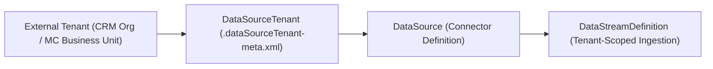

## Architectural Overview

In enterprise Salesforce Data Cloud architectures, a single logical connector (`DataSource`) often ingests data from specific tenant instances—such as multiple Salesforce CRM orgs in a hub-and-spoke topology, distinct Marketing Cloud Engagement Business Units (MIDs), or B2C Commerce realms. The `DataSourceTenant` metadata type captures the binding between a logical `DataSource` and a physical external tenant identifier.

For Technical Architects, `DataSourceTenant` is critical for multi-org governance and lineage tracking. When records flow from three regional Salesforce CRM orgs into a unified `Individual` Data Model Object, the tenant configuration underpins the `DataSourceObject` lineage and ensures records are tagged with the correct source tenant qualifier.



## SFDX Directory and File Suffix

| Property | Value |
| :--- | :--- |
| **Metadata Type Name** | `DataSourceTenant` |
| **SFDX Directory Path** | `force-app/main/default/dataSourceTenants/` |
| **File Suffix** | `.dataSourceTenant-meta.xml` |
| **Extends** | `Metadata` |
| **API Version** | `68.0` (Winter '27) |

## Key Metadata Fields

| Field | Type | Required | Description & Architectural Notes |
| :--- | :--- | :--- | :--- |
| `masterLabel` | `string` | ✅ Yes | Display name for the data source tenant in Data Cloud Setup (for example, `EMEA CRM Production Org`). |
| `dataSource` | `string` | No | Developer name of the parent `DataSource` component associated with this tenant. |
| `externalRecordIdentifier` | `string` | No | The unique external tenant key, such as an 18-character Salesforce Org ID, Marketing Cloud Account ID, or cloud tenant UUID. |
| `description` | `string` | No | Architectural documentation detailing which region, business unit, or environment this tenant represents. |

> [!TIP]
> Always populate the `description` field with the region and environment tier of the external tenant so administrators inspecting Data Cloud Setup can immediately distinguish sandbox tenants from production tenants.

## Declarative XML and Package.xml Examples

### `DataSourceTenant` Metadata File

```xml title="force-app/main/default/dataSourceTenants/EMEA_Sales_Cloud_Tenant.dataSourceTenant-meta.xml"
<?xml version="1.0" encoding="UTF-8"?>
<DataSourceTenant xmlns="http://soap.sforce.com/2006/04/metadata">
    <dataSource>Salesforce_CRM_EMEA</dataSource>
    <description>EMEA Regional Sales Cloud Production Org Tenant Binding</description>
    <externalRecordIdentifier>00D8d000008xyz1EAA</externalRecordIdentifier>
    <masterLabel>EMEA Sales Cloud Tenant</masterLabel>
</DataSourceTenant>
```

### `package.xml` Manifest

```xml title="manifest/package.xml"
<?xml version="1.0" encoding="UTF-8"?>
<Package xmlns="http://soap.sforce.com/2006/04/metadata">
    <types>
        <members>EMEA_Sales_Cloud_Tenant</members>
        <name>DataSourceTenant</name>
    </types>
    <version>68.0</version>
</Package>
```

## SFDX CLI Retrieval and Deployment Commands

Retrieve and deploy `DataSourceTenant` metadata using `sf project retrieve start` and `sf project deploy start`:

```bash
# Retrieve all DataSourceTenant configurations from the target org
sf project retrieve start --metadata "DataSourceTenant" --target-org data-cloud-prod

# Retrieve a specific tenant alongside its parent DataSource
sf project retrieve start --metadata "DataSource:Salesforce_CRM_EMEA,DataSourceTenant:EMEA_Sales_Cloud_Tenant" --target-org data-cloud-prod

# Deploy the tenant definition to UAT using sfdx-project.json string replacements
sf project deploy start --metadata "DataSourceTenant:EMEA_Sales_Cloud_Tenant" --target-org data-cloud-uat
```

## Senior Architect Best Practices and Gotchas

> [!WARNING]
> **Environment Cross-Talk Risk:** Deploying a production `externalRecordIdentifier` into a Data Cloud Sandbox without environment-specific replacement can cause connection validation failures or unintended ingestion mapping against a production org ID. Configure `replacements` in `sfdx-project.json` to swap `externalRecordIdentifier` values per environment.

- **Key Qualifier Alignment:** In multi-org Data Cloud implementations, combine `DataSourceTenant` with Key Qualifier fields (`KQ_`) on your Data Lake Objects so identical record IDs (unlikely in Salesforce, but common in ERP/SQL databases with auto-incrementing integer keys) never overwrite each other during Identity Resolution.
- **Connection Handshake Prerequisite:** Metadata API deployment of `DataSourceTenant` defines the tenant metadata record, but OAuth or mutual TLS authentication for the underlying connector must still be authorized in Data Cloud Setup or via Named Credentials before streams can execute.
