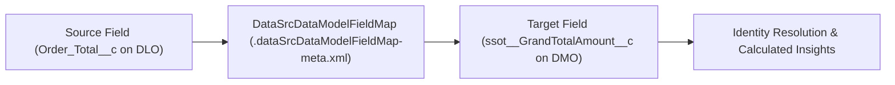

## Architectural Overview

Data harmonization is the core architectural value proposition of Salesforce Data Cloud: taking disparate schemas from CRM, ERP, web behavioral events, and mobile apps and mapping them into the canonical Customer 360 Data Model (such as `ssot__Individual__dlm`, `ssot__ContactPointEmail__dlm`, and `ssot__SalesOrder__dlm`). The `DataSrcDataModelFieldMap` metadata type represents an individual field-level mapping link between a source Data Lake Object (DLO) field and a target Data Model Object (DMO) field.

By tracking `DataSrcDataModelFieldMap` in Git, architects prevent manual "point-and-click drift" in the Data Cloud visual schema mapper. Every mapping between an ingested source field and a canonical DMO attribute becomes auditable, peer-reviewable, and repeatable via Data Kits or SFDX deployments.



## SFDX Directory and File Suffix

| Property | Value |
| :--- | :--- |
| **Metadata Type Name** | `DataSrcDataModelFieldMap` |
| **SFDX Directory Path** | `force-app/main/default/dataSrcDataModelFieldMaps/` |
| **File Suffix** | `.dataSrcDataModelFieldMap-meta.xml` |
| **Extends** | `Metadata` |
| **API Version** | `68.0` (Winter '27) |

## Key Metadata Fields

| Field | Type | Required | Description & Architectural Notes |
| :--- | :--- | :--- | :--- |
| `masterLabel` | `string` | ✅ Yes | Human-readable label for the field mapping record. |
| `sourceField` | `string` | ✅ Yes | Fully qualified source object and field API name on the DataSourceObject / DLO (for example, `ERP_Order_Header__dll.Order_Id__c`). |
| `targetField` | `string` | ✅ Yes | Fully qualified target object and field API name on the Data Model Object (for example, `ssot__SalesOrder__dlm.ssot__Id__c`). |
| `filterOperationType` | `string` | No | Optional filter operator applied when conditional entity mapping filters records into the target DMO. |
| `filterValue` | `string` | No | Optional literal comparison value used with `filterOperationType` for conditional DMO population. |
| `templateVersion` | `int` | No | Version number incremented when updating field mappings inside a packaged Data Kit. |
| `versionNumber` | `double` | No | Internal schema mapping version number managed by the platform. |

> [!NOTE]
> Both the source DLO field and the target DMO field must exist in the target org (or be included in the same deployment payload) before deploying `DataSrcDataModelFieldMap`.

## Declarative XML and Package.xml Examples

### `DataSrcDataModelFieldMap` Metadata File

```xml title="force-app/main/default/dataSrcDataModelFieldMaps/ERP_Order_To_SalesOrder_Total.dataSrcDataModelFieldMap-meta.xml"
<?xml version="1.0" encoding="UTF-8"?>
<DataSrcDataModelFieldMap xmlns="http://soap.sforce.com/2006/04/metadata">
    <masterLabel>ERP Order Total to SalesOrder Grand Total</masterLabel>
    <sourceField>ERP_Order_Header_DSO.Order_Total_Amount__c</sourceField>
    <targetField>ssot__SalesOrder__dlm.ssot__GrandTotalAmount__c</targetField>
    <templateVersion>1</templateVersion>
    <versionNumber>1.0</versionNumber>
</DataSrcDataModelFieldMap>
```

### `package.xml` Manifest

```xml title="manifest/package.xml"
<?xml version="1.0" encoding="UTF-8"?>
<Package xmlns="http://soap.sforce.com/2006/04/metadata">
    <types>
        <members>ERP_Order_To_SalesOrder_Total</members>
        <name>DataSrcDataModelFieldMap</name>
    </types>
    <version>68.0</version>
</Package>
```

## SFDX CLI Retrieval and Deployment Commands

Use `sf project retrieve start` and `sf project deploy start` to manage field mappings from the CLI:

```bash
# Retrieve all DLO-to-DMO field mappings from your Data Cloud org
sf project retrieve start --metadata "DataSrcDataModelFieldMap" --target-org data-cloud-dev

# Retrieve a specific mapping alongside custom DMO fields
sf project retrieve start --metadata "DataSrcDataModelFieldMap:ERP_Order_To_SalesOrder_Total,CustomObject:ssot__SalesOrder__dlm" --target-org data-cloud-dev

# Deploy updated field mappings to staging
sf project deploy start --metadata "DataSrcDataModelFieldMap" --target-org data-cloud-staging
```

## Senior Architect Best Practices and Gotchas

> [!WARNING]
> **Primary Key Mapping Requirement:** Every target Data Model Object mapped from a `DataSourceObject` requires a `DataSrcDataModelFieldMap` targeting the DMO's Primary Key field (such as `ssot__Id__c`). Deploying secondary attribute mappings without a primary key mapping will fail Data Cloud schema validation.

> [!TIP]
> **Normalize Types in Formula Fields First:** `DataSrcDataModelFieldMap` does not perform implicit type casting (for example, converting an ISO date string into a `DateTime` or a currency text into a `Number`). Create a row-level formula field on the DataStream / DLO first, and point `sourceField` to that typed formula field.

- **Downstream Dependency Locks:** You cannot delete or repoint a `DataSrcDataModelFieldMap` if the `targetField` is currently consumed by an active Identity Resolution Ruleset, Calculated Insight, Segmentation filter, or Data Action without first removing the downstream reference.
- **Party Identification Mappings:** When mapping to `ssot__Individual__dlm` or `ssot__ContactPointEmail__dlm`, always include mappings for Party Identification (`ssot__PartyIdentification__dlm`) if your enterprise architecture relies on deterministic cross-system customer keys.
