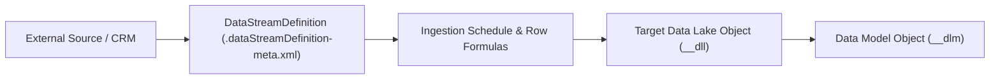

## Architectural Overview

In Salesforce Data Cloud, a Data Stream is the operational ingestion pipeline that pulls batch or streaming records from an external or internal source into a Data Lake Object (`__dll`). The `DataStreamDefinition` metadata type represents the declarative configuration of that ingestion pipeline—including the connector type, data source object reference, extraction parameters, and target lake storage binding.

For enterprise architects, `DataStreamDefinition` governs ingestion cadence, credit consumption, and data freshness SLAs. Whether ingesting real-time behavioral events via the Ingestion API or nightly batch files from Amazon S3, properly structuring `DataStreamDefinition` ensures predictable ingestion behavior across environments.



## SFDX Directory and File Suffix

| Property | Value |
| :--- | :--- |
| **Metadata Type Name** | `DataStreamDefinition` |
| **SFDX Directory Path** | `force-app/main/default/dataStreamDefinitions/` |
| **File Suffix** | `.dataStreamDefinition-meta.xml` |
| **Extends** | `Metadata` |
| **API Version** | `68.0` (Winter '27) |

## Key Metadata Fields

| Field | Type | Required | Description & Architectural Notes |
| :--- | :--- | :--- | :--- |
| `masterLabel` | `string` | ✅ Yes | The display name of the data stream in the Data Cloud UI. |
| `dataSource` | `string` | ✅ Yes | Developer name of the parent `DataSource` component providing connectivity. |
| `dataSourceObject` | `string` | No | Developer name of the `DataSourceObject` whose schema this stream ingests. |
| `dataConnectorType` | `string` | No | Identifies the connector mechanism (for example, `SalesforceDotCom`, `AmazonS3`, `StreamingApp`, or `Snowflake`). |
| `isMissingFileFailure` | `boolean` | No | For file-based connectors (S3/GCS/SFTP), specifies whether the stream run should fail if no matching file is found during a scheduled window. |
| `mktDataTranObject` | `string` | No | Reference to the associated Data Lake Object / Data Transport Object receiving the ingested payload. |
| `parameters` | `DataStreamDefinitionParameter[]` | No | Key-value configuration parameters for the connector (such as bucket directory path, file wildcard pattern, or delimiter). |

> [!TIP]
> For S3 or SFTP daily delta feeds where weekends may legitimately produce zero files, set `isMissingFileFailure` to `false` so your monitoring alerts aren't flooded with false-positive ingestion failures.

## Declarative XML and Package.xml Examples

### `DataStreamDefinition` Metadata File

```xml title="force-app/main/default/dataStreamDefinitions/ERP_Daily_Orders_Stream.dataStreamDefinition-meta.xml"
<?xml version="1.0" encoding="UTF-8"?>
<DataStreamDefinition xmlns="http://soap.sforce.com/2006/04/metadata">
    <dataConnectorType>AmazonS3</dataConnectorType>
    <dataSource>AWS_S3_Enterprise_Lake</dataSource>
    <dataSourceObject>ERP_Order_Header_DSO</dataSourceObject>
    <isMissingFileFailure>false</isMissingFileFailure>
    <masterLabel>ERP Daily Orders Stream</masterLabel>
    <mktDataTranObject>ERP_Order_Header__dll</mktDataTranObject>
</DataStreamDefinition>
```

### `package.xml` Manifest

```xml title="manifest/package.xml"
<?xml version="1.0" encoding="UTF-8"?>
<Package xmlns="http://soap.sforce.com/2006/04/metadata">
    <types>
        <members>ERP_Daily_Orders_Stream</members>
        <name>DataStreamDefinition</name>
    </types>
    <version>68.0</version>
</Package>
```

## Monitoring Data Streams via SOQL and SFDX CLI

While `DataStreamDefinition` is deployed via Metadata API, Data Cloud also exposes the runtime `DataStream` standard object in SOQL for operational health monitoring:

```soql
SELECT Id, Name, DataStreamStatus, ImportRunStatus,
       LastRefreshDate, LastNumberOfRowsAdded, TotalNumberOfRowsAdded
FROM DataStream
WHERE DataStreamStatus = 'ERROR' OR ImportRunStatus = 'FAILURE'
ORDER BY LastRefreshDate DESC
```

To retrieve or deploy the metadata definition using Salesforce CLI:

```bash
# Retrieve a DataStreamDefinition from your org
sf project retrieve start --metadata "DataStreamDefinition:ERP_Daily_Orders_Stream" --target-org data-cloud-prod
```

## Senior Architect Best Practices and Gotchas

> [!WARNING]
> **Engagement Event DateTime Immutable Requirement:** When configuring a `DataStreamDefinition` for an `Engagement` category object, the Event Time field is locked upon stream creation. Verify the timestamp column in your source payload before deploying, as changing the Event Time field later requires deleting and recreating the stream.

- **Prefer `DataStreamTemplate` for Packaging:** In ISV or multi-org enterprise pipelines, deploying raw `DataStreamDefinition` files directly can fail if tenant-specific connector credentials are not yet initialized. Bundle streams as `DataStreamTemplate` items inside a Data Kit (`DataPackageKitDefinition`) and instantiate them after authenticating the connector.
- **Credit Optimization on Refresh Mode:** Use `Upsert` with an indexed timestamp or CDC watermark rather than `Full Refresh` on high-volume profile tables to minimize Data Services credit consumption.
