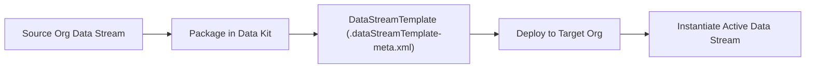

## Architectural Overview

Deploying Salesforce Data Cloud configurations across Dev, UAT, and Production orgs—or distributing them to customers via Second-Generation Managed Packages (2GP)—requires decoupling stream metadata from live connector sessions. The `DataStreamTemplate` metadata type solves this architectural challenge by encapsulating a data stream's schema, refresh mode, object category, and transformation formulas into a portable template inside a Data Kit.

When a `DataStreamTemplate` is deployed to a target org, administrators or automated post-install flows instantiate a live `DataStreamDefinition` from the template, binding it to the local org's authenticated connector while preserving all upstream-to-DLO field definitions and row-level formulas.



## SFDX Directory and File Suffix

| Property | Value |
| :--- | :--- |
| **Metadata Type Name** | `DataStreamTemplate` |
| **SFDX Directory Path** | `force-app/main/default/dataStreamTemplates/` |
| **File Suffix** | `.dataStreamTemplate-meta.xml` |
| **Extends** | `Metadata` |
| **API Version** | `68.0` (Winter '27) |

## Key Metadata Fields

| Field | Type | Required | Description & Architectural Notes |
| :--- | :--- | :--- | :--- |
| `masterLabel` | `string` | ✅ Yes | Display name of the data stream template in Data Cloud Setup and Data Kit wizards. |
| `dataSourceBundleDefinition` | `string` | No | Reference to the parent Data Kit bundle (`DataSourceBundleDefinition` or `DataPackageKitDefinition`) that groups this stream template. |
| `dataSourceObject` | `string` | No | Developer name of the `DataSourceObject` schema this template is built upon. |
| `objectCategory` | `string` | No | The Data Cloud semantic category for the stream: `Profile`, `Engagement`, or `Other`. |
| `refreshFrequency` | `string` | No | Default schedule interval when instantiated (such as `HOURLY`, `DAILY`, `WEEKLY`, or `NONE`). |
| `refreshMode` | `string` | No | Default ingestion write mode (`UPSERT` or `FULL_REFRESH`). |
| `sourceObjectName` | `string` | No | The API name of the object or table in the external source system (for example, `OrderSummary` or `LoyaltyTransaction`). |
| `templateVersion` | `int` | No | Monotonically increasing integer version used to track schema and formula upgrades across Data Kit releases. |

> [!NOTE]
> When packaging a CRM connector stream into a `DataStreamTemplate`, ensure any custom fields referenced in `sourceObjectName` are also deployed to the connected CRM org before instantiating the stream in the target Data Cloud environment.

## Declarative XML and Package.xml Examples

### `DataStreamTemplate` Metadata File

```xml title="force-app/main/default/dataStreamTemplates/Loyalty_Engagement_Stream_Tmpl.dataStreamTemplate-meta.xml"
<?xml version="1.0" encoding="UTF-8"?>
<DataStreamTemplate xmlns="http://soap.sforce.com/2006/04/metadata">
    <dataSourceObject>Loyalty_Ledger_DSO</dataSourceObject>
    <masterLabel>Loyalty Ledger Engagement Stream Template</masterLabel>
    <objectCategory>Engagement</objectCategory>
    <refreshFrequency>HOURLY</refreshFrequency>
    <refreshMode>UPSERT</refreshMode>
    <sourceObjectName>LoyaltyLedger__c</sourceObjectName>
    <templateVersion>1</templateVersion>
</DataStreamTemplate>
```

### `package.xml` Manifest

```xml title="manifest/package.xml"
<?xml version="1.0" encoding="UTF-8"?>
<Package xmlns="http://soap.sforce.com/2006/04/metadata">
    <types>
        <members>Loyalty_Engagement_Stream_Tmpl</members>
        <name>DataStreamTemplate</name>
    </types>
    <version>68.0</version>
</Package>
```

## SFDX CLI Retrieval and Deployment Commands

Retrieve and deploy `DataStreamTemplate` files alongside your Data Kit components:

```bash
# Retrieve all DataStreamTemplate components from a packaging org
sf project retrieve start --metadata "DataStreamTemplate" --target-org data-cloud-dev

# Deploy the template together with its DataSourceObject and Field Maps
sf project deploy start \
  --metadata "DataSourceObject:Loyalty_Ledger_DSO,DataStreamTemplate:Loyalty_Engagement_Stream_Tmpl" \
  --target-org data-cloud-uat
```

## Senior Architect Best Practices and Gotchas

> [!WARNING]
> **Deploying Templates Does Not Auto-Start Ingestion:** Deploying a `DataStreamTemplate` via `sf project deploy start` only registers the template metadata in the target org. You must still activate/deploy the Data Stream from the Data Kit UI or via the Data Cloud Connect REST API (`/services/data/v68.0/ssot/data-streams`) to begin ingesting data.

> [!TIP]
> **Always Increment `templateVersion`:** If you add a new formula field or source column to an existing stream, rebuild the Data Kit in your source org so `templateVersion` increments. Target orgs use this version number to detect available schema upgrades on already-instantiated streams.

- **Keep Object Categories Accurate:** Selecting `Other` instead of `Engagement` prevents the target DLO/DMO from participating in time-windowed segmentation filters (such as "Purchased in the last 30 days") and Calculated Insights engagement aggregations.
