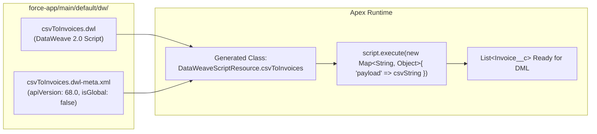

## Why `DataWeaveResource` Revolutionizes File & Payload Parsing in Apex

Available starting in **API version 58.0**, **`DataWeaveResource`** (`dw/<ScriptName>.dwl` and `dw/<ScriptName>.dwl-meta.xml`) brings MuleSoft's **DataWeave 2.0** transformation language natively into the Apex runtime.

Instead of writing fragile regexes to parse RFC-4180 CSV files with embedded newlines or walking `Dom.Document` XML trees that exhaust the 10,000-ms Apex CPU limit, you deploy a declarative `.dwl` script that transforms **CSV, JSON, or XML directly into `List<SObject>` or Apex DTOs**.



---

## SFDX Source Format & Metadata Fields

Each `DataWeaveResource` consists of two paired files inside `force-app/main/default/dw/`:
- `dw/<ScriptName>.dwl`: The DataWeave 2.0 script (`%dw 2.0`).
- `dw/<ScriptName>.dwl-meta.xml`: The metadata companion file.

| Field | Type | Required | Description |
|---|---|---|---|
| `apiVersion` | `double` | Yes | Salesforce API version (`58.0` or higher; use `68.0`). |
| `isGlobal` | `boolean` | No | Marks the generated `DataWeaveScriptResource.<ScriptName>` class as `global`. Defaults to `false`. |
| `isProtected` | `boolean` | No | Reserved field. |

---

## Real-World Example: Transforming CSV directly to `Contact` SObjects

### 1. DataWeave Script (`dw/csvToContacts.dwl`)

```dataweave
%dw 2.0
input records application/csv
output application/apex
---
records map(record) -> {
    FirstName: trim(record.first_name),
    LastName: trim(record.last_name),
    Email: lower(trim(record.email)),
    Department: record.dept default "General"
} as Object {class: "Contact"}
```

### 2. Metadata Sidecar (`dw/csvToContacts.dwl-meta.xml`)

```xml
<?xml version="1.0" encoding="UTF-8"?>
<DataWeaveResource xmlns="http://soap.sforce.com/2006/04/metadata">
    <apiVersion>68.0</apiVersion>
    <isGlobal>false</isGlobal>
</DataWeaveResource>
```

### 3. Invoking the `DataWeaveResource` in Apex

```java
DataWeave.Script script = new DataWeaveScriptResource.csvToContacts();
DataWeave.Result result = script.execute(new Map<String, Object>{
    'records' => csvFileBodyString
});
List<Contact> contactsToUpsert = (List<Contact>) result.getValue();
upsert contactsToUpsert;
```

---

## Senior Architect Best Practices & Limits

> [!TIP]
> **Compile-Time Safety with `new DataWeaveScriptResource.<ScriptName>()`:** Always prefer instantiating `new DataWeaveScriptResource.csvToContacts()` over `DataWeave.Script.createScript('csvToContacts')`. Using the generated `DataWeaveScriptResource` subclass creates a hard metadata dependency in Salesforce, preventing anyone from accidentally deleting the `.dwl` script while your Apex class depends on it!

- **Check FLS / CRUD After `output application/apex`:** Instantiating SObjects inside a `.dwl` script bypasses UI-level field checks just like `new Contact()` in Apex. Always run `insert as user contactsToUpsert` or `Security.stripInaccessible()` before committing records parsed from external files.
