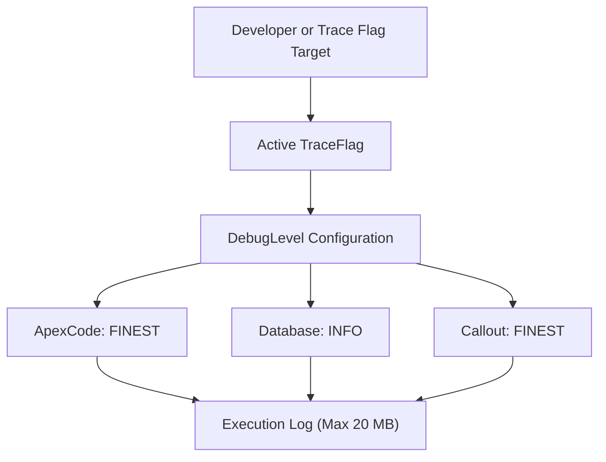

## Architectural Overview

The `DebugLevel` metadata type represents the diagnostic filter profile used by the platform logging engine. In enterprise architectures with complex orchestration—such as triggers, asynchronous queues, and external web service callouts—capturing the correct event payload without overflowing the 20 MB log limit requires purpose-built log levels.

A `DebugLevel` governs the granularity of event emissions across ten functional categories. When linked to an active `TraceFlag` targeting an automated process user, integration user, or individual developer, the platform evaluates the `DebugLevel` thresholds before buffering log statements to disk.



## SFDX Directory and File Suffix

| Property | Value |
| :--- | :--- |
| **Metadata Type Name** | `DebugLevel` |
| **SFDX Directory Path** | `force-app/main/default/debugLevels/` |
| **File Suffix** | `.debugLevel-meta.xml` |
| **API Version** | `68.0` (Winter '27) |

## Key Metadata Fields

| Field | Type | Required | Description & Architectural Considerations |
| :--- | :--- | :--- | :--- |
| `masterLabel` | `string` | Yes | Developer-facing label displayed in Developer Console and Setup. |
| `description` | `string` | No | Architectural description of intended diagnostic usage. |
| `apexCode` | `string` | Yes | Log filter level for Apex execution statements (`NONE`, `ERROR`, `WARN`, `INFO`, `DEBUG`, `FINE`, `FINER`, `FINEST`). |
| `apexProfiling` | `string` | Yes | Granularity for Apex heap size, execution limits, and method timing profiling. |
| `callout` | `string` | Yes | Verbosity for outbound HTTP REST and SOAP requests and response payloads. |
| `database` | `string` | Yes | Verbosity for SOQL, SOSL, DML operations, and rollback checkpoints. |
| `system` | `string` | Yes | System method invocations and garbage collection notifications. |
| `validation` | `string` | Yes | Validation rule evaluation, formula resolutions, and pass/fail statuses. |
| `visualforce` | `string` | Yes | Visualforce page rendering, controller instantiation, and component execution. |
| `workflow` | `string` | Yes | Flow engine executions, workflow rules, process builder, and approval steps. |
| `nba` | `string` | No | Next Best Action strategy execution and recommendation scoring. |
| `wave` | `string` | No | CRM Analytics (Tableau CRM) query and dashboard execution logging. |

> [!NOTE]
> Setting all categories to `FINEST` simultaneously quickly triggers the 20 MB debug log truncation limit. For performance profiling, set `apexProfiling` to `FINEST` and reduce `database` and `apexCode` to `INFO`.

## Declarative XML and Package.xml Examples

### `DebugLevel` Definition

```xml title="force-app/main/default/debugLevels/Integration_Diagnostics.debugLevel-meta.xml"
<?xml version="1.0" encoding="UTF-8"?>
<DebugLevel xmlns="http://soap.sforce.com/2006/04/metadata">
    <apexCode>FINE</apexCode>
    <apexProfiling>INFO</apexProfiling>
    <callout>FINEST</callout>
    <database>INFO</database>
    <description>Verbose callout logging for outbound REST/SOAP microservice integrations.</description>
    <masterLabel>Integration Diagnostics</masterLabel>
    <nba>NONE</nba>
    <system>DEBUG</system>
    <validation>INFO</validation>
    <visualforce>NONE</visualforce>
    <wave>NONE</wave>
    <workflow>INFO</workflow>
</DebugLevel>
```

### `package.xml` Manifest

```xml title="manifest/package.xml"
<?xml version="1.0" encoding="UTF-8"?>
<Package xmlns="http://soap.sforce.com/2006/04/metadata">
    <types>
        <members>Integration_Diagnostics</members>
        <name>DebugLevel</name>
    </types>
    <version>68.0</version>
</Package>
```

## SFDX CLI Retrieval and Deployment Commands

Retrieve and deploy predefined debug levels to standardise diagnostic tooling across sandbox tiers:

```bash
# Retrieve all DebugLevel configurations from an org
sf project retrieve start --metadata "DebugLevel" --target-org dev-sandbox

# Deploy a specific DebugLevel to UAT or Production
sf project deploy start --metadata "DebugLevel:Integration_Diagnostics" --target-org staging-org

# Query existing DebugLevels via Tooling API
sf data query --use-tooling-api --query "SELECT Id, DeveloperName, ApexCode, Callout, Database FROM DebugLevel" --target-org staging-org
```

## Senior Architect Best Practices and Gotchas

> [!WARNING]
> **Debug Log Truncation and Governor Limits:** An overly verbose `DebugLevel` introduces CPU time overhead because string serialization of large collections and JSON payloads consumes CPU clock cycles inside the sandbox, potentially throwing `LimitException: Apex CPU time limit exceeded`.

> [!TIP]
> **Automate Trace Flags in CI/CD:** While `DebugLevel` is deployable via Metadata API, `TraceFlag` records are transactional runtime records. Use the Salesforce CLI Tooling API command `sf data create record --sobject TraceFlag` in automated smoke-test scripts to pair temporary trace flags with version-controlled debug levels.

- **Standardise Production Triage Levels:** Maintain version-controlled `DebugLevel` records for `Production_Lightweight` and `Integration_DeepDive` so on-call engineers do not configure arbitrary logging levels during critical incidents.
- **Data Protection Compliance:** Verbose callout logging at `FINEST` captures unmasked bearer tokens, authorization headers, and personally identifiable information (PII). Ensure sensitive endpoint headers are masked using named credentials or Apex crypto utilities.
