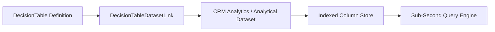

## Architectural Overview

The `DecisionTableDatasetLink` metadata type creates an architectural bridge between a `DecisionTable` definition and a backing data store, such as a CRM Analytics dataset, Data Cloud data lake object, or high-volume custom dataset. In enterprise architectures managing millions of rate schedules or eligibility records, querying standard transactional sObjects directly can exhaust governor limits or lead to index degradation.

By decoupling the logical decision definition from the underlying data warehouse or analytical dataset, `DecisionTableDatasetLink` allows architects to optimize data ingestion and indexing schedules independently of application business logic.



## SFDX Directory and File Suffix

| Property | Value |
| :--- | :--- |
| **Metadata Type Name** | `DecisionTableDatasetLink` |
| **SFDX Directory Path** | `force-app/main/default/decisionTableDatasetLinks/` |
| **File Suffix** | `.decisionTableDatasetLink-meta.xml` |
| **API Version** | `68.0` (Winter '27) |

## Key Metadata Fields

| Field | Type | Required | Description & Architectural Considerations |
| :--- | :--- | :--- | :--- |
| `masterLabel` | `string` | Yes | Human-readable label for the dataset linkage. |
| `description` | `string` | No | Architectural description of the associated dataset and refresh cadence. |
| `decisionTable` | `string` | Yes | API name of the target `DecisionTable` metadata component. |
| `dataset` | `string` | Yes | Identifier or API name of the target dataset or data lake object. |
| `status` | `string` | Yes | Operational state of the linkage: `Active` or `Inactive`. |

> [!NOTE]
> The target `DecisionTable` must exist in the target org or be bundled in the same deployment payload as `DecisionTableDatasetLink`.

## Declarative XML and Package.xml Examples

### `DecisionTableDatasetLink` Metadata File

```xml title="force-app/main/default/decisionTableDatasetLinks/Premium_Rate_Dataset_Link.decisionTableDatasetLink-meta.xml"
<?xml version="1.0" encoding="UTF-8"?>
<DecisionTableDatasetLink xmlns="http://soap.sforce.com/2006/04/metadata">
    <dataset>Insurance_Actuarial_Rates_DS</dataset>
    <decisionTable>Underwriting_Rate_Table</decisionTable>
    <description>Links the underwriting decision table to the actuarial risk rates dataset.</description>
    <masterLabel>Premium Rate Dataset Link</masterLabel>
    <status>Active</status>
</DecisionTableDatasetLink>
```

### `package.xml` Manifest

```xml title="manifest/package.xml"
<?xml version="1.0" encoding="UTF-8"?>
<Package xmlns="http://soap.sforce.com/2006/04/metadata">
    <types>
        <members>Premium_Rate_Dataset_Link</members>
        <name>DecisionTableDatasetLink</name>
    </types>
    <version>68.0</version>
</Package>
```

## SFDX CLI Retrieval and Deployment Commands

Retrieve and deploy dataset links across environments:

```bash
# Retrieve all dataset link components
sf project retrieve start --metadata "DecisionTableDatasetLink" --target-org analytics-dev

# Deploy the decision table and its dataset link simultaneously
sf project deploy start \
  --metadata "DecisionTable:Underwriting_Rate_Table,DecisionTableDatasetLink:Premium_Rate_Dataset_Link" \
  --target-org uat-env

# Query linked decision tables via Tooling API
sf data query --use-tooling-api --query "SELECT Id, DeveloperName, DecisionTableId, Status FROM DecisionTableDatasetLink" --target-org uat-env
```

## Senior Architect Best Practices and Gotchas

> [!WARNING]
> **Dataset Availability in Target Sandboxes:** Analytical datasets populated by data recipes or external ETL jobs may not exist in newly refreshed developer sandboxes. Ensure your seed scripts build the target dataset prior to activating the `DecisionTableDatasetLink`.

> [!TIP]
> **Strict Field Alignment:** Verify that all parameter fields declared in the parent `DecisionTable` match the schema column names and primitive types in the linked dataset. Mismatched field types cause runtime execution exceptions during Flow or Apex evaluation.

- **Dependency Ordering in Manifests:** In automated CI pipelines, package `DecisionTable` before `DecisionTableDatasetLink` or ensure both are deployed in an atomic single-transaction deployment.
- **Monitoring Query Latency:** Monitor execution times in Event Monitoring when decision tables evaluate multi-gigabyte linked datasets to ensure platform transaction timeouts are not exceeded.
