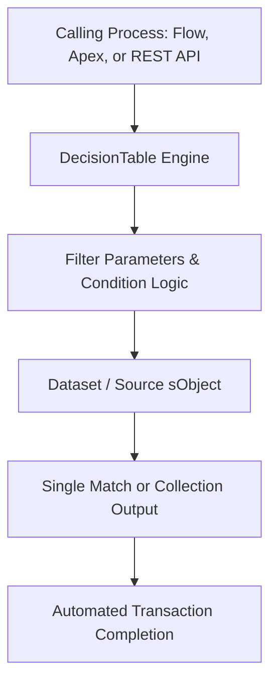

## Architectural Overview

The `DecisionTable` metadata type encapsulates complex business decision logic evaluated against operational datasets. While decision matrices excel at key-value lookup grids, `DecisionTable` enables architects to query dynamic database objects (such as `Product2`, `PricebookEntry`, or custom policy records) using rich operators (`Equals`, `GreaterOrEqual`, `Contains`, `Matches`).

Integrated directly with Flow Builder, Omnistudio, and Apex invocations, decision tables decouple volatile operational rule evaluations from transactional application code. In large enterprise implementations—such as insurance risk underwriting or discount governance—deploying decision table metadata ensures repeatable qualification logic across sandboxes and production orgs.



## SFDX Directory and File Suffix

| Property | Value |
| :--- | :--- |
| **Metadata Type Name** | `DecisionTable` |
| **SFDX Directory Path** | `force-app/main/default/decisionTables/` |
| **File Suffix** | `.decisionTable-meta.xml` |
| **API Version** | `68.0` (Winter '27) |

## Key Metadata Fields

| Field | Type | Required | Description & Architectural Considerations |
| :--- | :--- | :--- | :--- |
| `setupName` | `string` | Yes | Developer unique API name identifying the decision table. |
| `label` | `string` | Yes | Human-readable label displayed in Setup and Flow Action dialogs. |
| `description` | `string` | No | Architectural documentation explaining the operational purpose. |
| `sourceObject` | `string` | Yes | The API name of the primary sObject supplying evaluation rows. |
| `conditionType` | `string` | Yes | Filter mode: `All` (AND), `Any` (OR), or `Custom` logic. |
| `conditionLogic` | `string` | No | Custom Boolean string (e.g., `1 AND (2 OR 3)`) when `conditionType` is `Custom`. |
| `status` | `string` | Yes | Deployment lifecycle state: `Draft`, `Active`, or `Inactive`. |
| `decisionTableParameters` | `DecisionTableParameter[]` | Yes | List of field mappings, operators, input/output flags, and sort preferences. |
| `decisionTableParameters.fieldName` | `string` | Yes | Source field evaluated or returned. |
| `decisionTableParameters.operator` | `string` | Yes | Evaluation operator (`Equals`, `GreaterThan`, `Matches`, `Between`). |
| `decisionTableParameters.usage` | `string` | Yes | Role of the field: `Input` parameter or `Output` attribute. |

> [!NOTE]
> A `DecisionTable` must have at least one `Input` parameter and at least one `Output` parameter defined in `decisionTableParameters` before it can be activated.

## Declarative XML and Package.xml Examples

### `DecisionTable` Metadata File

```xml title="force-app/main/default/decisionTables/Loan_Approval_Matrix.decisionTable-meta.xml"
<?xml version="1.0" encoding="UTF-8"?>
<DecisionTable xmlns="http://soap.sforce.com/2006/04/metadata">
    <conditionType>All</conditionType>
    <description>Evaluates credit score, loan amount, and collateral to return interest rate tier.</description>
    <label>Loan Approval Matrix</label>
    <setupName>Loan_Approval_Matrix</setupName>
    <sourceObject>LoanUnderwritingRule__c</sourceObject>
    <status>Active</status>
    <decisionTableParameters>
        <fieldName>CreditScoreMin__c</fieldName>
        <operator>GreaterOrEqual</operator>
        <usage>Input</usage>
    </decisionTableParameters>
    <decisionTableParameters>
        <fieldName>DebtToIncomeMax__c</fieldName>
        <operator>LessOrEqual</operator>
        <usage>Input</usage>
    </decisionTableParameters>
    <decisionTableParameters>
        <fieldName>ApprovedRate__c</fieldName>
        <operator>Equals</operator>
        <usage>Output</usage>
    </decisionTableParameters>
</DecisionTable>
```

### `package.xml` Manifest

```xml title="manifest/package.xml"
<?xml version="1.0" encoding="UTF-8"?>
<Package xmlns="http://soap.sforce.com/2006/04/metadata">
    <types>
        <members>Loan_Approval_Matrix</members>
        <name>DecisionTable</name>
    </types>
    <version>68.0</version>
</Package>
```

## SFDX CLI Retrieval and Deployment Commands

Retrieve and deploy decision tables across test environments:

```bash
# Retrieve all DecisionTable components
sf project retrieve start --metadata "DecisionTable" --target-org staging-sandbox

# Deploy a single decision table along with its underlying custom object
sf project deploy start \
  --metadata "CustomObject:LoanUnderwritingRule__c,DecisionTable:Loan_Approval_Matrix" \
  --target-org uat-sandbox

# Verify table configuration via Tooling API query
sf data query --use-tooling-api --query "SELECT Id, DeveloperName, Status, SourceObject FROM DecisionTable" --target-org uat-sandbox
```

## Senior Architect Best Practices and Gotchas

> [!WARNING]
> **Schema Dependencies on Source Objects:** A `DecisionTable` references physical database columns via `fieldName`. If the referenced `CustomObject` or custom fields are not present or lack read permissions during metadata deployment, the deployment will fail with missing field compilation errors.

> [!TIP]
> **Index Evaluation Columns:** When the underlying `sourceObject` contains tens of thousands of records, ensure custom fields marked as `Input` parameters are designated as external IDs or custom indexed to maintain high evaluation throughput during real-time transaction processing.

- **Manage Activation via Lifecycle Scripts:** If your CI/CD pipeline deploys `DecisionTable` in `Draft` status, use post-deployment CLI scripts or Apex invocations to test rule coverage before executing activation commands.
- **Single vs Multiple Match Semantics:** Carefully designate in calling Flows whether the decision table returns `Single` (first matched row) or `Multiple` records to prevent unhandled collection runtime faults.
