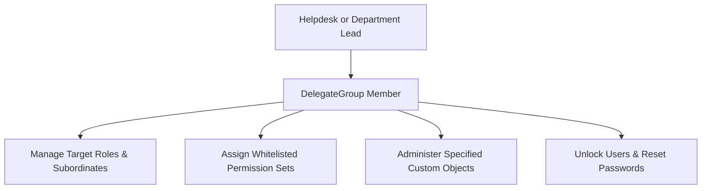

## Architectural Overview

The `DelegateGroup` metadata type represents Delegated Administration Groups in Salesforce. In large enterprises with regional business units or decentralized IT teams, assigning the global `Modify All Data` or `System Administrator` profile introduces severe compliance, operational, and security risks.

Delegated administration provides a principle-of-least-privilege mechanism to empower local department leads or helpdesk agents to unlock user accounts, reset passwords, assign pre-approved permission sets, and manage specific custom object schemas without compromising global security governance.



## SFDX Directory and File Suffix

| Property | Value |
| :--- | :--- |
| **Metadata Type Name** | `DelegateGroup` |
| **SFDX Directory Path** | `force-app/main/default/delegateGroups/` |
| **File Suffix** | `.delegateGroup-meta.xml` |
| **API Version** | `68.0` (Winter '27) |

## Key Metadata Fields

| Field | Type | Required | Description & Architectural Considerations |
| :--- | :--- | :--- | :--- |
| `label` | `string` | Yes | Human-readable name of the delegated administration group. |
| `loginAccess` | `boolean` | No | Indicates whether delegated admins can log in as users in their delegated roles. |
| `customObjects` | `string[]` | No | List of custom objects that delegated administrators can configure and manage. |
| `permissionSets` | `string[]` | No | Specific permission sets delegated admins are authorized to assign or revoke. |
| `profiles` | `string[]` | No | Specific profiles delegated admins are permitted to assign to new or modified users. |
| `roles` | `string[]` | No | User roles and subordinate hierarchies managed by this group. |
| `groups` | `string[]` | No | Public groups that delegated admins can administer. |
| `userProfiles` | `string[]` | No | Profiles of delegated administrator members who exercise these powers. |

> [!NOTE]
> Delegated administrators cannot modify permissions or reset passwords for users possessing higher administrative privileges (such as users assigned the System Administrator profile).

## Declarative XML and Package.xml Examples

### `DelegateGroup` Metadata File

```xml title="force-app/main/default/delegateGroups/Regional_Helpdesk_Admin.delegateGroup-meta.xml"
<?xml version="1.0" encoding="UTF-8"?>
<DelegateGroup xmlns="http://soap.sforce.com/2006/04/metadata">
    <customObjects>BranchOffice__c</customObjects>
    <customObjects>FieldInventory__c</customObjects>
    <label>Regional Helpdesk Admin</label>
    <loginAccess>true</loginAccess>
    <permissionSets>Field_Technician_Access</permissionSets>
    <permissionSets>Inventory_Clerk_Permissions</permissionSets>
    <profiles>Standard User</profiles>
    <roles>EMEA_Sales_Support</roles>
    <roles>APAC_Sales_Support</roles>
</DelegateGroup>
```

### `package.xml` Manifest

```xml title="manifest/package.xml"
<?xml version="1.0" encoding="UTF-8"?>
<Package xmlns="http://soap.sforce.com/2006/04/metadata">
    <types>
        <members>Regional_Helpdesk_Admin</members>
        <name>DelegateGroup</name>
    </types>
    <version>68.0</version>
</Package>
```

## SFDX CLI Retrieval and Deployment Commands

Retrieve and deploy delegated administration groups across your deployment pipeline:

```bash
# Retrieve all DelegateGroup metadata
sf project retrieve start --metadata "DelegateGroup" --target-org staging-sandbox

# Deploy a specific DelegateGroup with dependent custom objects and permission sets
sf project deploy start \
  --metadata "DelegateGroup:Regional_Helpdesk_Admin,PermissionSet:Field_Technician_Access" \
  --target-org prod-org

# Query existing delegated groups via SOQL
sf data query --query "SELECT Id, DeveloperName, Description FROM DelegateGroup" --target-org prod-org
```

## Senior Architect Best Practices and Gotchas

> [!WARNING]
> **Dependency Ordering on Roles and Permission Sets:** If a `DelegateGroup` references a `roles` or `permissionSets` entry that does not exist in the target org, metadata deployment fails immediately. Ensure dependent roles and permission sets are deployed in the same change set.

> [!TIP]
> **Enforce Strict Privilege Separation:** Avoid adding high-privilege permission sets (such as those granting `View All Data` or `Author Apex`) to a delegated group. Audit whitelisted permission sets during release code reviews to avoid privilege escalation vulnerabilities.

- **Login-As Audit Logging:** If `loginAccess` is set to `true`, configure Event Monitoring to track `LoginAs` event log files. This satisfies SOC 2 and ISO 27001 audit controls for delegated session impersonation.
- **Role Hierarchy Stability:** Delegated user management is scoped to specific user roles. Ensure your organizational role hierarchy naming is standardized across sandbox and production orgs.
