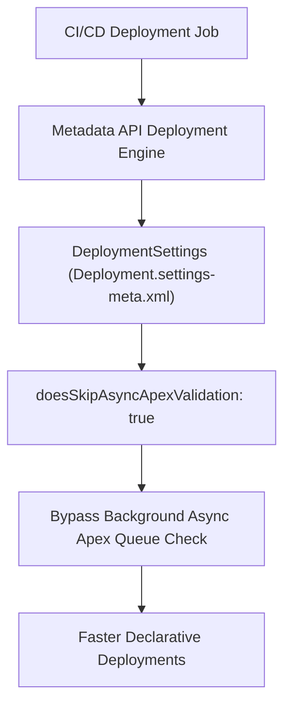

## Architectural Overview

The `DeploymentSettings` metadata type governs org-level behavior for the Salesforce Metadata API deployment engine. In enterprise DevOps architectures where automated CI/CD pipelines run dozens of builds daily, optimizing deployment validation overhead is paramount to keeping developer feedback loops fast.

By managing switches such as `doesSkipAsyncApexValidation` in version-controlled source, enterprise architects can prevent non-code deployments (e.g. custom labels, reports, layouts, or field permissions) from triggering lengthy asynchronous Apex validations.



## SFDX Directory and File Suffix

| Property | Value |
| :--- | :--- |
| **Metadata Type Name** | `Settings` (member: `Deployment`) |
| **XML Root Element** | `<DeploymentSettings>` |
| **SFDX Directory Path** | `force-app/main/default/settings/` |
| **File Suffix** | `Deployment.settings-meta.xml` |
| **API Version** | `68.0` (Winter '27) |

## Key Metadata Fields

| Field | Type | Required | Description & Architectural Considerations |
| :--- | :--- | :--- | :--- |
| `doesSkipAsyncApexValidation` | `boolean` | No | When `true`, skips asynchronous Apex validations during deployments that do not contain Apex code changes. |
| `enableAutoDeploymentJobCleanup` | `boolean` | No | Automatically purges completed metadata deployment records to conserve deployment history storage. |
| `enableCheckOnlyCancelNotification` | `boolean` | No | Dispatches notification emails when a validation-only (`checkOnly=true`) deployment is cancelled. |

> [!NOTE]
> Enabling `doesSkipAsyncApexValidation` reduces deployment lock contention when background batch jobs or queueable workers are actively executing in the target environment.

## Declarative XML and Package.xml Examples

### `DeploymentSettings` Metadata File

```xml title="force-app/main/default/settings/Deployment.settings-meta.xml"
<?xml version="1.0" encoding="UTF-8"?>
<DeploymentSettings xmlns="http://soap.sforce.com/2006/04/metadata">
    <doesSkipAsyncApexValidation>true</doesSkipAsyncApexValidation>
    <enableAutoDeploymentJobCleanup>true</enableAutoDeploymentJobCleanup>
    <enableCheckOnlyCancelNotification>false</enableCheckNotification>
</DeploymentSettings>
```

### `package.xml` Manifest

```xml title="manifest/package.xml"
<?xml version="1.0" encoding="UTF-8"?>
<Package xmlns="http://soap.sforce.com/2006/04/metadata">
    <types>
        <members>Deployment</members>
        <name>Settings</name>
    </types>
    <version>68.0</version>
</Package>
```

## SFDX CLI Retrieval and Deployment Commands

Retrieve and deploy deployment settings to establish consistent build characteristics across sandbox pools:

```bash
# Retrieve deployment settings using Settings type
sf project retrieve start --metadata "Settings:Deployment" --target-org scratch-org

# Deploy deployment settings to staging org
sf project deploy start --metadata "Settings:Deployment" --target-org uat-org

# Retrieve using specific DeploymentSettings type name
sf project retrieve start --metadata "DeploymentSettings" --target-org prod-org
```

## Senior Architect Best Practices and Gotchas

> [!WARNING]
> **Production Code Coverage Guardrails Remain Active:** Skipping asynchronous Apex validation does not bypass synchronous Apex test execution requirements. Deploying to production still requires minimum 75% overall test coverage and clean execution of all targeted test suites.

> [!TIP]
> **Include in Scratch Org Definition Files:** You can pre-configure `DeploymentSettings` in your `project-scratch-def.json` by specifying `deploymentSettings: { "doesSkipAsyncApexValidation": true }` to accelerate automated pipeline scratch org creation.

- **Automated Deployment History Pruning:** In busy integration orgs with high-frequency Jenkins or GitHub Actions runners, enabling `enableAutoDeploymentJobCleanup` prevents deployment history tables from accumulating hundreds of stale deployment logs.
- **Environment Parity:** Keep `Deployment.settings-meta.xml` identical across all sandbox and production repositories to eliminate subtle timing differences between sandbox and production releases.
