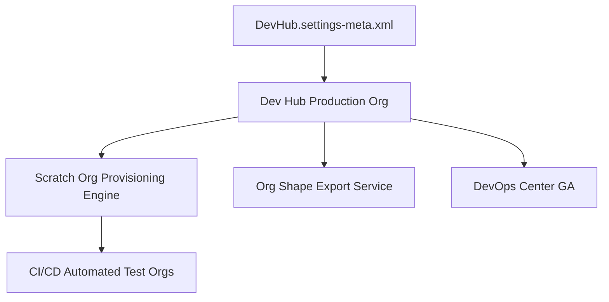

## Architectural Overview

The `DevHubSettings` metadata type represents the foundational developer operations settings for an enterprise Salesforce organization. A Dev Hub org serves as the authoritative anchor for modern source-driven development, enabling continuous integration runners and developer teams to spin up ephemeral scratch orgs, snapshot Org Shapes, and package second-generation managed and unlocked packages (2GP).

By capturing `DevHubSettings` in source control, architects ensure that production and release management environments maintain consistent DevOps capabilities without requiring manual setup steps in the user interface.



## SFDX Directory and File Suffix

| Property | Value |
| :--- | :--- |
| **Metadata Type Name** | `Settings` (member: `DevHub`) |
| **XML Root Element** | `<DevHubSettings>` |
| **SFDX Directory Path** | `force-app/main/default/settings/` |
| **File Suffix** | `DevHub.settings-meta.xml` |
| **API Version** | `68.0` (Winter '27) |

## Key Metadata Fields

| Field | Type | Required | Description & Architectural Considerations |
| :--- | :--- | :--- | :--- |
| `enableScratchOrgManagementPref` | `boolean` | No | Enables the org to create, track, and destroy scratch orgs. Once enabled in production, cannot be disabled via UI. |
| `enableShapeExportPref` | `boolean` | No | Allows exporting the org's features, limits, and settings into an Org Shape representation for scratch org creation. |
| `enableDevOpsCenterGA` | `boolean` | No | Enables the Salesforce DevOps Center application for pipeline management and change tracking. |

> [!NOTE]
> Activating `enableScratchOrgManagementPref` creates standard objects like `ActiveScratchOrg` and `ScratchOrgInfo` in the org, allowing custom reporting and license tracking.

## Declarative XML and Package.xml Examples

### `DevHubSettings` Metadata File

```xml title="force-app/main/default/settings/DevHub.settings-meta.xml"
<?xml version="1.0" encoding="UTF-8"?>
<DevHubSettings xmlns="http://soap.sforce.com/2006/04/metadata">
    <enableDevOpsCenterGA>true</enableDevOpsCenterGA>
    <enableScratchOrgManagementPref>true</enableScratchOrgManagementPref>
    <enableShapeExportPref>true</enableShapeExportPref>
</DevHubSettings>
```

### `package.xml` Manifest

```xml title="manifest/package.xml"
<?xml version="1.0" encoding="UTF-8"?>
<Package xmlns="http://soap.sforce.com/2006/04/metadata">
    <types>
        <members>DevHub</members>
        <name>Settings</name>
    </types>
    <version>68.0</version>
</Package>
```

## SFDX CLI Retrieval and Deployment Commands

Manage Dev Hub configurations using standard Salesforce CLI commands:

```bash
# Retrieve DevHubSettings from production or Dev Hub org
sf project retrieve start --metadata "Settings:DevHub" --target-org production-devhub

# Deploy DevHub settings to activate Org Shape and scratch org management
sf project deploy start --metadata "Settings:DevHub" --target-org production-devhub

# Verify scratch org pool limits on the Dev Hub
sf org list limits --target-org production-devhub
```

## Senior Architect Best Practices and Gotchas

> [!WARNING]
> **Irreversible Dev Hub Activation:** In production orgs, turning on `enableScratchOrgManagementPref` is a permanent operational decision. Do not deploy this setting to ephemeral testing sandboxes where Dev Hub functionality is unsupported.

> [!TIP]
> **Harness Org Shape for Fidelity:** When `enableShapeExportPref` is enabled, run `sf org create shape --target-org production-devhub` to capture active licenses, features, and settings. Scratch orgs can reference this shape directly in `project-scratch-def.json` using `"sourceOrg": "00D..."`.

- **Audit Scratch Org Consumption:** Use standard SOQL queries on `ScratchOrgInfo` and `ActiveScratchOrg` to build automated alert mechanisms when daily scratch org allocation limits approach 80%.
- **Role-Based Access for Developers:** Do not grant System Administrator profiles to developers in the Dev Hub org simply to create scratch orgs. Assign the standard `Salesforce Limited Access` user license coupled with the `Scratch Org User` permission set.
