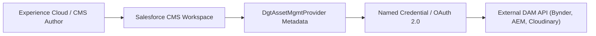

## Architectural Overview

The `DgtAssetMgmtProvider` (Digital Asset Management Provider) metadata type registers third-party Digital Asset Management (DAM) solutions—such as Bynder, Adobe Experience Manager (AEM), Cloudinary, or Widen—with Salesforce CMS and Experience Cloud. Large marketing and enterprise organizations centralize high-resolution images, brand vectors, videos, and collateral in specialized external DAM repositories rather than duplicating binary payloads inside Salesforce storage.

By defining a `DgtAssetMgmtProvider`, architects link external repository endpoints, authentication protocols, and metadata schemas directly into the unified Salesforce CMS authoring interface. Content creators and experience designers can browse, search, and embed external assets without leaving Salesforce.



## SFDX Directory and File Suffix

| Property | Value |
| :--- | :--- |
| **Metadata Type Name** | `DgtAssetMgmtProvider` |
| **SFDX Directory Path** | `force-app/main/default/dgtAssetMgmtProviders/` |
| **File Suffix** | `.dgtAssetMgmtProvider-meta.xml` |
| **API Version** | `68.0` (Winter '27) |

## Key Metadata Fields

| Field | Type | Required | Description & Architectural Considerations |
| :--- | :--- | :--- | :--- |
| `masterLabel` | `string` | Yes | Display label shown to CMS content authors selecting an asset source. |
| `description` | `string` | No | Architectural overview of the integrated repository and asset types supported. |
| `providerType` | `string` | Yes | Type or adapter class identifying the DAM integration protocol. |
| `namedCredential` | `string` | Yes | API name of the `NamedCredential` securing outbound REST API connectivity. |
| `status` | `string` | No | Lifecycle status of the provider registration (`Active` or `Inactive`). |

> [!NOTE]
> `DgtAssetMgmtProvider` relies on modern Named Credentials with External Credentials to handle OAuth token refreshes and JWT bearer flows securely without hardcoding secrets in metadata.

## Declarative XML and Package.xml Examples

### `DgtAssetMgmtProvider` Metadata File

```xml title="force-app/main/default/dgtAssetMgmtProviders/Enterprise_Bynder_DAM.dgtAssetMgmtProvider-meta.xml"
<?xml version="1.0" encoding="UTF-8"?>
<DgtAssetMgmtProvider xmlns="http://soap.sforce.com/2006/04/metadata">
    <description>Enterprise Bynder DAM repository integration for corporate marketing assets.</description>
    <masterLabel>Enterprise Bynder DAM</masterLabel>
    <namedCredential>Bynder_OAuth_Credential</namedCredential>
    <providerType>Bynder</providerType>
    <status>Active</status>
</DgtAssetMgmtProvider>
```

### `package.xml` Manifest

```xml title="manifest/package.xml"
<?xml version="1.0" encoding="UTF-8"?>
<Package xmlns="http://soap.sforce.com/2006/04/metadata">
    <types>
        <members>Enterprise_Bynder_DAM</members>
        <name>DgtAssetMgmtProvider</name>
    </types>
    <version>68.0</version>
</Package>
```

## SFDX CLI Retrieval and Deployment Commands

Retrieve and deploy DAM provider metadata alongside related integration artifacts:

```bash
# Retrieve all DAM providers from the packaging org
sf project retrieve start --metadata "DgtAssetMgmtProvider" --target-org staging-org

# Deploy the DAM provider along with its Named Credential
sf project deploy start \
  --metadata "NamedCredential:Bynder_OAuth_Credential,DgtAssetMgmtProvider:Enterprise_Bynder_DAM" \
  --target-org prod-org

# Query registered DAM providers via Tooling API
sf data query --use-tooling-api --query "SELECT Id, DeveloperName, MasterLabel, ProviderType FROM DgtAssetMgmtProvider" --target-org prod-org
```

## Senior Architect Best Practices and Gotchas

> [!WARNING]
> **Dependency on Named Credentials:** Deploying `DgtAssetMgmtProvider` without its target `NamedCredential` results in immediate deployment failure. Always bundle the named credential and external credential definitions in the same deployment payload.

> [!TIP]
> **Combine with Custom Provider Components:** Pair `DgtAssetMgmtProvider` with `DgtAssetMgmtPrvdLghtCpnt` to provide content authors with tailored asset selection filters, brand category pickers, and thumbnail grids.

- **Content Security Policy (CSP) Alignment:** Register the external DAM CDN domain in CSP Trusted Sites and CORS settings so Experience Cloud sites can render external media without browser security blocks.
- **Cross-Environment Named Credentials:** In non-production sandboxes, point the `NamedCredential` to staging DAM sandbox tenants to prevent test content uploads from polluting production digital asset repositories.
