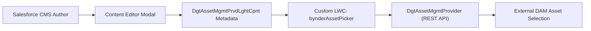

## Architectural Overview

The `DgtAssetMgmtPrvdLghtCpnt` (Digital Asset Management Provider Lightning Component) metadata type associates custom Lightning Web Components (LWC) with an external `DgtAssetMgmtProvider`. While the provider metadata defines API credentials and endpoints, the user experience of browsing external media—such as filtering by brand campaign, viewing copyright statuses, or selecting asset renditions—requires specialized UI elements.

By deploying `DgtAssetMgmtPrvdLghtCpnt` metadata, architects replace standard placeholder file selectors with rich interactive LWC modals inside Salesforce CMS content authoring editors, ensuring seamless asset embedding across digital channels.



## SFDX Directory and File Suffix

| Property | Value |
| :--- | :--- |
| **Metadata Type Name** | `DgtAssetMgmtPrvdLghtCpnt` |
| **SFDX Directory Path** | `force-app/main/default/dgtAssetMgmtPrvdLghtCpnts/` |
| **File Suffix** | `.dgtAssetMgmtPrvdLghtCpnt-meta.xml` |
| **API Version** | `68.0` (Winter '27) |

## Key Metadata Fields

| Field | Type | Required | Description & Architectural Considerations |
| :--- | :--- | :--- | :--- |
| `masterLabel` | `string` | Yes | Human-readable label for the component binding. |
| `description` | `string` | No | Architectural purpose and modal display behavior details. |
| `dgtAssetMgmtProvider` | `string` | Yes | Developer name of the associated `DgtAssetMgmtProvider`. |
| `lightningComponent` | `string` | Yes | Qualified name of the custom `LightningComponentBundle` (LWC). |
| `componentType` | `string` | Yes | Interaction role of the component (such as `AssetPicker` or `AssetViewer`). |

> [!NOTE]
> The target LWC referenced in `lightningComponent` must expose the required CMS target configs (`lightningCommunity__Default` or CMS adapter interfaces) in its `.js-meta.xml` file.

## Declarative XML and Package.xml Examples

### `DgtAssetMgmtPrvdLghtCpnt` Metadata File

```xml title="force-app/main/default/dgtAssetMgmtPrvdLghtCpnts/Bynder_Picker_Binding.dgtAssetMgmtPrvdLghtCpnt-meta.xml"
<?xml version="1.0" encoding="UTF-8"?>
<DgtAssetMgmtPrvdLghtCpnt xmlns="http://soap.sforce.com/2006/04/metadata">
    <componentType>AssetPicker</componentType>
    <description>Connects the custom Bynder asset picker LWC to the Bynder DAM provider.</description>
    <dgtAssetMgmtProvider>Enterprise_Bynder_DAM</dgtAssetMgmtProvider>
    <lightningComponent>c:bynderAssetPickerModal</lightningComponent>
    <masterLabel>Bynder Picker Binding</masterLabel>
</DgtAssetMgmtPrvdLghtCpnt>
```

### `package.xml` Manifest

```xml title="manifest/package.xml"
<?xml version="1.0" encoding="UTF-8"?>
<Package xmlns="http://soap.sforce.com/2006/04/metadata">
    <types>
        <members>Bynder_Picker_Binding</members>
        <name>DgtAssetMgmtPrvdLghtCpnt</name>
    </types>
    <version>68.0</version>
</Package>
```

## SFDX CLI Retrieval and Deployment Commands

Retrieve and deploy component bindings alongside the associated LWC bundle:

```bash
# Retrieve all DAM component bindings
sf project retrieve start --metadata "DgtAssetMgmtPrvdLghtCpnt" --target-org cms-dev

# Deploy the component binding, provider, and LWC bundle together
sf project deploy start \
  --metadata "LightningComponentBundle:bynderAssetPickerModal,DgtAssetMgmtProvider:Enterprise_Bynder_DAM,DgtAssetMgmtPrvdLghtCpnt:Bynder_Picker_Binding" \
  --target-org uat-org

# Query registered DAM Lightning components via Tooling API
sf data query --use-tooling-api --query "SELECT Id, DeveloperName, DgtAssetMgmtProviderId, ComponentType FROM DgtAssetMgmtPrvdLghtCpnt" --target-org uat-org
```

## Senior Architect Best Practices and Gotchas

> [!WARNING]
> **Strict LWC Deployment Precedence:** The Lightning Web Component specified in `lightningComponent` must be deployed before or in the exact same transaction as the `DgtAssetMgmtPrvdLghtCpnt` component. Referencing an undeployed bundle causes a fatal deployment error.

> [!TIP]
> **Client-Side Asset Validation:** Ensure your custom asset picker LWC verifies aspect ratios, file size boundaries, and MIME types directly on the client side before emitting the selected asset URL back to the CMS authoring canvas.

- **Cross-Origin Resource Sharing (CORS):** Ensure external asset thumbnail and preview URLs rendered by the LWC are permitted under the target org's CORS and CSP configurations.
- **Graceful Error States:** Implement fallback UI states inside the LWC in the event the third-party DAM API experiences transient latency or token expiration during editorial sessions.
