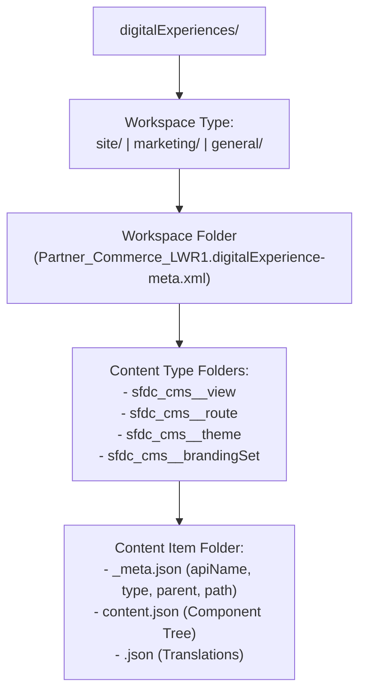

The `DigitalExperienceBundle` metadata type represents a workspace in **Enhanced LWR Experience Cloud sites**, **Salesforce CMS**, or **Marketing Cloud on Core**. Introduced in API version 56.0, `DigitalExperienceBundle` stores every page view (`sfdc_cms__view`), route (`sfdc_cms__route`), theme (`sfdc_cms__theme`), branding set (`sfdc_cms__brandingSet`), and CMS asset as a modular content item backed by `_meta.json` and `content.json` files.

## SFDX Four-Level Directory Structure

When retrieved into a Salesforce DX project, `DigitalExperienceBundle` organizes workspaces under `force-app/main/default/digitalExperiences/<workspace_type>/<Workspace_Name>/`:

```text
force-app/main/default/digitalExperiences/
└── site/
    └── Partner_Commerce_LWR1/
        ├── Partner_Commerce_LWR1.digitalExperience-meta.xml
        ├── sfdc_cms__appPage/
        │   └── mainAppPage/
        │       ├── _meta.json
        │       └── content.json
        ├── sfdc_cms__brandingSet/
        ├── sfdc_cms__route/
        │   └── Home/
        │       ├── _meta.json
        │       └── content.json
        ├── sfdc_cms__site/
        └── sfdc_cms__view/
            └── home/
                ├── _meta.json
                ├── content.json
                └── fr.json
```



## Key Properties in `_meta.json`

Every content item subfolder contains a `_meta.json` descriptor with four fields:

| Property | Type | Required | Description |
|---|---|---|---|
| `apiName` | `string` | Yes | Unique alphanumeric/underscore identifier within that content type in the workspace |
| `type` | `string` | Yes | Content type prefixed with `sfdc_cms__` (for example, `sfdc_cms__view`, `sfdc_cms__route`) |
| `parent` | `string` | No | Developer name of the parent content item (for example, linking a view to its route) |
| `path` | `string` | No | Relative folder path within the workspace (`""` for root items like `sfdc_cms__site`) |

## Production-Grade Examples

### 1. Workspace Header (`Partner_Commerce_LWR1.digitalExperience-meta.xml`)

```xml
<?xml version="1.0" encoding="UTF-8"?>
<DigitalExperienceBundle xmlns="http://soap.sforce.com/2006/04/metadata">
    <description>Enhanced LWR Partner Commerce and Deal Registration portal.</description>
    <label>Partner Commerce LWR</label>
</DigitalExperienceBundle>
```

### 2. Content Item Metadata (`sfdc_cms__view/home/_meta.json`)

```json
{
  "apiName": "home",
  "type": "sfdc_cms__view",
  "path": "views"
}
```

### 3. Retrieving and Deploying via `package.xml`

When deploying an Enhanced LWR site, include `DigitalExperienceBundle`, `DigitalExperienceConfig`, `Network`, and [CustomSite](/docs/metadata/custom-site-metadata-type/):

```xml
<?xml version="1.0" encoding="UTF-8"?>
<Package xmlns="http://soap.sforce.com/2006/04/metadata">
    <types>
        <members>site/Partner_Commerce_LWR1</members>
        <name>DigitalExperienceBundle</name>
    </types>
    <types>
        <members>Partner_Commerce_LWR1</members>
        <name>DigitalExperienceConfig</name>
    </types>
    <types>
        <members>Partner Commerce LWR</members>
        <name>Network</name>
    </types>
    <types>
        <members>Partner_Commerce_LWR</members>
        <name>CustomSite</name>
    </types>
    <version>68.0</version>
</Package>
```

> [!WARNING]
> **Keep `<label>` Synchronized with `Network`**: For Enhanced LWR sites (`site/<WorkspaceName>`), the `<label>` in `.digitalExperience-meta.xml` must stay synchronized with the site's `Network` name, and any translated `<locale>.json` files present in the target org must also be retrieved into your source branch before deploying.

