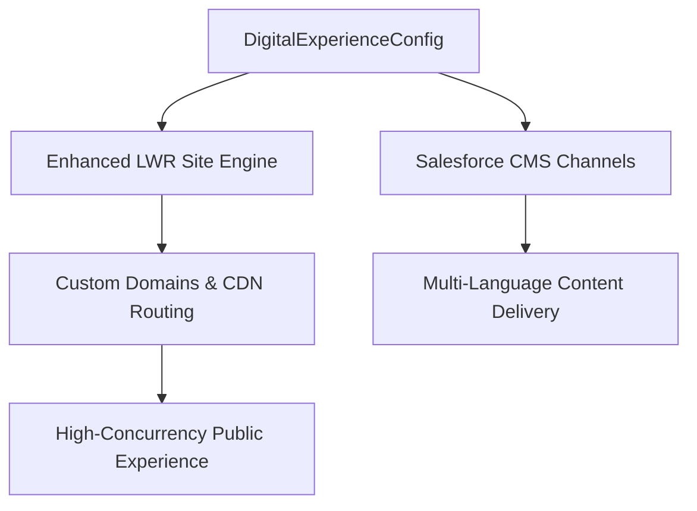

## Architectural Overview

The `DigitalExperienceConfig` metadata type manages architectural configurations for modern Salesforce Digital Experiences, particularly enhanced Lightning Web Runtime (LWR) sites and Salesforce CMS workspaces. As digital experience architectures evolved from Aura Community templates to high-performance micro-frontends on LWR, metadata configuration decoupled content channels from page layout definitions.

Using `DigitalExperienceConfig`, architects declare workspace properties, channel delivery endpoints, content access boundaries, and site status programmatically across development pipelines, eliminating manual point-and-click publishing steps in target orgs.



## SFDX Directory and File Suffix

| Property | Value |
| :--- | :--- |
| **Metadata Type Name** | `DigitalExperienceConfig` |
| **SFDX Directory Path** | `force-app/main/default/digitalExperienceConfigs/` |
| **File Suffix** | `.digitalExperienceConfig-meta.xml` |
| **API Version** | `68.0` (Winter '27) |

## Key Metadata Fields

| Field | Type | Required | Description & Architectural Considerations |
| :--- | :--- | :--- | :--- |
| `label` | `string` | Yes | Human-readable title of the digital experience configuration. |
| `description` | `string` | No | Architectural description of channel routing and site boundaries. |
| `site` | `string` | Yes | API name of the target Experience Cloud `CustomSite` or LWR container. |
| `status` | `string` | Yes | Deployment and activation status (`Active`, `Draft`, `UnderMaintenance`). |
| `experienceType` | `string` | No | Type of digital experience runtime architecture (e.g., `LWR`, `EnhancedCMS`). |

> [!NOTE]
> Ensure the underlying `CustomSite` and `Network` metadata components exist in the target org before deploying dependent `DigitalExperienceConfig` components.

## Declarative XML and Package.xml Examples

### `DigitalExperienceConfig` Metadata File

```xml title="force-app/main/default/digitalExperienceConfigs/Partner_Portal_Config.digitalExperienceConfig-meta.xml"
<?xml version="1.0" encoding="UTF-8"?>
<DigitalExperienceConfig xmlns="http://soap.sforce.com/2006/04/metadata">
    <description>Enterprise partner portal digital experience configuration on enhanced LWR.</description>
    <experienceType>LWR</experienceType>
    <label>Partner Portal Config</label>
    <site>Partner_Portal_Site</site>
    <status>Active</status>
</DigitalExperienceConfig>
```

### `package.xml` Manifest

```xml title="manifest/package.xml"
<?xml version="1.0" encoding="UTF-8"?>
<Package xmlns="http://soap.sforce.com/2006/04/metadata">
    <types>
        <members>Partner_Portal_Config</members>
        <name>DigitalExperienceConfig</name>
    </types>
    <version>68.0</version>
</Package>
```

## SFDX CLI Retrieval and Deployment Commands

Retrieve and deploy digital experience configs across CI/CD stages:

```bash
# Retrieve all digital experience configs
sf project retrieve start --metadata "DigitalExperienceConfig" --target-org experience-dev

# Deploy the configuration along with its target CustomSite and ExperienceBundle
sf project deploy start \
  --metadata "CustomSite:Partner_Portal_Site,DigitalExperienceConfig:Partner_Portal_Config" \
  --target-org uat-org

# Query existing digital experience configs via Tooling API
sf data query --use-tooling-api --query "SELECT Id, DeveloperName, Site, Status FROM DigitalExperienceConfig" --target-org uat-org
```

## Senior Architect Best Practices and Gotchas

> [!WARNING]
> **Network and CustomSite Coupling:** `DigitalExperienceConfig` is tightly coupled with `Network` and `CustomSite` metadata. If the associated Experience Cloud site is inactive or missing from the deployment payload, the deployment will fail with reference validation errors.

> [!TIP]
> **Coordinate Content Delivery Security:** When deploying new digital experience configurations, review the associated guest user profile and public access settings to avoid exposing internal business objects to unauthenticated public visitors.

- **Automated Staging Promotion:** Promote `DigitalExperienceConfig` in `Draft` or `UnderMaintenance` status during deployment maintenance windows, then transition to `Active` via post-deployment smoke tests.
- **Cache Invalidation:** For enhanced LWR sites connected to Salesforce Edge Network or Cloudforce CDN, changing digital experience config flags may require CDN cache purge cycles to take immediate effect for global visitors.
