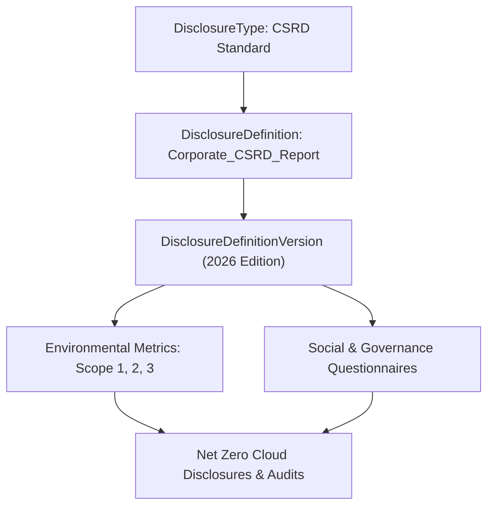

## Architectural Overview

The `DisclosureDefinition` metadata type represents structured sustainability and ESG (Environmental, Social, and Governance) disclosure frameworks in Salesforce Net Zero Cloud. Multinational corporations face rigorous reporting mandates—such as the European Union's Corporate Sustainability Reporting Directive (CSRD), Global Reporting Initiative (GRI), and Carbon Disclosure Project (CDP)—requiring auditable, reproducible disclosure schemas.

A `DisclosureDefinition` models the regulatory parent container, establishing reporting scope, disclosure categories, and framework boundaries. By maintaining disclosure definitions in source control, enterprise architects guarantee that corporate sustainability reporting templates remain standardized across multi-org architectures.



## SFDX Directory and File Suffix

| Property | Value |
| :--- | :--- |
| **Metadata Type Name** | `DisclosureDefinition` |
| **SFDX Directory Path** | `force-app/main/default/disclosureDefinitions/` |
| **File Suffix** | `.disclosureDefinition-meta.xml` |
| **API Version** | `68.0` (Winter '27) |

## Key Metadata Fields

| Field | Type | Required | Description & Architectural Considerations |
| :--- | :--- | :--- | :--- |
| `name` | `string` | Yes | API name uniquely identifying the disclosure definition. |
| `masterLabel` | `string` | Yes | Human-readable label displayed in Net Zero Cloud Disclosure Hub. |
| `description` | `string` | No | Regulatory scope and governing statutory body summary. |
| `disclosureType` | `string` | Yes | Developer name of the associated `DisclosureType` standard. |
| `category` | `string` | No | ESG category classification (`Environmental`, `Social`, `Governance`). |
| `status` | `string` | No | Operational status of the definition (`Active`, `Draft`, `Deprecated`). |

> [!NOTE]
> Net Zero Cloud licenses and Disclosure and Compliance Hub features must be provisioned in the target org before deploying `DisclosureDefinition` metadata.

## Declarative XML and Package.xml Examples

### `DisclosureDefinition` Metadata File

```xml title="force-app/main/default/disclosureDefinitions/Corporate_CSRD_Report.disclosureDefinition-meta.xml"
<?xml version="1.0" encoding="UTF-8"?>
<DisclosureDefinition xmlns="http://soap.sforce.com/2006/04/metadata">
    <category>Environmental</category>
    <description>Corporate Sustainability Reporting Directive disclosure framework definition.</description>
    <disclosureType>CSRD_Standard</disclosureType>
    <masterLabel>Corporate CSRD Report</masterLabel>
    <name>Corporate_CSRD_Report</name>
    <status>Active</status>
</DisclosureDefinition>
```

### `package.xml` Manifest

```xml title="manifest/package.xml"
<?xml version="1.0" encoding="UTF-8"?>
<Package xmlns="http://soap.sforce.com/2006/04/metadata">
    <types>
        <members>Corporate_CSRD_Report</members>
        <name>DisclosureDefinition</name>
    </types>
    <version>68.0</version>
</Package>
```

## SFDX CLI Retrieval and Deployment Commands

Retrieve and deploy disclosure definitions alongside dependent ESG configuration types:

```bash
# Retrieve all DisclosureDefinition metadata
sf project retrieve start --metadata "DisclosureDefinition" --target-org netzero-dev

# Deploy the disclosure definition and its parent DisclosureType
sf project deploy start \
  --metadata "DisclosureType:CSRD_Standard,DisclosureDefinition:Corporate_CSRD_Report" \
  --target-org netzero-uat

# Query disclosure definitions via SOQL
sf data query --query "SELECT Id, Name, DeveloperName, Status FROM DisclosureDefinition" --target-org netzero-uat
```

## Senior Architect Best Practices and Gotchas

> [!WARNING]
> **Parent DisclosureType Dependency:** `DisclosureDefinition` requires that the referenced `disclosureType` exists in the target environment. Deploying a definition pointing to an uncommitted disclosure type fails with foreign key reference errors.

> [!TIP]
> **Version-Centric Framework Evolution:** Treat the `DisclosureDefinition` as a static framework shell and encapsulate annual statutory adjustments in `DisclosureDefinitionVersion` components to preserve historical auditability.

- **Data Privacy in ESG Disclosures:** Disclosures capturing social metrics (workforce diversity, executive compensation ratios) may contain sensitive HR data. Enforce field-level security and permission sets for sustainability reporting users.
- **Audit Trail Compliance:** Regulatory audits require strict immutability for published disclosures. Ensure historical definition metadata is archived in Git release tags matching corporate annual reporting cycles.
