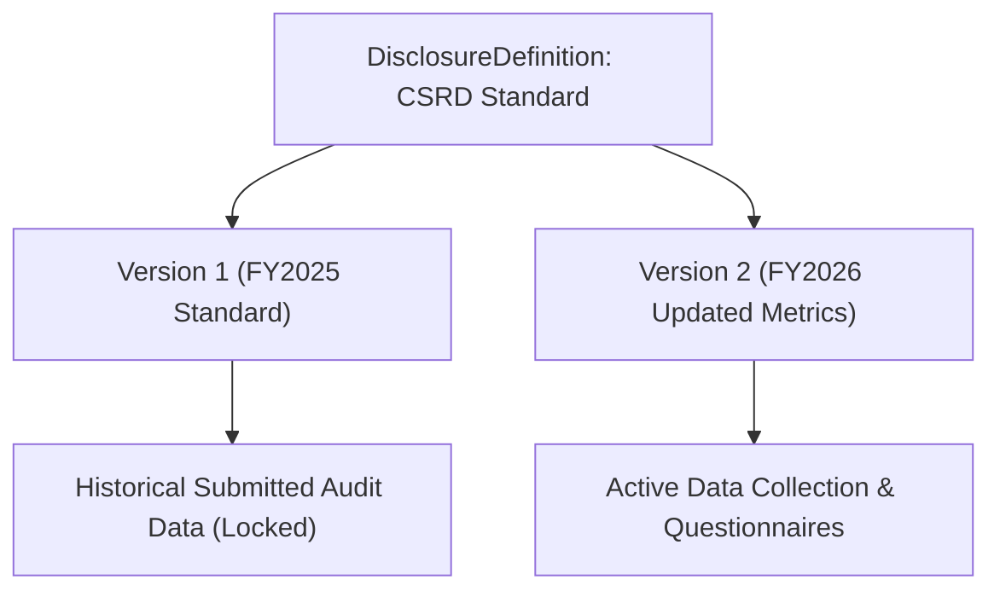

## Architectural Overview

The `DisclosureDefinitionVersion` metadata type captures point-in-time regulatory revisions of sustainability disclosure frameworks in Salesforce Net Zero Cloud. Global reporting standards—such as SEC Climate Disclosures or the EU CSRD—undergo periodic statutory revisions that introduce new carbon accounting metrics, mandatory supply-chain due diligence criteria, and updated questionnaire schemas.

By isolating versions into dedicated `DisclosureDefinitionVersion` metadata artifacts, enterprise architects ensure that historical disclosures submitted for prior fiscal years remain completely immutable and audit-compliant, while teams deploy forward-looking questionnaire revisions for upcoming audit cycles.



## SFDX Directory and File Suffix

| Property | Value |
| :--- | :--- |
| **Metadata Type Name** | `DisclosureDefinitionVersion` |
| **SFDX Directory Path** | `force-app/main/default/disclosureDefinitionVersions/` |
| **File Suffix** | `.disclosureDefinitionVersion-meta.xml` |
| **API Version** | `68.0` (Winter '27) |

## Key Metadata Fields

| Field | Type | Required | Description & Architectural Considerations |
| :--- | :--- | :--- | :--- |
| `name` | `string` | Yes | API name uniquely identifying the version record. |
| `masterLabel` | `string` | Yes | Human-readable version label (such as `CSRD 2026 V1`). |
| `disclosureDefinition` | `string` | Yes | Developer name of the parent `DisclosureDefinition`. |
| `versionNumber` | `int` | Yes | Incremental sequence number representing the framework revision. |
| `effectiveFromDate` | `date` | No | Beginning calendar date when this version becomes valid for submissions. |
| `effectiveToDate` | `date` | No | Expiration calendar date after which new disclosures cannot instantiate this version. |
| `status` | `string` | Yes | Operational lifecycle state (`Draft`, `Active`, `Archived`). |

> [!NOTE]
> When instantiating a new ESG report in Net Zero Cloud, the system automatically resolves the `Active` `DisclosureDefinitionVersion` matching the report's target accounting period.

## Declarative XML and Package.xml Examples

### `DisclosureDefinitionVersion` Metadata File

```xml title="force-app/main/default/disclosureDefinitionVersions/Corporate_CSRD_Report_V2.disclosureDefinitionVersion-meta.xml"
<?xml version="1.0" encoding="UTF-8"?>
<DisclosureDefinitionVersion xmlns="http://soap.sforce.com/2006/04/metadata">
    <description>FY2026 revision including Scope 3 category 15 investment emissions reporting.</description>
    <disclosureDefinition>Corporate_CSRD_Report</disclosureDefinition>
    <effectiveFromDate>2026-01-01</effectiveFromDate>
    <effectiveToDate>2026-12-31</effectiveToDate>
    <masterLabel>Corporate CSRD Report V2</masterLabel>
    <name>Corporate_CSRD_Report_V2</name>
    <status>Active</status>
    <versionNumber>2</versionNumber>
</DisclosureDefinitionVersion>
```

### `package.xml` Manifest

```xml title="manifest/package.xml"
<?xml version="1.0" encoding="UTF-8"?>
<Package xmlns="http://soap.sforce.com/2006/04/metadata">
    <types>
        <members>Corporate_CSRD_Report_V2</members>
        <name>DisclosureDefinitionVersion</name>
    </types>
    <version>68.0</version>
</Package>
```

## SFDX CLI Retrieval and Deployment Commands

Retrieve and deploy versioned ESG disclosures using the Salesforce CLI:

```bash
# Retrieve all version definitions
sf project retrieve start --metadata "DisclosureDefinitionVersion" --target-org netzero-dev

# Deploy the version together with its parent disclosure definition
sf project deploy start \
  --metadata "DisclosureDefinition:Corporate_CSRD_Report,DisclosureDefinitionVersion:Corporate_CSRD_Report_V2" \
  --target-org netzero-uat

# Query all registered disclosure definition versions via SOQL
sf data query --query "SELECT Id, Name, VersionNumber, Status FROM DisclosureDefinitionVersion" --target-org netzero-uat
```

## Senior Architect Best Practices and Gotchas

> [!WARNING]
> **Immutability of Submitted Disclosures:** Never modify a `DisclosureDefinitionVersion` that is already linked to finalized or submitted disclosure records. Instead, create and deploy a new version with an incremented `versionNumber` to maintain statutory compliance and external audit readiness.

> [!TIP]
> **Align Effective Dates with Fiscal Calendars:** Set `effectiveFromDate` and `effectiveToDate` to match corporate fiscal reporting periods exactly, preventing reporting teams from logging emissions figures against outdated questionnaire structures.

- **Atomic Deployment with Question Sets:** Deploy `DisclosureDefinitionVersion` in the same manifest as dependent disclosure assessment questions and document templates to avoid broken relational bindings.
- **Retirement Planning:** Transition superseded versions to `Archived` status once all audits for that calendar year have completed, preventing accidental use in new reporting cycles.
