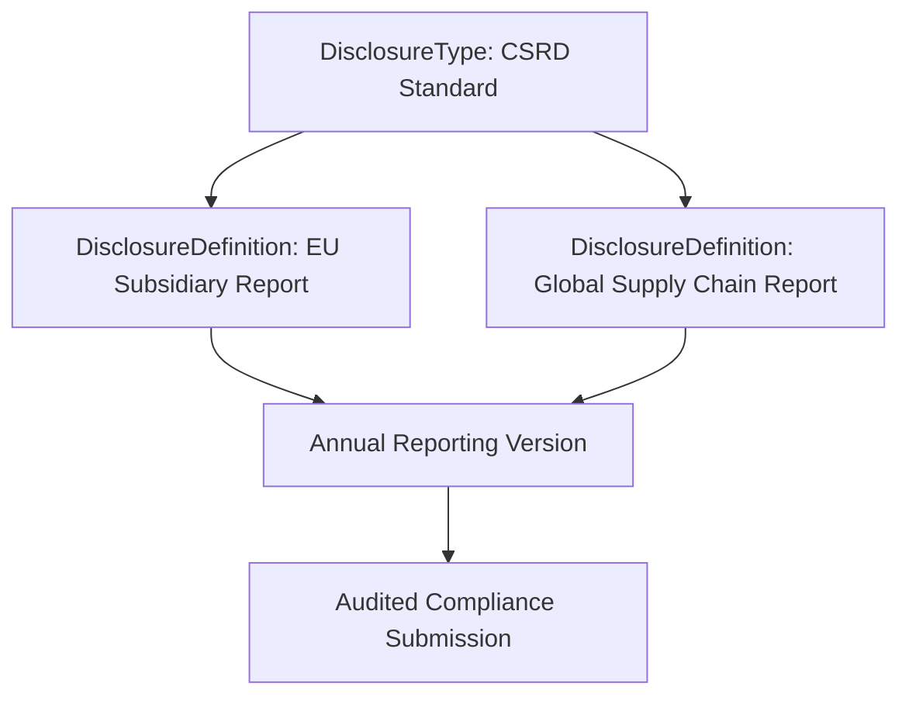

## Architectural Overview

The `DisclosureType` metadata type categorizes top-level environmental, social, and governance (ESG) reporting frameworks in Salesforce Net Zero Cloud. Global organizations must report against multiple distinct regulatory regimes simultaneously—such as the Global Reporting Initiative (GRI), Task Force on Climate-related Financial Disclosures (TCFD), Carbon Disclosure Project (CDP), and the European Corporate Sustainability Reporting Directive (CSRD).

`DisclosureType` acts as the root taxonomy entity. It groups lower-level `DisclosureDefinition` and `DisclosureDefinitionVersion` components into standard statutory families, allowing sustainability officers and compliance auditors to navigate disclosures by regulatory body and legal jurisdiction.



## SFDX Directory and File Suffix

| Property | Value |
| :--- | :--- |
| **Metadata Type Name** | `DisclosureType` |
| **SFDX Directory Path** | `force-app/main/default/disclosureTypes/` |
| **File Suffix** | `.disclosureType-meta.xml` |
| **API Version** | `68.0` (Winter '27) |

## Key Metadata Fields

| Field | Type | Required | Description & Architectural Considerations |
| :--- | :--- | :--- | :--- |
| `name` | `string` | Yes | Unique API name identifying the disclosure type. |
| `masterLabel` | `string` | Yes | Display name of the standard shown in reporting dashboards. |
| `description` | `string` | No | Description of the statutory reporting requirements and jurisdictions. |
| `category` | `string` | No | Higher-level reporting category (`Environmental`, `Social`, `Governance`, `Holistic`). |
| `complianceStandard` | `string` | No | Official standard reference code (e.g., `GRI-Universal`, `CSRD-ESRS-E1`). |

> [!NOTE]
> `DisclosureType` serves as the foundational parent in the Net Zero Cloud metadata hierarchy and should always be deployed prior to dependent disclosure definitions.

## Declarative XML and Package.xml Examples

### `DisclosureType` Metadata File

```xml title="force-app/main/default/disclosureTypes/CSRD_Standard.disclosureType-meta.xml"
<?xml version="1.0" encoding="UTF-8"?>
<DisclosureType xmlns="http://soap.sforce.com/2006/04/metadata">
    <category>Environmental</category>
    <complianceStandard>CSRD-ESRS-E1</complianceStandard>
    <description>European Union Corporate Sustainability Reporting Directive standards.</description>
    <masterLabel>CSRD Standard</masterLabel>
    <name>CSRD_Standard</name>
</DisclosureType>
```

### `package.xml` Manifest

```xml title="manifest/package.xml"
<?xml version="1.0" encoding="UTF-8"?>
<Package xmlns="http://soap.sforce.com/2006/04/metadata">
    <types>
        <members>CSRD_Standard</members>
        <name>DisclosureType</name>
    </types>
    <version>68.0</version>
</Package>
```

## SFDX CLI Retrieval and Deployment Commands

Retrieve and deploy disclosure types across sandboxes:

```bash
# Retrieve all DisclosureType metadata components
sf project retrieve start --metadata "DisclosureType" --target-org netzero-dev

# Deploy DisclosureType to staging org
sf project deploy start --metadata "DisclosureType:CSRD_Standard" --target-org netzero-uat

# Query all registered disclosure types via SOQL
sf data query --query "SELECT Id, Name, MasterLabel, Category FROM DisclosureType" --target-org netzero-uat
```

## Senior Architect Best Practices and Gotchas

> [!WARNING]
> **Deployment Ordering Dependencies:** If you deploy a `DisclosureDefinition` that references a new `DisclosureType`, both metadata components must be included in the same deployment manifest. Deploying the definition alone triggers a reference unresolved error.

> [!TIP]
> **Map to Official Regulatory Codes:** Use the `complianceStandard` field to record official standard codes (such as ISO 14064 or ESRS E1) to facilitate automated tagging in third-party ESG accounting integrations and external audit tools.

- **Standardize Taxonomy Across Business Units:** Establish an enterprise taxonomy for disclosure types to prevent duplicate standard entries across distinct geographic divisions or subsidiaries.
- **Support Multi-Standard Harmonization:** Build unified question mappings across disclosure types to allow a single emissions data point to satisfy both CDP and CSRD disclosure definitions.
