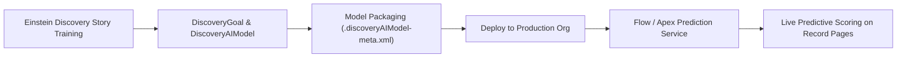

## Architectural Overview

The `DiscoveryAIModel` metadata type represents a deployed machine learning model trained in Einstein Discovery (part of CRM Analytics and Tableau CRM). In intelligent enterprise architectures, machine learning models analyze historical transactional datasets to produce predictive scores (such as customer churn probability, opportunity win likelihood, or invoice payment delays) alongside prescriptive recommendations.

By packaging model hyperparameters, scoring coefficients, and target outcome fields into `DiscoveryAIModel` metadata, data science and DevOps teams can train models on scrubbed analytics sandboxes and deploy approved models deterministically into production via continuous delivery pipelines.



## SFDX Directory and File Suffix

| Property | Value |
| :--- | :--- |
| **Metadata Type Name** | `DiscoveryAIModel` |
| **SFDX Directory Path** | `force-app/main/default/discoveryAIModels/` |
| **File Suffix** | `.discoveryAIModel-meta.xml` |
| **API Version** | `68.0` (Winter '27) |

## Key Metadata Fields

| Field | Type | Required | Description & Architectural Considerations |
| :--- | :--- | :--- | :--- |
| `label` | `string` | Yes | Human-readable name displayed in Model Manager and Flow Builder. |
| `description` | `string` | No | Architectural description of model training features, dataset, and accuracy metrics. |
| `discoveryGoal` | `string` | Yes | Developer name of the parent `DiscoveryGoal` this model optimizes. |
| `modelType` | `string` | Yes | Algorithmic prediction structure (`BinaryClassification`, `Regression`, `Multiclass`). |
| `algorithmType` | `string` | No | Machine learning algorithm used (`GLM`, `GBM`, `RandomForest`, `XGBoost`). |
| `predictionType` | `string` | Yes | Nature of model scoring output (e.g., `Probability`, `Score`, `RawValue`). |
| `status` | `string` | Yes | Operational deployment state (`Active`, `Draft`, `Retired`). |

> [!NOTE]
> Deploying a `DiscoveryAIModel` makes the prediction definition immediately available inside Model Manager and within the Einstein Prediction Service for real-time scoring.

## Declarative XML and Package.xml Examples

### `DiscoveryAIModel` Metadata File

```xml title="force-app/main/default/discoveryAIModels/Opportunity_Win_Predictor.discoveryAIModel-meta.xml"
<?xml version="1.0" encoding="UTF-8"?>
<DiscoveryAIModel xmlns="http://soap.sforce.com/2006/04/metadata">
    <algorithmType>GBM</algorithmType>
    <description>Gradient Boosted Machine predicting opportunity win probability and prescriptive recommendations.</description>
    <discoveryGoal>Maximize_Opportunity_Win_Rate</discoveryGoal>
    <label>Opportunity Win Predictor</label>
    <modelType>BinaryClassification</modelType>
    <predictionType>Probability</predictionType>
    <status>Active</status>
</DiscoveryAIModel>
```

### `package.xml` Manifest

```xml title="manifest/package.xml"
<?xml version="1.0" encoding="UTF-8"?>
<Package xmlns="http://soap.sforce.com/2006/04/metadata">
    <types>
        <members>Opportunity_Win_Predictor</members>
        <name>DiscoveryAIModel</name>
    </types>
    <version>68.0</version>
</Package>
```

## SFDX CLI Retrieval and Deployment Commands

Retrieve and deploy predictive models across test and production orgs:

```bash
# Retrieve all DiscoveryAIModel components
sf project retrieve start --metadata "DiscoveryAIModel" --target-org analytics-dev

# Deploy the model and its governing goal simultaneously
sf project deploy start \
  --metadata "DiscoveryGoal:Maximize_Opportunity_Win_Rate,DiscoveryAIModel:Opportunity_Win_Predictor" \
  --target-org uat-org

# Query existing models in Model Manager via Tooling API
sf data query --use-tooling-api --query "SELECT Id, DeveloperName, ModelType, Status FROM DiscoveryAIModel" --target-org uat-org
```

## Senior Architect Best Practices and Gotchas

> [!WARNING]
> **Parent DiscoveryGoal Dependency:** A `DiscoveryAIModel` cannot exist without an associated `DiscoveryGoal`. If the goal does not exist in the target org or is omitted from the deployment manifest, the deployment will fail immediately.

> [!TIP]
> **Continuous Drift Monitoring:** Machine learning models experience accuracy degradation as business conditions shift. In production, configure Einstein Model Manager alert thresholds to trigger retraining workflows when prediction accuracy drops below acceptable R-squared or AUC limits.

- **Batch Scoring Governor Limits:** Scoring hundreds of thousands of records synchronously via Apex can exceed daily Einstein Prediction Service API call allocations. Leverage asynchronous Batch Apex or Flow bulkification for nightly scoring jobs.
- **Explainability and Compliance:** When deploying models in regulated industries (financial lending, insurance underwriting), ensure feature weights exclude protected demographic attributes to avoid algorithmic bias and compliance penalties.
