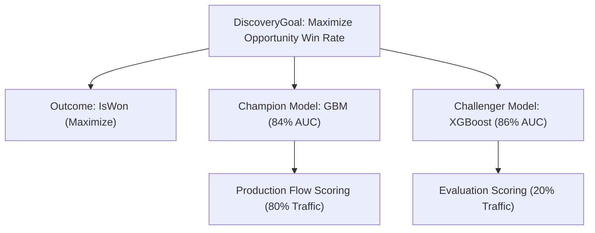

## Architectural Overview

The `DiscoveryGoal` metadata type defines the strategic business objective for machine learning initiatives within Einstein Discovery and CRM Analytics. Before an algorithmic model can be trained or deployed, architects and data scientists establish a target business outcome—such as maximizing revenue per account, minimizing case handle duration, or predicting employee retention.

A `DiscoveryGoal` establishes the primary key performance indicator (KPI), the target outcome column on the source dataset, and the optimization direction (`Maximize` or `Minimize`). Serving as the parent container for multiple `DiscoveryAIModel` records, `DiscoveryGoal` provides an architectural framework for versioning, comparing champion vs. challenger models, and executing A/B test splits in production environments.



## SFDX Directory and File Suffix

| Property | Value |
| :--- | :--- |
| **Metadata Type Name** | `DiscoveryGoal` |
| **SFDX Directory Path** | `force-app/main/default/discoveryGoals/` |
| **File Suffix** | `.discoveryGoal-meta.xml` |
| **API Version** | `68.0` (Winter '27) |

## Key Metadata Fields

| Field | Type | Required | Description & Architectural Considerations |
| :--- | :--- | :--- | :--- |
| `label` | `string` | Yes | Human-readable name for the business optimization goal. |
| `description` | `string` | No | Architectural summary of the strategic KPI and expected business impact. |
| `outcomeField` | `string` | Yes | API name of the target field or outcome variable on the source dataset. |
| `outcomeGoal` | `string` | Yes | Optimization directionality: `Maximize` or `Minimize`. |
| `dataset` | `string` | No | Name or ID of the training CRM Analytics dataset. |
| `status` | `string` | Yes | Operational state of the goal (`Active`, `Draft`, `Retired`). |

> [!NOTE]
> `DiscoveryGoal` serves as the parent metadata anchor. When deploying Einstein Discovery assets, always ensure `DiscoveryGoal` is deployed before or concurrently with dependent `DiscoveryAIModel` components.

## Declarative XML and Package.xml Examples

### `DiscoveryGoal` Metadata File

```xml title="force-app/main/default/discoveryGoals/Maximize_Opportunity_Win_Rate.discoveryGoal-meta.xml"
<?xml version="1.0" encoding="UTF-8"?>
<DiscoveryGoal xmlns="http://soap.sforce.com/2006/04/metadata">
    <description>Strategic goal to maximize B2B enterprise opportunity close-win conversion rates.</description>
    <label>Maximize Opportunity Win Rate</label>
    <outcomeField>IsWon</outcomeField>
    <outcomeGoal>Maximize</outcomeGoal>
    <status>Active</status>
</DiscoveryGoal>
```

### `package.xml` Manifest

```xml title="manifest/package.xml"
<?xml version="1.0" encoding="UTF-8"?>
<Package xmlns="http://soap.sforce.com/2006/04/metadata">
    <types>
        <members>Maximize_Opportunity_Win_Rate</members>
        <name>DiscoveryGoal</name>
    </types>
    <version>68.0</version>
</Package>
```

## SFDX CLI Retrieval and Deployment Commands

Retrieve and deploy discovery goals across environments:

```bash
# Retrieve all DiscoveryGoal metadata components
sf project retrieve start --metadata "DiscoveryGoal" --target-org analytics-dev

# Deploy the goal along with its deployed predictive models
sf project deploy start \
  --metadata "DiscoveryGoal:Maximize_Opportunity_Win_Rate,DiscoveryAIModel:Opportunity_Win_Predictor" \
  --target-org uat-org

# Query existing discovery goals via Tooling API
sf data query --use-tooling-api --query "SELECT Id, DeveloperName, OutcomeField, OutcomeGoal FROM DiscoveryGoal" --target-org uat-org
```

## Senior Architect Best Practices and Gotchas

> [!WARNING]
> **Schema Stability of OutcomeField:** The field specified in `outcomeField` must exist and be accessible in the target org schema. Modifying or deleting a custom field referenced by an active `DiscoveryGoal` causes dependent predictive models to fail during scoring cycles.

> [!TIP]
> **Champion-Challenger Model Strategy:** Keep the `DiscoveryGoal` permanent and swap or evaluate multiple `DiscoveryAIModel` implementations beneath it. This allows continuous model enhancements without breaking existing Flow or Apex integrations that reference the goal container.

- **KPI Alignment with Business Stakeholders:** Ensure the `outcomeGoal` directionality aligns with corporate OKRs (e.g. minimizing customer churn rate rather than maximizing churn probability).
- **Security Scoping for Analytics Datasets:** Restrict access to training datasets powering discovery goals using CRM Analytics sharing inheritance to prevent exposure of sensitive transaction history.
