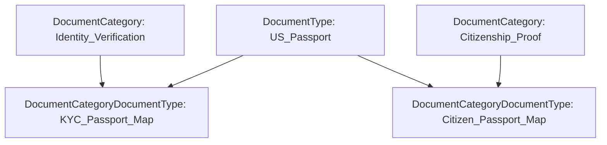

## Overview

The `DocumentCategoryDocumentType` metadata type represents a declarative junction mapping between a `DocumentCategory` and a `DocumentType`. In enterprise document management architectures (such as loan origination in Financial Services Cloud, prior authorization in Health Cloud, or permit applications in Public Sector Solutions), a single `DocumentType` (like *US Passport* or *Form W-2*) often satisfies multiple compliance categories (for example, both *Identity Verification* and *Citizenship Proof*).

Instead of duplicating `DocumentType` definitions, architects use `DocumentCategoryDocumentType` to maintain a normalized many-to-many taxonomy fully tracked in version control.



## Directory and File Suffix Reference

| Property | Value |
| :--- | :--- |
| **Metadata Type Name** | `DocumentCategoryDocumentType` |
| **SFDX Source Directory** | `force-app/main/default/documentCategoryDocumentTypes/` |
| **Metadata File Suffix** | `.documentCategoryDocumentType-meta.xml` |
| **Package Manifest Type** | `DocumentCategoryDocumentType` |
| **Supports Wildcard (`*`)** | Yes |
| **API Version Introduced** | v52.0 (Verified through `68.0` in Winter '27) |

## Key Metadata Fields

| Field Name | Field Type | Required | Architectural Description |
| :--- | :--- | :--- | :--- |
| `documentCategory` | `string` | Yes | The `DeveloperName` of the parent `DocumentCategory` metadata record. |
| `documentType` | `string` | Yes | The `DeveloperName` of the child `DocumentType` metadata record being categorized. |
| `masterLabel` | `string` | Yes | The user-facing display label for this category-to-type mapping (up to 80 characters). |
| `isProtected` | `boolean` | No | Indicates whether the junction record is protected inside a managed package (`true` or `false`). |

## Querying the Junction via SOQL

At runtime, Apex controllers and [Flow](/docs/metadata/flow-metadata-type/) data fetchers can query `DocumentCategoryDocumentType` to dynamically render only the `DocumentType` options that belong to a selected `DocumentCategory`:

```soql
SELECT Id, DeveloperName, MasterLabel,
       DocumentCategory.DeveloperName, DocumentCategory.MasterLabel,
       DocumentType.DeveloperName, DocumentType.MasterLabel
FROM DocumentCategoryDocumentType
WHERE DocumentCategory.DeveloperName = 'Identity_Verification'
ORDER BY DocumentType.MasterLabel ASC
```

## Declarative XML and Package.xml Examples

### 1. Junction Metadata File (`KYC_Passport_Link.documentCategoryDocumentType-meta.xml`)

```xml title="force-app/main/default/documentCategoryDocumentTypes/KYC_Passport_Link.documentCategoryDocumentType-meta.xml"
<?xml version="1.0" encoding="UTF-8"?>
<DocumentCategoryDocumentType xmlns="http://soap.sforce.com/2006/04/metadata">
    <documentCategory>Identity_Verification</documentCategory>
    <documentType>Passport_Document</documentType>
    <isProtected>false</isProtected>
    <masterLabel>Identity Verification - Passport</masterLabel>
</DocumentCategoryDocumentType>
```

### 2. Complete Taxonomy Package Manifest (`package.xml`)

Always include `DocumentCategory` and `DocumentType` in the same `package.xml` manifest when promoting `DocumentCategoryDocumentType` across environments:

```xml title="manifest/package.xml"
<?xml version="1.0" encoding="UTF-8"?>
<Package xmlns="http://soap.sforce.com/2006/04/metadata">
    <types>
        <members>Identity_Verification</members>
        <name>DocumentCategory</name>
    </types>
    <types>
        <members>Passport_Document</members>
        <name>DocumentType</name>
    </types>
    <types>
        <members>KYC_Passport_Link</members>
        <name>DocumentCategoryDocumentType</name>
    </types>
    <version>68.0</version>
</Package>
```

### 3. SFDX CLI Commands

```bash
# Retrieve all DocumentCategoryDocumentType junction mappings
sf project retrieve start --metadata "DocumentCategoryDocumentType:*"

# Deploy the category, document type, and junction together
sf project deploy start \
  --metadata DocumentCategory:Identity_Verification \
  --metadata DocumentType:Passport_Document \
  --metadata DocumentCategoryDocumentType:KYC_Passport_Link
```

## Architect Best Practices and Gotchas

- **Deterministic Naming Convention:** Name every `DocumentCategoryDocumentType` file using a composite pattern like `<CategoryShortName>_<DocumentTypeShortName>` (keeping total `DeveloperName` length under 40 characters) so developers can immediately spot duplicate mappings in Git pull requests.
- **Avoid Duplicate Pairings:** Creating two `DocumentCategoryDocumentType` records that reference the exact same `documentCategory` and `documentType` pair causes duplicate entries in custom LWC category picklists. Enforce uniqueness in code reviews.
- **Deployment Ordering:** When deploying via a single `package.xml` or `sf project deploy start` command, Salesforce Metadata API automatically resolves the dependency order (`DocumentCategory` and `DocumentType` before `DocumentCategoryDocumentType`). If splitting deployments into stages, deploy the parent types in Stage 1 and the junction in Stage 2.

