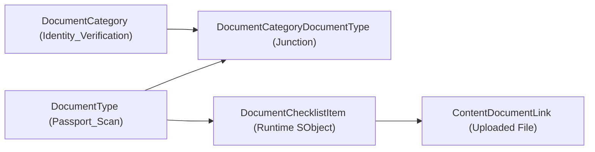

## Overview

The `DocumentCategory` metadata type defines a top-level grouping category used by Salesforce's **Document Checklist** and **Intelligent Document Reader** frameworks across Financial Services Cloud, Health Cloud, Public Sector Solutions, Education Cloud, and core CRM orgs.

In complex onboarding, underwriting, or licensing workflows, users upload multiple supporting files against `DocumentChecklistItem` records. `DocumentCategory` provides the taxonomy layer above `DocumentType` (linked via `DocumentCategoryDocumentType`) so intake Flows, OmniScripts, and compliance reviewers can filter and validate required documents by category (for example, *Identity Verification*, *Tax & Income*, or *Property Appraisal*).



## Directory and File Suffix Reference

| Property | Value |
| :--- | :--- |
| **Metadata Type Name** | `DocumentCategory` |
| **SFDX Source Directory** | `force-app/main/default/documentCategories/` |
| **Metadata File Suffix** | `.documentCategory-meta.xml` |
| **Package Manifest Type** | `DocumentCategory` |
| **Supports Wildcard (`*`)** | Yes |
| **API Version Introduced** | v52.0 (Verified through `68.0` in Winter '27) |

## Key Metadata Fields

`DocumentCategory` is a lightweight taxonomy metadata type extending `Metadata`.

| Field Name | Field Type | Required | Architectural Description |
| :--- | :--- | :--- | :--- |
| `masterLabel` | `string` | Yes | The user-facing display label of the document category (up to 80 characters). |
| `description` | `string` | No | Detailed explanation of the compliance or business rules governing documents in this category (up to 255 characters). |
| `isProtected` | `boolean` | No | Reserved for managed packages; when `true`, subscriber orgs cannot reference or modify the category outside package upgrades. |

## Querying DocumentCategory via SOQL

Because `DocumentCategory` is backed by a setup object accessible in both standard SOQL and Tooling API, you can query it directly to drive dynamic LWC intake screens or [Flow](/docs/metadata/flow-metadata-type/) screen components:

```soql
SELECT Id, DeveloperName, MasterLabel, NamespacePrefix, Description, CreatedDate
FROM DocumentCategory
ORDER BY MasterLabel ASC
```

## Declarative XML and Package.xml Examples

### 1. DocumentCategory Definition (`Identity_Verification.documentCategory-meta.xml`)

```xml title="force-app/main/default/documentCategories/Identity_Verification.documentCategory-meta.xml"
<?xml version="1.0" encoding="UTF-8"?>
<DocumentCategory xmlns="http://soap.sforce.com/2006/04/metadata">
    <description>Government-issued photo identification and KYC verification documents required for onboarding.</description>
    <isProtected>false</isProtected>
    <masterLabel>Identity Verification</masterLabel>
</DocumentCategory>
```

### 2. Package Manifest (`package.xml`)

Deploy `DocumentCategory` alongside `DocumentType` and `DocumentCategoryDocumentType` so the entire classification hierarchy lands in a single atomic transaction:

```xml title="manifest/package.xml"
<?xml version="1.0" encoding="UTF-8"?>
<Package xmlns="http://soap.sforce.com/2006/04/metadata">
    <types>
        <members>Identity_Verification</members>
        <members>Income_And_Tax_Proof</members>
        <name>DocumentCategory</name>
    </types>
    <version>68.0</version>
</Package>
```

### 3. SFDX CLI Commands

```bash
# Retrieve all DocumentCategory metadata definitions from the org
sf project retrieve start --metadata "DocumentCategory:*"

# Deploy a specific DocumentCategory to the target environment
sf project deploy start --metadata DocumentCategory:Identity_Verification
```

## Architect Best Practices and Gotchas

- **Prerequisite Org Feature (`DocumentChecklistSettings`):** Ensure Document Checklist Items are enabled in the target org (or include `DocumentChecklistSettings` in your scratch org definition) before deploying `DocumentCategory` components.
- **Consistent Naming Convention:** Prefix or group `DocumentCategory` developer names by domain (for example, `KYC_Identity_Verification`, `KYC_Proof_Of_Address`) so administrators can easily distinguish categories across multiple business units sharing the same org.
- **Deletion Constraints:** You cannot delete a `DocumentCategory` if any `DocumentCategoryDocumentType` junction records still reference it. Remove the junction metadata first in `destructiveChangesPre.xml` before deleting the parent category.

