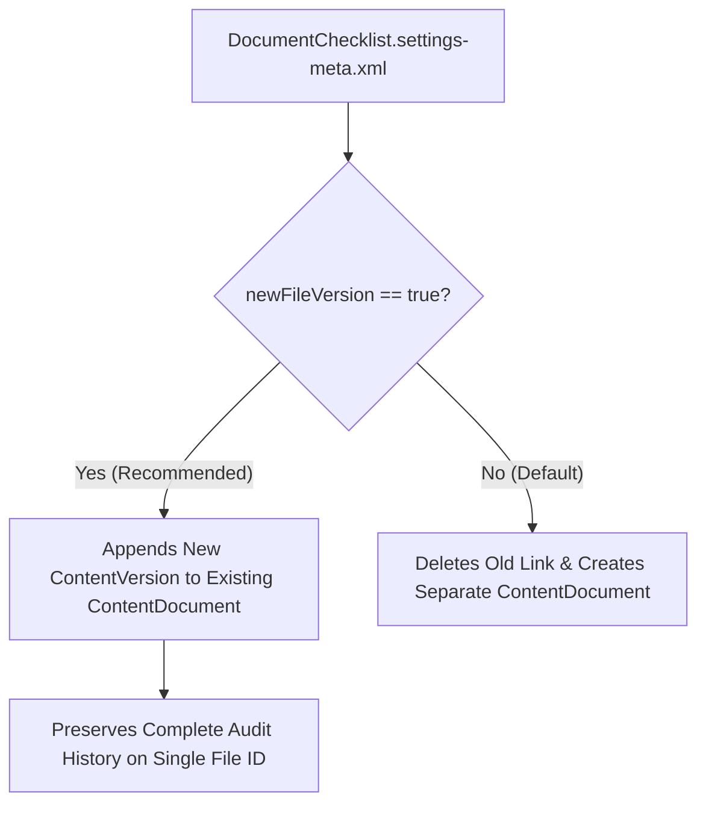

## Overview

The `DocumentChecklistSettings` metadata type represents the org-wide configuration settings for **Document Checklist Items** (`Setup > Feature Settings > Document Checklist Settings`).

Architecturally, `DocumentChecklistItem` records act as structured placeholders between a parent business record (such as an `Account`, `Opportunity`, `ResidentialLoanApplication`, or `Case`) and an uploaded Salesforce File (`ContentDocument`). `DocumentChecklistSettings` governs what happens to the underlying `ContentDocument` and `ContentVersion` data model when a customer or back-office reviewer uploads a replacement file to an existing checklist item.



## Directory and File Suffix Reference

| Property | Value |
| :--- | :--- |
| **Metadata Type Name** | `DocumentChecklistSettings` (deployed via `Settings`) |
| **SFDX Source File Path** | `force-app/main/default/settings/DocumentChecklist.settings-meta.xml` |
| **Package Manifest Type** | `Settings` |
| **Package Manifest Member** | `DocumentChecklist` |
| **API Version Introduced** | v49.0 (Verified through `68.0` in Winter '27) |

## Key Metadata Fields

| Field Name | Field Type | Required | Architectural Description |
| :--- | :--- | :--- | :--- |
| `newFileVersion` | `boolean` | No | When `true`, uploading a file to a `DocumentChecklistItem` that already has an attached file uploads a new `ContentVersion` of that file rather than creating a new `ContentDocument`. Defaults to `false`. |

## Declarative XML, Scratch Org, and Package.xml Examples

### 1. Settings Metadata File (`DocumentChecklist.settings-meta.xml`)

```xml title="force-app/main/default/settings/DocumentChecklist.settings-meta.xml"
<?xml version="1.0" encoding="UTF-8"?>
<DocumentChecklistSettings xmlns="http://soap.sforce.com/2006/04/metadata">
    <newFileVersion>true</newFileVersion>
</DocumentChecklistSettings>
```

### 2. Scratch Org Definition (`config/project-scratch-def.json`)

Include `documentChecklistSettings` in your scratch org definition so automated Apex tests verifying `ContentVersion` counts on `DocumentChecklistItem` behave identically to production:

```json title="config/project-scratch-def.json"
{
  "orgName": "Enterprise Document Checklist Scratch Org",
  "edition": "Enterprise",
  "settings": {
    "documentChecklistSettings": {
      "newFileVersion": true
    }
  }
}
```

### 3. Package Manifest (`package.xml`)

```xml title="manifest/package.xml"
<?xml version="1.0" encoding="UTF-8"?>
<Package xmlns="http://soap.sforce.com/2006/04/metadata">
    <types>
        <members>DocumentChecklist</members>
        <name>Settings</name>
    </types>
    <version>68.0</version>
</Package>
```

### 4. SFDX CLI Commands

```bash
# Retrieve DocumentChecklistSettings from the target org
sf project retrieve start --metadata Settings:DocumentChecklist

# Deploy DocumentChecklistSettings to the target org
sf project deploy start --metadata Settings:DocumentChecklist
```

## Architect Best Practices and Gotchas

- **Impact on `ContentVersion` Triggers and Integration IDs:** When `newFileVersion` is `true`, the `ContentDocumentId` linked to the `DocumentChecklistItem` remains constant across re-uploads, while `ContentVersion.VersionNumber` increments (`1`, `2`, `3`). If you integrate Salesforce Files with an external Enterprise Content Management (ECM) system like Box, SharePoint, or AWS S3, enabling `newFileVersion` prevents orphaned file records in your external storage bucket.
- **Storage Consumption Trade-off:** Because `newFileVersion: true` retains all historical versions under the same `ContentDocument`, every rejected and re-uploaded PDF continues to count against the org's File Storage allocation until older versions are archived or purged.
- **Experience Cloud Collaborator Permissions:** When external Experience Cloud users upload a new version to an existing `ContentDocument` (`newFileVersion: true`), verify that their `ContentDocumentLink.ShareType` (`V` vs `C`) and [PermissionSet](/docs/metadata/permission-set-metadata-type/) permissions allow uploading a new version of a file they own or collaborate on.

