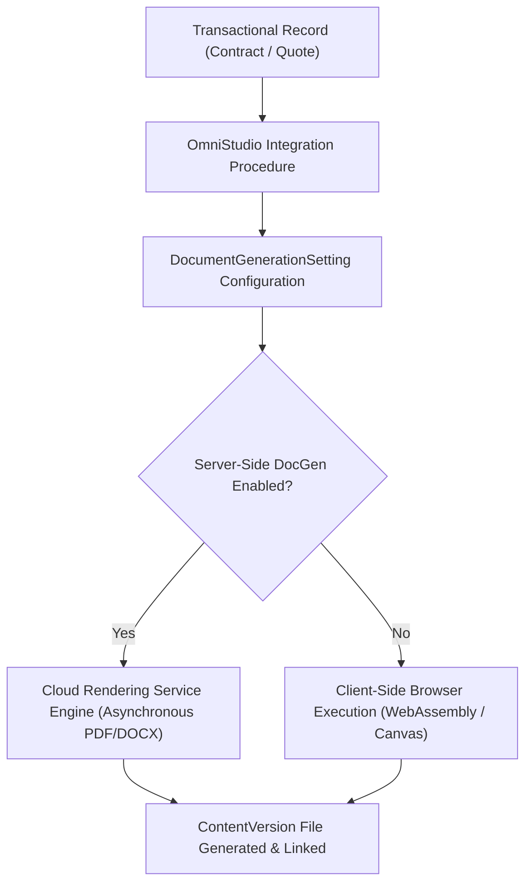

## Architectural Overview

The `DocumentGenerationSetting` metadata type represents org-wide preferences for **OmniStudio Document Generation** and **Salesforce Contracts** (`Setup > Feature Settings > Document Generation > Document Generation Settings`).

Architecturally, automated document generation bridges structured transactional data (Quotes, Contracts, Opportunities, Work Orders) with enterprise-grade publishing templates (DOCX, PPTX, PDF). Enterprise architectures leverage OmniStudio Integration Procedures, DataRaptors / Omnistudio Data Mappers, and Flow orchestrations to merge record payloads into dynamic document templates. `DocumentGenerationSetting` toggles whether generation and PDF conversion run client-side in the user's browser runtime or server-side across high-capacity cloud rendering services.



Deploying `DocumentGenerationSetting` via source-tracked CI/CD pipelines ensures that sandbox refreshes, scratch orgs, and production environments share consistent document rendering engines and avoid unexpected rendering discrepancies or browser memory limits.

## Directory and File Suffix Reference

In Salesforce DX project structures, settings are singleton metadata files organized under the `settings` directory.

| Property | Value |
| :--- | :--- |
| **Metadata Type Name** | `DocumentGenerationSetting` (deployed via `Settings`) |
| **SFDX Source Directory** | `force-app/main/default/settings/` |
| **Source File Name** | `DocumentGeneration.settings-meta.xml` |
| **Package Manifest Type** | `Settings` |
| **Package Manifest Member** | `DocumentGeneration` |
| **API Version Introduced** | v54.0 (Verified through `68.0` in Winter '27) |

## Key Metadata Fields

The `DocumentGenerationSetting` metadata type extends `Metadata` and exposes configuration properties for document rendering and conversion:

| Field Name | Field Type | Required | Architectural Description |
| :--- | :--- | :--- | :--- |
| `enableServerSideDocGen` | `boolean` | No | Enables server-side processing for high-volume and complex document rendering. When enabled, generation requests run asynchronously via microservices rather than consuming client browser compute. |
| `enableClientSideDocGen` | `boolean` | No | Enables client-side document generation using browser-based JavaScript libraries, suitable for lightweight proposals and interactive previews. |
| `enablePdfConversion` | `boolean` | No | Activates automated document format conversion from Microsoft Word (DOCX) or PowerPoint (PPTX) into high-fidelity PDF artifacts. |

> [!NOTE]
> Server-side document generation requires the appropriate OmniStudio or Salesforce Industries Foundation license in the target org. Verify license provisioning before deploying `enableServerSideDocGen: true`.

## Declarative XML, Scratch Org, and Package.xml Examples

### 1. Settings Metadata File (`DocumentGeneration.settings-meta.xml`)

```xml title="force-app/main/default/settings/DocumentGeneration.settings-meta.xml"
<?xml version="1.0" encoding="UTF-8"?>
<DocumentGenerationSetting xmlns="http://soap.sforce.com/2006/04/metadata">
    <enableClientSideDocGen>true</enableClientSideDocGen>
    <enablePdfConversion>true</enablePdfConversion>
    <enableServerSideDocGen>true</enableServerSideDocGen>
</DocumentGenerationSetting>
```

### 2. Scratch Org Definition (`config/project-scratch-def.json`)

To ensure automated scratch org creation sets up Document Generation features seamlessly for CI/CD test runners, include `documentGenerationSettings` inside `settings`:

```json title="config/project-scratch-def.json"
{
  "orgName": "Enterprise Document Generation Scratch Org",
  "edition": "Enterprise",
  "features": ["OmniStudioDesigner", "ContractsUser"],
  "settings": {
    "documentGenerationSettings": {
      "enableServerSideDocGen": true,
      "enableClientSideDocGen": true,
      "enablePdfConversion": true
    }
  }
}
```

### 3. Package Manifest (`manifest/package.xml`)

When retrieving or deploying via metadata manifests, use the `Settings` type definition:

```xml title="manifest/package.xml"
<?xml version="1.0" encoding="UTF-8"?>
<Package xmlns="http://soap.sforce.com/2006/04/metadata">
    <types>
        <members>DocumentGeneration</members>
        <name>Settings</name>
    </types>
    <version>68.0</version>
</Package>
```

## Retrieval and Deployment Commands

Retrieve and deploy settings metadata using modern Salesforce CLI (`sf`) commands:

```bash
# Retrieve DocumentGeneration settings from target org
sf project retrieve start --metadata Settings:DocumentGeneration

# Deploy DocumentGeneration settings to target org
sf project deploy start --metadata Settings:DocumentGeneration --target-org prod-ci

# Validate deployment without saving changes
sf project deploy validate --metadata Settings:DocumentGeneration --target-org staging-sandbox
```

## Senior Architect Deployment Best Practices and Gotchas

- **Dependency on Industry Licenses:** `DocumentGenerationSetting` depends on underlying Salesforce Industry Cloud licenses (OmniStudio, Financial Services Cloud, Health Cloud, or Salesforce Contracts). If you deploy `DocumentGeneration.settings-meta.xml` to a developer or scratch org lacking these licenses, the deployment fails with feature entitlement errors.
- **Client-Side vs. Server-Side Execution Limits:** Client-side document generation operates within the user's browser session. For large documents containing hundreds of line items or rich high-resolution images, client-side rendering can trigger browser timeouts or crash mobile device tabs. Architects should enforce server-side document generation (`enableServerSideDocGen: true`) for enterprise contract workflows exceeding 20 pages.
- **File Storage and Version Purging:** Each execution of server-side document generation creates a new `ContentVersion` record linked to the target record via `ContentDocumentLink`. Implement automated data retention policies or platform event listeners to archive superseded drafts to external cloud storage (such as AWS S3 or Google Cloud Storage) to prevent excessive consumption of Salesforce File storage limits.
- **Apex Test Isolation:** Automated test classes invoking document generation APIs must account for whether server-side processing is asynchronous. When `enableServerSideDocGen` is active, generation jobs enqueue asynchronous platform tasks; tests must encapsulate generation calls within `Test.startTest()` and `Test.stopTest()` to ensure completion before asserting `ContentVersion` records.
